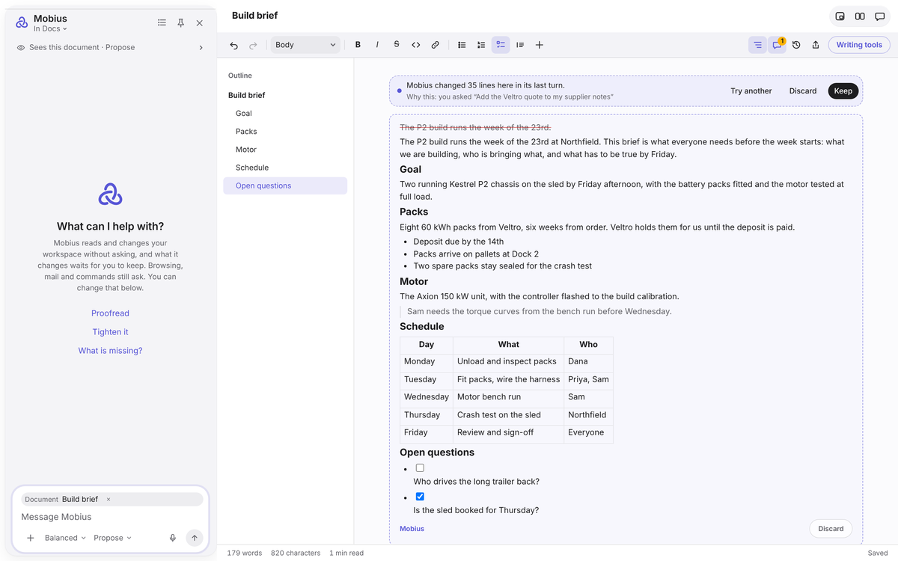
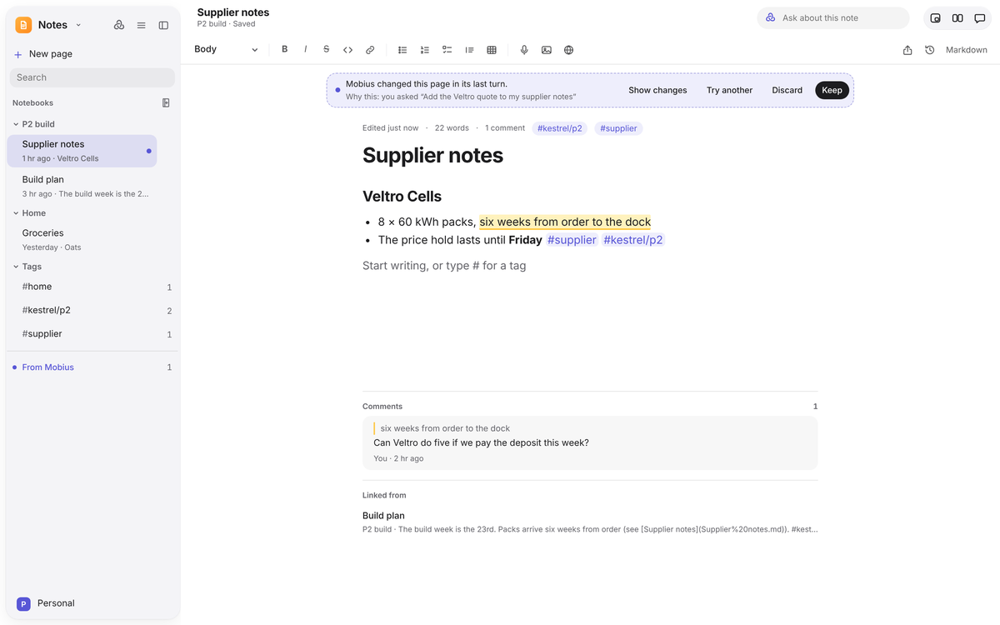
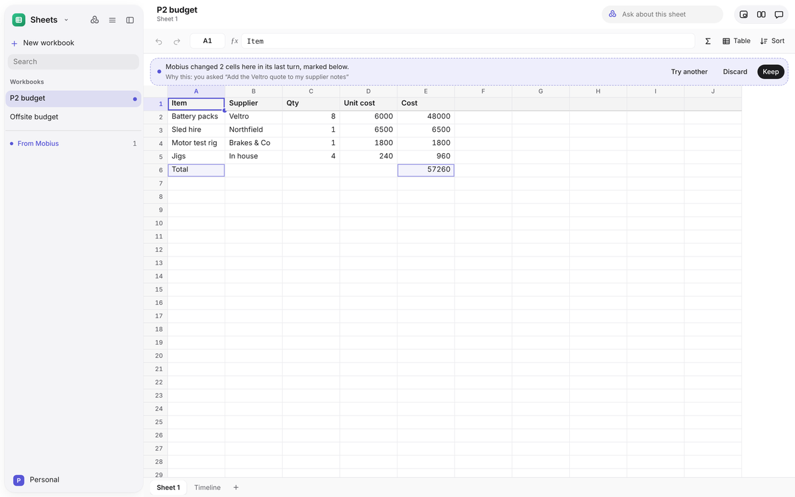
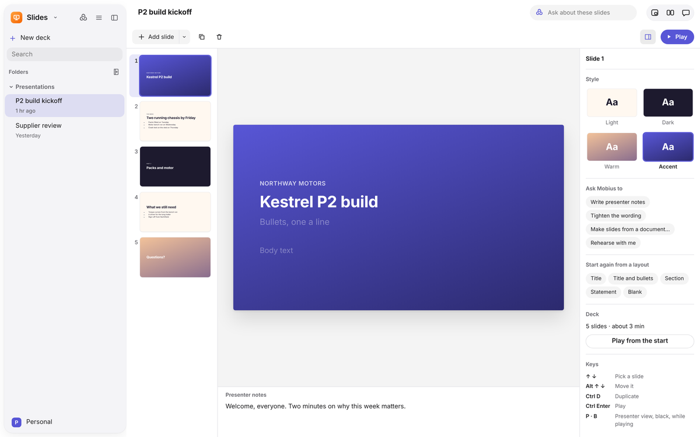
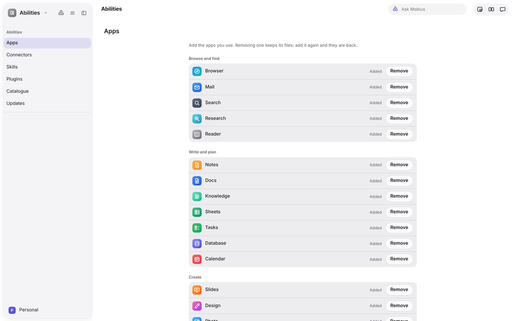
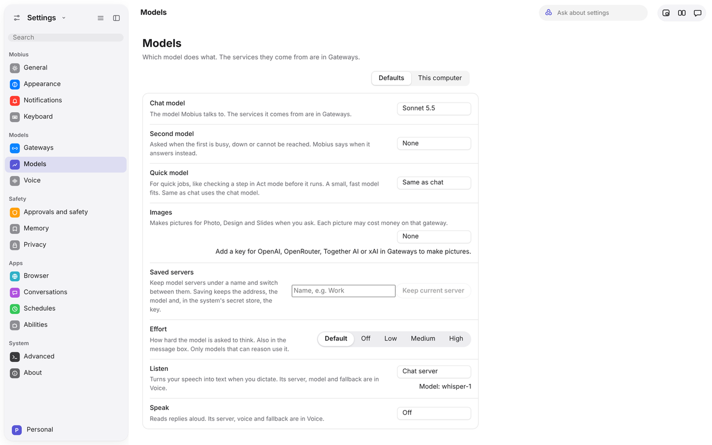

<div align="center">

<picture>
  <source media="(prefers-color-scheme: dark)" srcset="docs/readme/banner-dark.png">
  
</picture>

<h3>Mobius is an AI workspace: your everyday apps in one app, with an agent that works across all of them.</h3>

<p>
  <a href="https://github.com/BevActual/mobius/releases"><b>Download</b></a> &nbsp;·&nbsp;
  <a href="#what-you-can-do-today"><b>What it does</b></a> &nbsp;·&nbsp;
  <a href="docs/README.md"><b>Docs</b></a> &nbsp;·&nbsp;
  <a href="#where-it-stands"><b>Where it stands</b></a> &nbsp;·&nbsp;
  <a href="#build-from-source"><b>Build from source</b></a> &nbsp;·&nbsp;
  <a href="CONTRIBUTING.md"><b>Contribute</b></a>
</p>

<p>
  <a href="LICENSE"></a>
  
  
  
</p>

<br>

<picture>
  <source media="(prefers-color-scheme: dark)" srcset="docs/readme/hero-dark.png">
  
</picture>

<sub>Calendar, with Mobius open in the sidebar. Every app works the same way.</sub>

</div>

<br>

## What it is

Mobius is one app that holds the apps you use every day, Notes, Mail, Calendar, Docs, Tasks, a Browser and more, in one
calm design. Built into all of them is **Mobius, the agent**. It sees the app you have open, moves with you from one app
to the next, and carries your work between them: a date from an email becomes an event, a note becomes a document, a
quote becomes a row in a sheet.

It suggests and you decide. Nothing is sent, paid for, deleted or run without your OK.

New here? [Install it](docs/getting-started/install.md), then take the [two-minute tour](docs/getting-started/tour.md).

## Why we're making it

Work today is split across a dozen apps, and AI sits beside them in a chat box that can't see or touch most of it. You
end up copying and pasting between your tools and the AI, and explaining the same context again and again.

Mobius puts the apps and the agent in one place. The agent can follow your work from an email to a task to a document,
and every change it makes shows up in place for you to keep or throw away. It is open source, and you choose the AI
behind it, so you are not locked into one company.

## Who it's for

People whose day is spread across lots of tools and who already lean on AI: founders, freelancers, students and small
teams.

Right now, while Mobius is early, it is for **tinkerers and AI enthusiasts** who like open source, want to choose their
own models, and are happy to try something unfinished and tell us what breaks.

## How we're building it

- **Refine before adding.** A small core of apps made genuinely good first. The rest are added when you want them.
- **Designed with care.** Apple's Human Interface Guidelines shape every screen: one look, one sidebar and one way of
  reviewing changes in every app.
- **You stay in charge.** Mobius proposes and you approve. Keep, Discard and Rewind make its work undoable.
- **Your AI, your choice.** Use your ChatGPT or Claude plan, an API key, OpenRouter, or a model on your own computer, and
  pick a different model for each job.
- **Local and open.** Your notes, documents and settings live in files on your computer, keys sit in the system's
  secret store, and the code is MIT licensed.
- **Built by using it.** Mobius is developed with AI agents that also use Mobius to do real work, so problems surface
  from real use rather than guesses.

<br>

## What you can do today

<table>
<tr>
<td width="50%" valign="top"><br><b>Review what Mobius changed.</b> Its edits appear in place, with why it made them. Keep, Discard or Try another.</td>
<td width="50%" valign="top"><br><b>Notes and Docs.</b> Formatted pages kept as Markdown, checklists, tags, comments, history and links between pages.</td>
</tr>
<tr>
<td width="50%" valign="top"><br><b>Sheets and Slides.</b> Formulas, fill and sort; decks with layouts, presenter notes and a full-screen player.</td>
<td width="50%" valign="top"><br><b>Ask in place.</b> Every app has its own Ask Mobius actions, like "Write presenter notes" or "Plan my week".</td>
</tr>
<tr>
<td width="50%" valign="top"><br><b>Abilities.</b> Start with the everyday apps and add the rest when you need them. Removing an app keeps its files.</td>
<td width="50%" valign="top"><br><b>Models by task.</b> One model to chat, a quick one for small jobs, others to make pictures, listen and speak.</td>
</tr>
</table>

### Apps

| | |
|---|---|
| **Everyday apps** (in every new install) | Notes, Tasks, Calendar, Mail, Docs, Browser |
| **Add from Abilities** | Sheets, Slides, Knowledge, Database, Search, Research, Reader, Design, Photo, Music, Video, Code, Terminal, Canvas |
| **Always there** | Home (where you talk to Mobius and see its agents and activity), Projects, Files, Review, Abilities, Settings |

Apps load the first time you open them, so the ones you don't use cost nothing. What each app does is in the
[app guide](docs/apps/README.md), and adding and removing them in [Abilities](docs/guide/abilities.md).

### Bring your own AI

| Way in | How |
|---|---|
| **ChatGPT plan** | Sign in with ChatGPT, OpenAI's official sign-in for open-source apps |
| **Claude plan** | Through Claude Code on your computer; use counts against your plan's limits |
| **OpenRouter** | Sign in on OpenRouter's own page, no key to paste |
| **API keys** | OpenAI, Anthropic, Google Gemini, DeepSeek, Groq, Mistral, xAI, Together AI, Fireworks, Hugging Face |
| **On your computer** | A built-in llama.cpp engine that picks a model to fit your graphics card, or Ollama and LM Studio |

Setting each one up is in [Models and gateways](docs/guide/models-and-gateways.md).

### Safety rules that don't bend

- Choose how far Mobius goes: **Ask first**, **Propose** (the default) or **Act**.
- **Sending, paying, deleting and running commands always ask**, whatever the mode.
- Every change is recorded, and **Rewind to here** takes your work back to any step.
- Keys are kept in the system's secret store and never shown to the interface.

More in [Working with Mobius](docs/guide/working-with-mobius.md) and [Privacy and profiles](docs/guide/privacy-and-profiles.md).

<br>

## Where it stands

Mobius is an **early preview**. The apps above run today, and the agent works across them, but expect rough edges,
missing features and changes between versions. It is not yet ready to be the only place you keep important work.

- **Windows** is the first platform. A macOS build compiles in CI but isn't released yet.
- **Releases** will appear on the [Releases page](https://github.com/BevActual/mobius/releases) as a Windows installer.
  The first, 0.1.0, is being prepared.
- **Coming next:** making the current apps hold up in daily use before adding new ones, then a guided first run and
  signed installers. See the [roadmap](docs/roadmap.md).

Found a bug or have an idea? [Open an issue](https://github.com/BevActual/mobius/issues/new/choose).

<br>

## Build from source

You need Node 22+, Rust stable (the MSVC toolchain on Windows) and git. The Chromium engine also needs CMake and Ninja,
which the Visual Studio Build Tools include.

```
git clone https://github.com/BevActual/mobius.git
cd mobius
npm ci
npm run app                 # build everything and open the app
```

`npm run dev` runs the interface alone in a browser at http://127.0.0.1:5180 with sample data, which is the quickest way
to look around. Setup, tests and the end-to-end suite are in the [developer guide](docs/developers/dev-setup.md).

### How it's put together

Everything that isn't interface is Rust: the core owns permissions, tools, the event log and the model providers, and
runs as its own process. The interface is React and TypeScript in a Tauri shell, using the system web view or Chromium
(CEF). The [architecture overview](docs/developers/architecture.md) walks through it, and design decisions are recorded
in [`docs/adr/`](docs/adr).

<br>

## Contributing

Mobius is young and moving quickly, so [bug reports and ideas](https://github.com/BevActual/mobius/issues/new/choose)
help most right now. If you'd like to send code, read [CONTRIBUTING.md](CONTRIBUTING.md) first. Please follow the
[code of conduct](CODE_OF_CONDUCT.md), and report security problems privately as described in [SECURITY.md](SECURITY.md).

## License

[MIT](LICENSE). Mobius builds on ideas from [Hermes Agent](https://github.com/NousResearch/hermes-agent) and other open
source projects; see [THIRD_PARTY_NOTICES.md](THIRD_PARTY_NOTICES.md).

<br>

<div align="center">

<br>
<sub>Made with care, for people who'd rather their computer worked with them.</sub>
</div>
