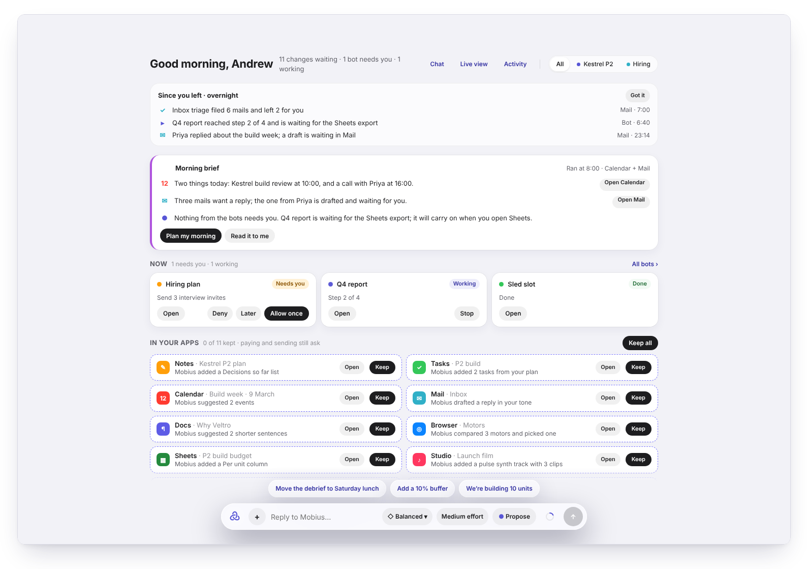
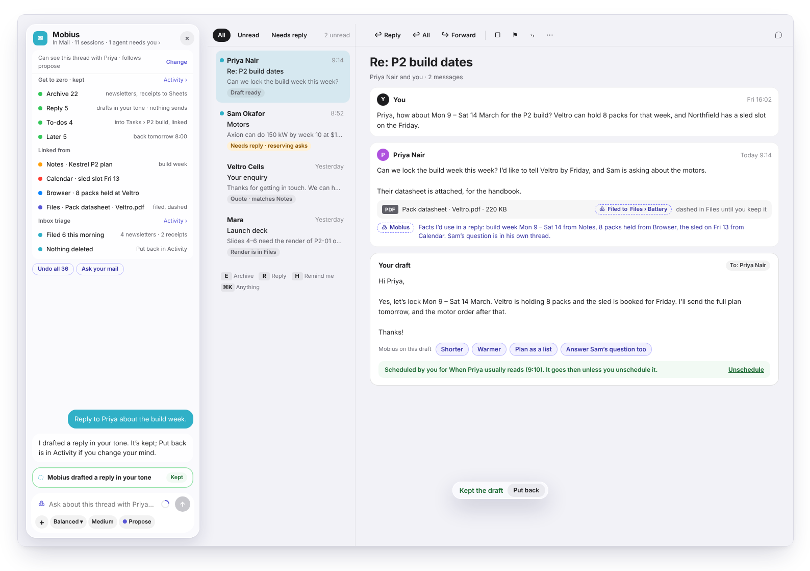
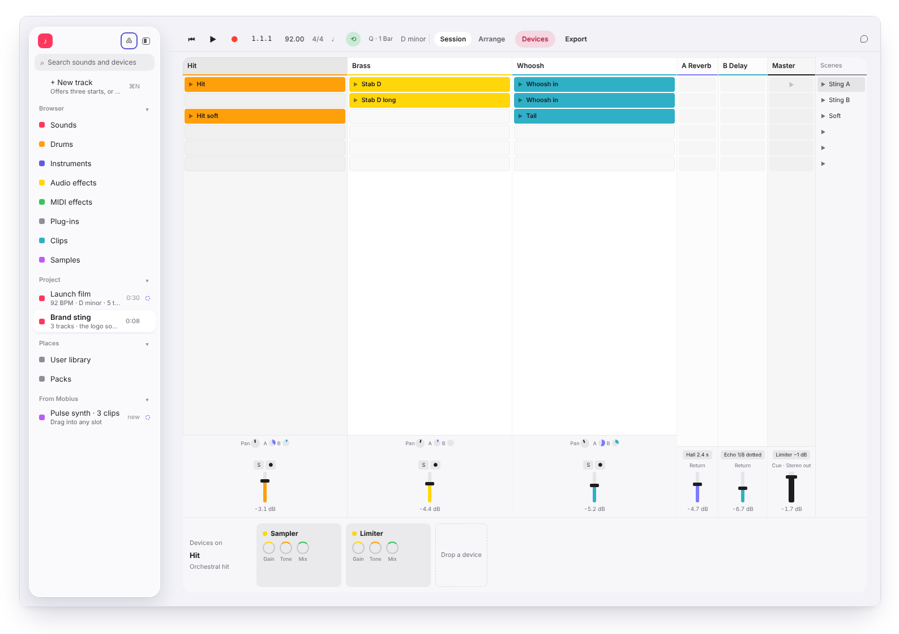
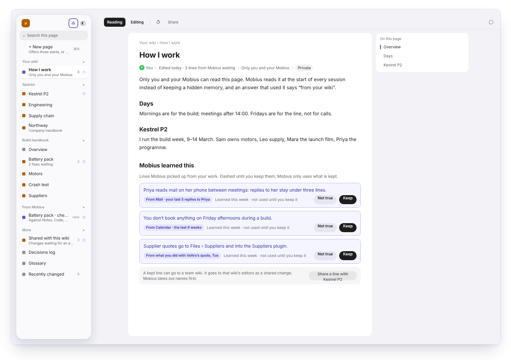
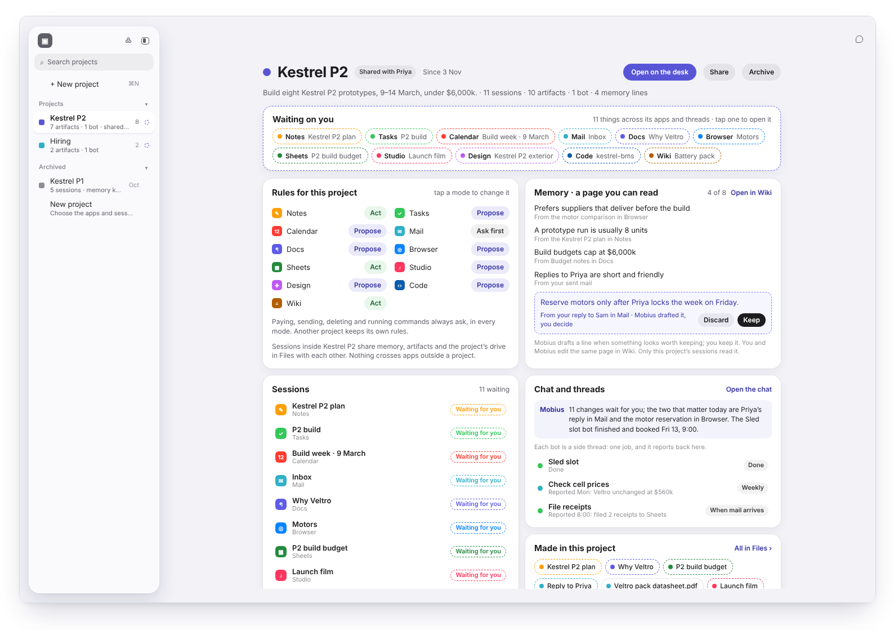
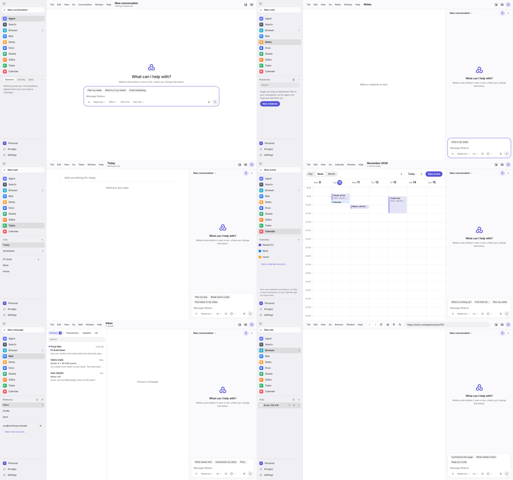

<div align="center">

<picture>
  <source media="(prefers-color-scheme: dark)" srcset="docs/readme/banner-dark.png">
  
</picture>

<h3>Mail, a browser, notes, sheets, a calendar, a design canvas, a code editor, a music studio.<br>
One window that changes shape around whichever app you open, and one Mobius that works in all of them.</h3>

<p>
  <a href="https://claude.ai/artifact/WB1MWLwD8ceZgeJyxMcQRR"><b>Design canvas</b></a> &nbsp;·&nbsp;
  <a href="https://claude.ai/artifact/Qa2vt5xSFiTUzoCnYQHqRJ"><b>From the canvas to the app</b></a> &nbsp;·&nbsp;
  <a href="#where-it-stands"><b>Where it stands</b></a> &nbsp;·&nbsp;
  <a href="#build-it"><b>Build it</b></a>
</p>

<p>
  
  
  
  
</p>

<br>



<sub>The desk. With no app open, home is a desk of live cards and a conversation with Mobius.</sub>

</div>

<br>

## The idea

Most AI assistants sit beside your apps in a chat box. Mobius turns that around: **the apps are the centre**, and the agent lives inside them.

<table>
<tr>
<td width="33%" valign="top">
<h4>One window, many apps</h4>
Simple apps like Notes and deep ones like a studio built the Ableton way share one shell. The sidebar belongs to the open app and morphs in place as you move between apps.
</td>
<td width="33%" valign="top">
<h4>Mobius proposes, you keep</h4>
What Mobius writes shows up in place with a dashed edge until you decide. Every app has the same bar: <b>Keep</b>, <b>Discard</b>, <b>Try another</b>, and <b>Why this</b>.
</td>
<td width="33%" valign="top">
<h4>You set how far it goes</h4>
<b>Ask first</b>, <b>Propose</b> (the default) or <b>Act</b>, cycled with <kbd>Shift</kbd>+<kbd>Tab</kbd>, and set per app. Paying, sending, deleting and running commands always ask.
</td>
</tr>
<tr>
<td width="33%" valign="top">
<h4>Nothing is final</h4>
Every change has a receipt in Activity, and <b>Rewind to here</b> takes your work back to any step.
</td>
<td width="33%" valign="top">
<h4>Bots are apps too</h4>
Turn a conversation into a bot, choose how it starts and what it may touch. Bots report back on the desk.
</td>
<td width="33%" valign="top">
<h4>One look</h4>
One theme, one review bar and one mark for Mobius's work, in every app.
</td>
</tr>
</table>

<br>

## A look inside

<table>
<tr>
<td width="50%"><br><b>Mail.</b> The sidebar becomes Mobius. It plans Get to zero, drafts in your tone and links the facts it used. Nothing sends without you.</td>
<td width="50%"><br><b>Studio.</b> A deep app, the Ableton way: session grid, scenes, mixer and devices. Mobius's track is dashed until you keep it.</td>
</tr>
<tr>
<td width="50%"><br><b>Wiki.</b> Instead of a hidden memory, Mobius reads a page you can see and edit. What it learns waits there for you to keep.</td>
<td width="50%"><br><b>Projects.</b> A place for one piece of work: what is waiting on you, the rules per app, its memory and its bots.</td>
</tr>
</table>

<sub>These are from the design canvas. The canvas leads and the code follows.</sub>

<br>

## Where it stands

The design lives on the [Mobius canvas](https://claude.ai/artifact/WB1MWLwD8ceZgeJyxMcQRR), a working prototype of the whole shell. [From the canvas to the app](https://claude.ai/artifact/Qa2vt5xSFiTUzoCnYQHqRJ) tracks what has been built.



<sub>The real app, running: Agent, Notes, Tasks, Calendar, Mail and Browser.</sub>

**In the app today** (on the `mobius-2-shell` line of work):

| | |
|---|---|
| **Apps** | Browser, Mail, Notes, Docs, Sheets, Slides, Tasks, Calendar, Database, Search, Research, Reader, Design, Photo, Studio, Video, Code, Terminal, Canvas |
| **Mobius's own apps** | Agent, Bots, Activity, Extensions (connectors, skills, plugins, MCP), Settings |
| **The shell** | One sidebar shape for every app with the switcher in its head, Mobius as the sidebar's third face, split view, the desk as home |
| **Working together** | Ask first / Propose / Act, per-app rules, one review bar with Why this, risky steps stop as *Needs you*, Rewind to here, sign in once per task |
| **Under it** | A Rust core that owns permissions, tools and the event log; local models; Claude through Claude Code; MCP tools |

**Designed, coming next:** Files as the company drive (with *Made by Mobius*), the Wiki, Projects, defence against instructions hidden in what Mobius reads, and taking over mid-task.

<br>

## How it is built

Everything that is not interface is Rust. The interface is React and TypeScript in a Tauri shell, with the system web view or Chromium (CEF). Windows comes first; macOS builds too. Decisions are in [`docs/adr/`](docs/adr).

```
crates/mobius-core       permissions, event log, tools, JSON-RPC protocol
crates/mobius-cored      the core as a separate process (JSON-RPC over stdin/stdout)
crates/mobius-agent      the agent turn engine and model providers
crates/mobius-runtime    local models (llama.cpp) and downloads
crates/mobius-host       what the window may ask for: validation, bridge, services
crates/mobius-store      small JSON stores (settings, history, bookmarks, ...)
crates/mobius-browser    the browser app, behind an Engine trait
crates/mobius-workspace  checkpoints of real folders, for rolling back agent changes
crates/mobius-shell      the Tauri shell; web view or Chromium (CEF) engine
apps/desktop             the React interface and the end-to-end tests
packages/shared          IPC contract + types generated from the Rust core
```

## Build it

Requirements: Node 22+, Rust stable (MSVC on Windows), git. Chromium (CEF) also needs CMake and Ninja, which the
Visual Studio Build Tools include.

```
npm run app                 # build everything and open the real window, to try changes by hand
npm run dev                 # the interface alone in a browser at 127.0.0.1:5180 (no Rust behind it)
npm test                    # Rust tests, then TypeScript unit tests
npm run e2e                 # builds the shell and drives the real app with Playwright (hidden window)
npm run gen:types           # regenerate TypeScript types from the Rust types
npm run check:types         # fail if the generated types are stale
npm run typecheck
```

`npm run app -- --webview` uses the system web view instead of Chromium.

On GitHub, **Checks** (`.github/workflows/ci.yml`) runs the types, the TypeScript tests and every Rust test on Linux for
every push and pull request. **Windows end-to-end** (`.github/workflows/windows-e2e.yml`) runs the Playwright suite
against the real app on Windows for pull requests and pushes to `main`, and by hand for a branch or a few test files.

<br>

<div align="center">
<sub>Inspired by Apple's design, Microsoft Copilot, Hermes Agent and Ableton. Third-party code is listed in <a href="THIRD_PARTY_NOTICES.md">THIRD_PARTY_NOTICES.md</a>.</sub>
</div>
