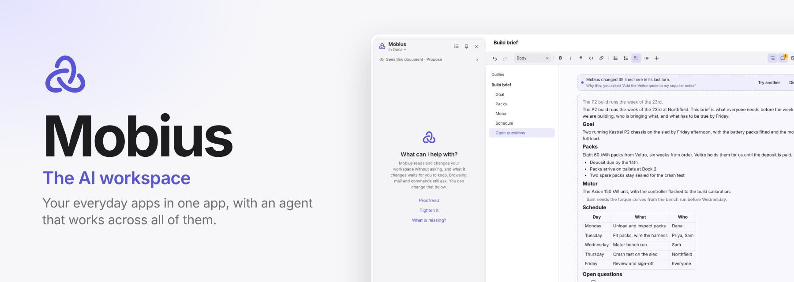
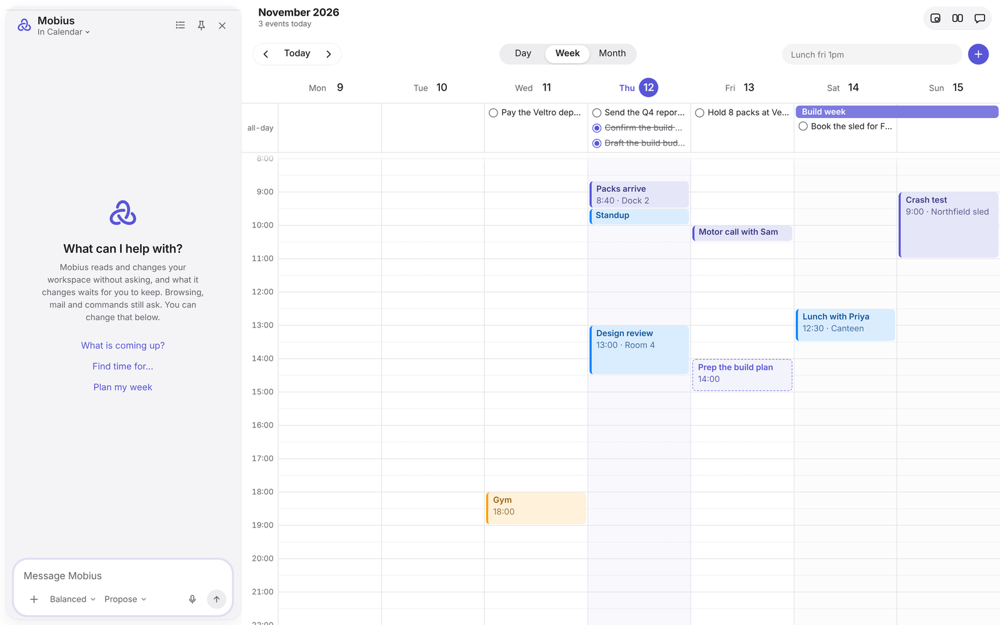
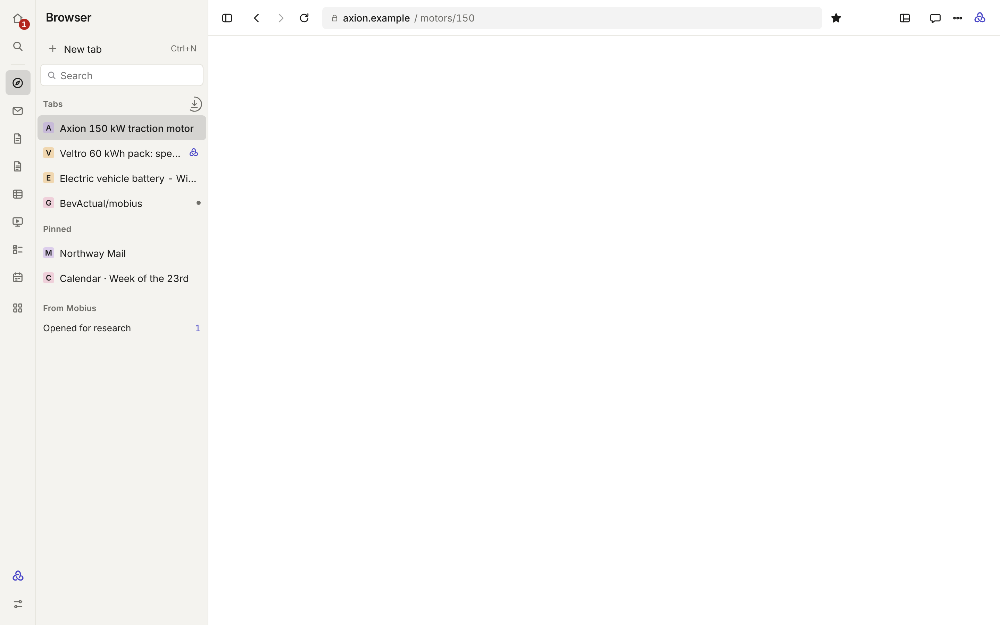
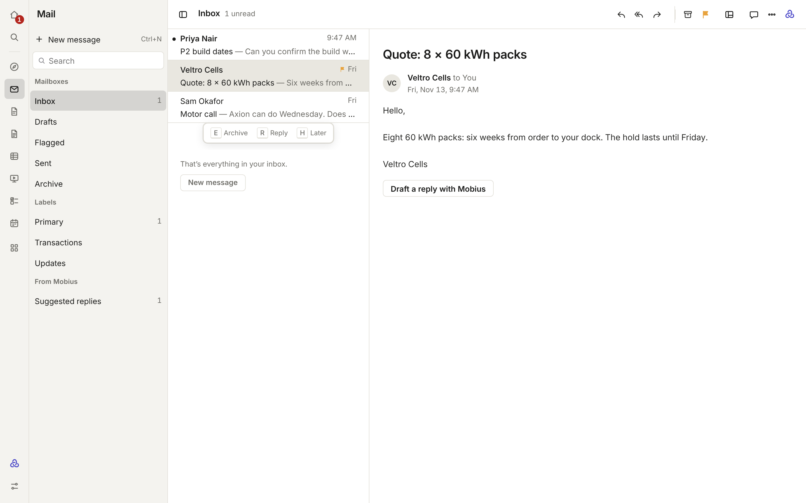
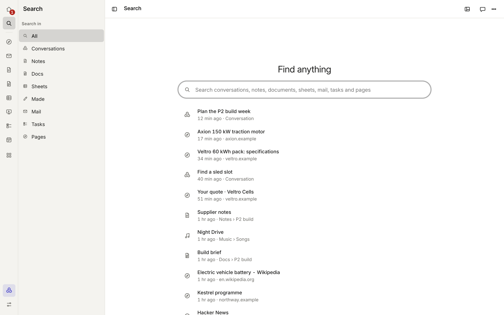
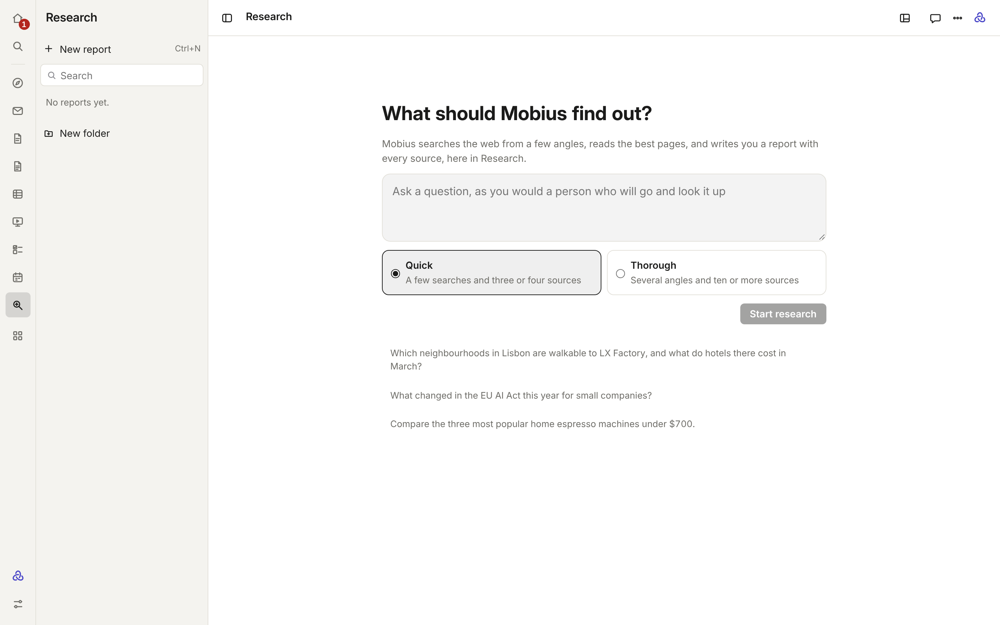
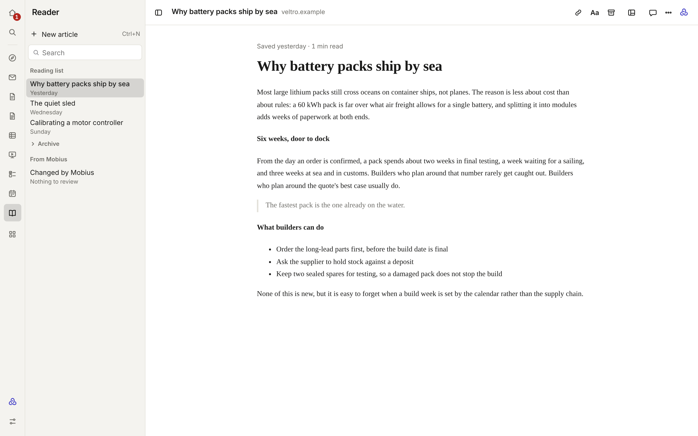
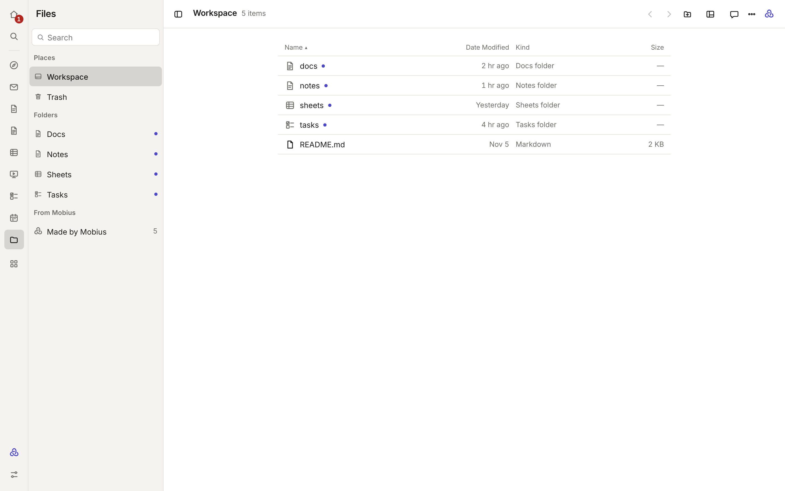
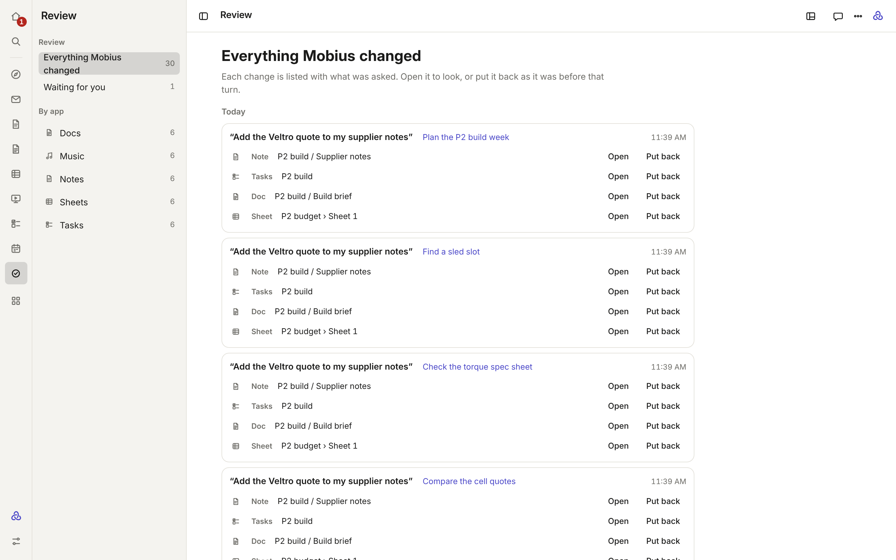
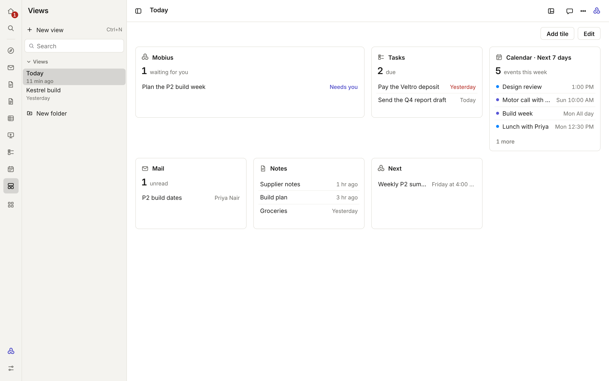

<div align="center">

<picture>
  <source media="(prefers-color-scheme: dark)" srcset="docs/readme/banner-dark.png">
  
</picture>

<h3>Mobius is an AI workspace: your everyday apps in one app, with an agent that works across all of them.</h3>

<p>
  <a href="https://github.com/BevActual/mobius/releases"><b>Download</b></a> &nbsp;·&nbsp;
  <a href="#every-app"><b>Every app</b></a> &nbsp;·&nbsp;
  <a href="docs/README.md"><b>Docs</b></a> &nbsp;·&nbsp;
  <a href="#where-it-stands"><b>Where it stands</b></a> &nbsp;·&nbsp;
  <a href="#build-from-source"><b>Build from source</b></a> &nbsp;·&nbsp;
  <a href="CONTRIBUTING.md"><b>Contribute</b></a>
</p>

<p>
  <a href="LICENSE"></a>
  
  
  
</p>

<br>

<picture>
  <source media="(prefers-color-scheme: dark)" srcset="docs/readme/hero-dark.png">
  
</picture>

<sub>Calendar, with Mobius open in the panel on the right. Every app works the same way.</sub>

</div>

<br>

## What it is

Mobius is one app that holds the apps you use every day, Notes, Mail, Calendar, Docs, Tasks, a Browser and more, in one
calm design. Built into all of them is **Mobius, the agent**. It sees the app you have open, moves with you from one app
to the next, and carries your work between them: a date from an email becomes an event, a note becomes a document, a
quote becomes a row in a sheet.

Beside every app sits the **Mobius panel**: a glance at what you have open (what's due today, the free time left, the
sum of the cells you picked), a short list of what Mobius can do with it, and the conversation. Some apps add a mode of
their own, such as **Triage** in Mail or **Analyse** in Sheets.

It suggests and you decide. Nothing is sent, paid for, deleted or run without your OK.

New here? [Install it](docs/getting-started/install.md), then take the [two-minute tour](docs/getting-started/tour.md).

## Why we're making it

Work today is split across a dozen apps, and AI sits beside them in a chat box that can't see or touch most of it. You
end up copying and pasting between your tools and the AI, and explaining the same context again and again.

Mobius puts the apps and the agent in one place. The agent can follow your work from an email to a task to a document,
and every change it makes shows up in place for you to keep or throw away. It is open source, and you choose the AI
behind it, so you are not locked into one company.

## Who it's for

People whose day is spread across lots of tools and who already lean on AI: founders, freelancers, students and small
teams.

Right now, while Mobius is early, it is for **tinkerers and AI enthusiasts** who like open source, want to choose their
own models, and are happy to try something unfinished and tell us what breaks.

## How we're building it

- **Refine before adding.** A small core of apps made genuinely good first. The rest are added when you want them.
- **Designed with care.** One design style, [Instrument](docs/design/instrument.md), for every screen:
  calm, precise and labelled, with one window layout and one way of reviewing changes in every app.
- **You stay in charge.** Mobius proposes and you approve. Keep, Discard and Rewind make its work undoable.
- **Your AI, your choice.** Use your ChatGPT, Claude or GitHub Copilot plan, an API key, OpenRouter, or a model on your
  own computer, and pick a different model for each job.
- **Local and open.** Your notes, documents and settings live in files on your computer, keys sit in the system's
  secret store, and the code is MIT licensed.
- **Built by using it.** Mobius is developed with AI agents that also use Mobius to do real work, so problems surface
  from real use rather than guesses.

<br>

## Every app

A new install starts with **Notes, Tasks, Calendar, Mail, Docs and Browser**, beside Mobius's own Home, Agents, Activity,
Abilities, Settings, Projects, Files, Review and Views. Add the rest from **Abilities** whenever you want them; apps load the first time you open them, so the ones you don't use cost nothing. Every app shares one
window layout, one look and one way of reviewing what Mobius changed. Pictures follow your light or dark setting. More in the [app guide](docs/apps/README.md).

### Assistant

Mobius's own apps, always there.

<table>
<tr>
<td width="50%" valign="top"><picture><source media="(prefers-color-scheme: dark)" srcset="docs/readme/apps/agent-dark.png"></picture><br><b>Home</b> · The desk and your conversations with Mobius.<br><sub>Talk to Mobius about anything in your workspace and see what it's working on.</sub></td>
<td width="50%" valign="top"><picture><source media="(prefers-color-scheme: dark)" srcset="docs/readme/apps/agents-dark.png"></picture><br><b>Agents</b> · Named helpers with their own instructions, model and schedule.<br><sub>Hand off jobs you repeat, like a weekly summary, and see each run: finished, waiting for you, or failed.</sub></td>
</tr>
<tr>
<td width="50%" valign="top"><picture><source media="(prefers-color-scheme: dark)" srcset="docs/readme/apps/abilities-dark.png"></picture><br><b>Abilities</b> · The app library, plus connectors, skills and plugins.<br><sub>Start small and add apps and tools when you need them. Removing an app keeps its files.</sub></td>
<td width="50%" valign="top"><picture><source media="(prefers-color-scheme: dark)" srcset="docs/readme/apps/settings-dark.png"></picture><br><b>Settings</b> · Gateways, models, voice, approvals, privacy and more.<br><sub>Choose which AI does which job and how far Mobius may go on its own.</sub></td>
</tr>
</table>

### Write and plan

<table>
<tr>
<td width="50%" valign="top"><picture><source media="(prefers-color-scheme: dark)" srcset="docs/readme/apps/notes-dark.png"></picture><br><b>Notes</b> · Quick pages, saved as you type, kept as Markdown files.<br><sub>Capture ideas, checklists and #tags. Mobius tidies, links and fills them in on request.</sub></td>
<td width="50%" valign="top"><picture><source media="(prefers-color-scheme: dark)" srcset="docs/readme/apps/docs-dark.png"></picture><br><b>Docs</b> · Longer documents with an outline, comments and history.<br><sub>Write briefs and reports. Mobius drafts, proofreads and answers comments in place.</sub></td>
</tr>
<tr>
<td width="50%" valign="top"><picture><source media="(prefers-color-scheme: dark)" srcset="docs/readme/apps/tasks-dark.png"></picture><br><b>Tasks</b> · Lists of things to do, in the spirit of Apple's Reminders.<br><sub>Keep track of what's due. Mobius adds and plans tasks, and you keep what you like.</sub></td>
<td width="50%" valign="top"><picture><source media="(prefers-color-scheme: dark)" srcset="docs/readme/apps/calendar-dark.png"></picture><br><b>Calendar</b> · Your calendars by day, week or month, with due tasks.<br><sub>See your time at a glance. Quick add in plain words, and Mobius finds time for things.</sub></td>
</tr>
<tr>
<td width="50%" valign="top"><picture><source media="(prefers-color-scheme: dark)" srcset="docs/readme/apps/sheets-dark.png"></picture><br><b>Sheets</b> · Spreadsheets with formulas, saved as CSV files.<br><sub>Budgets and lists any spreadsheet app can open. Mobius fills cells and explains formulas.</sub></td>
<td width="50%" valign="top"><picture><source media="(prefers-color-scheme: dark)" srcset="docs/readme/apps/database-dark.png"></picture><br><b>Database</b> · SQLite tables to browse, sort and filter, or query with SQL.<br><sub>Ask questions of your data in words; Mobius writes the query, read-only.</sub></td>
</tr>
<tr>
<td width="50%" valign="top"><picture><source media="(prefers-color-scheme: dark)" srcset="docs/readme/apps/projects-dark.png"></picture><br><b>Projects</b> · A place for one piece of work: its files, rules and memory.<br><sub>Keep everything about a project together, with its own rules for what Mobius may do.</sub></td>
<td width="50%" valign="top"><picture><source media="(prefers-color-scheme: dark)" srcset="docs/readme/apps/knowledge-dark.png"></picture><br><b>Knowledge</b> · What Mobius knows, on pages you can read and edit.<br><sub>No hidden memory: your How I work page and each project's memory, in plain sight.</sub></td>
</tr>
</table>

### Browse and find

<table>
<tr>
<td width="50%" valign="top"><picture><source media="(prefers-color-scheme: dark)" srcset="docs/readme/apps/browser-dark.png"></picture><br><b>Browser</b> · A full web browser with tabs, favourites and downloads.<br><sub>Mobius can read pages, compare and pull facts out for you. Signing in and paying stay yours.</sub></td>
<td width="50%" valign="top"><picture><source media="(prefers-color-scheme: dark)" srcset="docs/readme/apps/mail-dark.png"></picture><br><b>Mail</b> · Your mail on this computer, sorted, with drafts in your tone.<br><sub>Get to inbox zero faster. Mobius writes drafts; it never sends, you press Send.</sub></td>
</tr>
<tr>
<td width="50%" valign="top"><picture><source media="(prefers-color-scheme: dark)" srcset="docs/readme/apps/search-dark.png"></picture><br><b>Search</b> · One box for conversations, notes, tasks, docs, mail and pages.<br><sub>Find anything you've kept, or ask a question and Search hands it to Mobius.</sub></td>
<td width="50%" valign="top"><picture><source media="(prefers-color-scheme: dark)" srcset="docs/readme/apps/research-dark.png"></picture><br><b>Research</b> · Ask a question; Mobius searches, reads and writes a report.<br><sub>Get a sourced answer to a real question; follow-ups add to the same report.</sub></td>
</tr>
<tr>
<td width="50%" valign="top"><picture><source media="(prefers-color-scheme: dark)" srcset="docs/readme/apps/reader-dark.png"></picture><br><b>Reader</b> · Pages saved to read later, as clean readable text.<br><sub>Read without clutter, and ask Mobius about the article you're reading.</sub></td>
<td width="50%" valign="top"><picture><source media="(prefers-color-scheme: dark)" srcset="docs/readme/apps/files-dark.png"></picture><br><b>Files</b> · Your whole workspace as a drive, with Made by Mobius.<br><sub>Every note, sheet and doc is a real file you own, in one place.</sub></td>
</tr>
</table>

### Create

<table>
<tr>
<td width="50%" valign="top"><picture><source media="(prefers-color-scheme: dark)" srcset="docs/readme/apps/slides-dark.png"></picture><br><b>Slides</b> · Presentations with layouts, pictures, presenter notes and a player.<br><sub>Build a deck fast. Mobius makes slides from a document and writes speaker notes.</sub></td>
<td width="50%" valign="top"><picture><source media="(prefers-color-scheme: dark)" srcset="docs/readme/apps/design-dark.png"></picture><br><b>Design</b> · Frames on a canvas, with layers, styles and smart guides.<br><sub>Sketch screens and layouts; reuse parts as components with editable copies; borders and PNG export; lock, hide and drag layers. Mobius's changes come dashed, to keep or discard.</sub></td>
</tr>
<tr>
<td width="50%" valign="top"><picture><source media="(prefers-color-scheme: dark)" srcset="docs/readme/apps/photo-dark.png"></picture><br><b>Photo</b> · Your pictures, with crops, adjustments and filters you can undo.<br><sub>Edit without losing the original. Mobius can make pictures with your image model.</sub></td>
<td width="50%" valign="top"><picture><source media="(prefers-color-scheme: dark)" srcset="docs/readme/apps/music-dark.png"></picture><br><b>Music</b> · A small studio for writing songs as notes: tracks, piano roll, step drums, and a sound and effects for each track.<br><sub>Write a tune or a sting. Mobius reads and writes notes, so it can add a bassline.</sub></td>
</tr>
<tr>
<td width="50%" valign="top"><picture><source media="(prefers-color-scheme: dark)" srcset="docs/readme/apps/video-dark.png"></picture><br><b>Video</b> · Cut footage into a short film on a timeline.<br><sub>Trim, split and order shots in a filmstrip timeline, export the film, and ask Mobius about the cut.</sub></td>
<td width="50%" valign="top"><picture><source media="(prefers-color-scheme: dark)" srcset="docs/readme/apps/code-dark.png"></picture><br><b>Code</b> · A code editor for projects in your workspace, with git.<br><sub>Edit, find, run tests and commit. Mobius proposes changes you review line by line.</sub></td>
</tr>
<tr>
<td width="50%" valign="top"><picture><source media="(prefers-color-scheme: dark)" srcset="docs/readme/apps/terminal-dark.png"></picture><br><b>Terminal</b> · Run commands in a folder of your workspace.<br><sub>For the jobs that need a command line. Mobius always asks before running one.</sub></td>
<td width="50%" valign="top"><picture><source media="(prefers-color-scheme: dark)" srcset="docs/readme/apps/canvas-dark.png"></picture><br><b>Canvas</b> · A whiteboard of stickies, shapes, arrows and pen lines.<br><sub>Think out loud on a board. Send a sticky to Mobius to turn it into a plan.</sub></td>
</tr>
</table>

### Review

What Mobius did, at a glance, and what is waiting for you.

<table>
<tr>
<td width="50%" valign="top"><picture><source media="(prefers-color-scheme: dark)" srcset="docs/readme/apps/review-dark.png"></picture><br><b>Review</b> · Everything Mobius changed, from every conversation, in one place.<br><sub>Check what happened while you were away, then keep or roll back.</sub></td>
<td width="50%" valign="top"><picture><source media="(prefers-color-scheme: dark)" srcset="docs/readme/apps/views-dark.png"></picture><br><b>Views</b> · Dashboards of live tiles from your other apps.<br><sub>Tasks due, today's events, unread mail, recent notes and what Mobius is doing, at a glance. Ask Mobius to make one.</sub></td>
</tr>
<tr>
<td width="50%" valign="top"><picture><source media="(prefers-color-scheme: dark)" srcset="docs/readme/apps/activity-dark.png"></picture><br><b>Activity</b> · What Mobius did across your apps, a day at a time, and what needs you.<br><sub>Filter by who did it, by app, or to what can't be undone. Rewind a conversation from here.</sub></td>
<td width="50%" valign="top"></td>
</tr>
</table>

<sub>Screenshots from the current build, with sample data.</sub>

## Your AI, your rules

### Bring your own AI

| Way in | How |
|---|---|
| **ChatGPT plan** | Sign in with ChatGPT, OpenAI's official sign-in for open-source apps |
| **Claude plan** | Through Claude Code on your computer; use counts against your plan's limits |
| **GitHub Copilot plan** | Through GitHub's Copilot CLI; use counts against your premium requests |
| **OpenRouter** | Sign in on OpenRouter's own page, no key to paste |
| **API keys** | OpenAI, Anthropic, Google Gemini, DeepSeek, Groq, Mistral, xAI, Together AI, Fireworks, Hugging Face, Cerebras, Perplexity and more, plus Azure OpenAI and Amazon Bedrock |
| **On your computer** | A built-in llama.cpp engine that picks a model to fit your graphics card, or Ollama and LM Studio |

Setting each one up is in [Models and gateways](docs/guide/models-and-gateways.md).

### Safety rules that don't bend

- Choose how far Mobius goes: **Ask each time**, **Review changes** (the default), **Apply changes** or **Auto**.
- **Sending, paying, deleting and running commands always ask**, whatever the mode.
- Every change is recorded, and **Rewind to here** takes your work back to any step.
- Keys are kept in the system's secret store and never shown to the interface.

More in [Working with Mobius](docs/guide/working-with-mobius.md) and [Privacy and profiles](docs/guide/privacy-and-profiles.md).

<br>

## Where it stands

Mobius is an **early preview**. The apps above run today, and the agent works across them, but expect rough edges,
missing features and changes between versions. It is not yet ready to be the only place you keep important work.

- **Windows** is the first platform. A macOS build compiles in CI but isn't released yet.
- **Releases** will appear on the [Releases page](https://github.com/BevActual/mobius/releases) as a Windows installer.
  The first, 0.1.0, is being prepared.
- **Coming next:** making the current apps hold up in daily use before adding new ones, then a guided first run and
  signed installers. See the [roadmap](docs/roadmap.md).

Found a bug or have an idea? [Open an issue](https://github.com/BevActual/mobius/issues/new/choose).

<br>

## Build from source

You need Node 22+, Rust stable (the MSVC toolchain on Windows) and git. The Chromium engine also needs CMake and Ninja,
which the Visual Studio Build Tools include.

```
git clone https://github.com/BevActual/mobius.git
cd mobius
npm ci
npm run app                 # build everything and open the app
```

`npm run dev` runs the interface alone in a browser at http://127.0.0.1:5180 with sample data, which is the quickest way
to look around. Setup, tests and the end-to-end suite are in the [developer guide](docs/developers/dev-setup.md).

### How it's put together

Everything that isn't interface is Rust: the core owns permissions, tools, the event log and the model providers, and
runs as its own process. The interface is React and TypeScript in a Tauri shell, using the system web view or Chromium
(CEF). The [architecture overview](docs/developers/architecture.md) walks through it, and design decisions are recorded
in [`docs/adr/`](docs/adr).

<br>

## Contributing

Mobius is young and moving quickly, so [bug reports and ideas](https://github.com/BevActual/mobius/issues/new/choose)
help most right now. If you'd like to send code, read [CONTRIBUTING.md](CONTRIBUTING.md) first. Please follow the
[code of conduct](CODE_OF_CONDUCT.md), and report security problems privately as described in [SECURITY.md](SECURITY.md).

## License

[MIT](LICENSE). Mobius builds on ideas from [Hermes Agent](https://github.com/NousResearch/hermes-agent) and other open
source projects; see [THIRD_PARTY_NOTICES.md](THIRD_PARTY_NOTICES.md).

<br>

<div align="center">

<br>
<sub>Made with care, for people who'd rather their computer worked with them.</sub>
</div>
