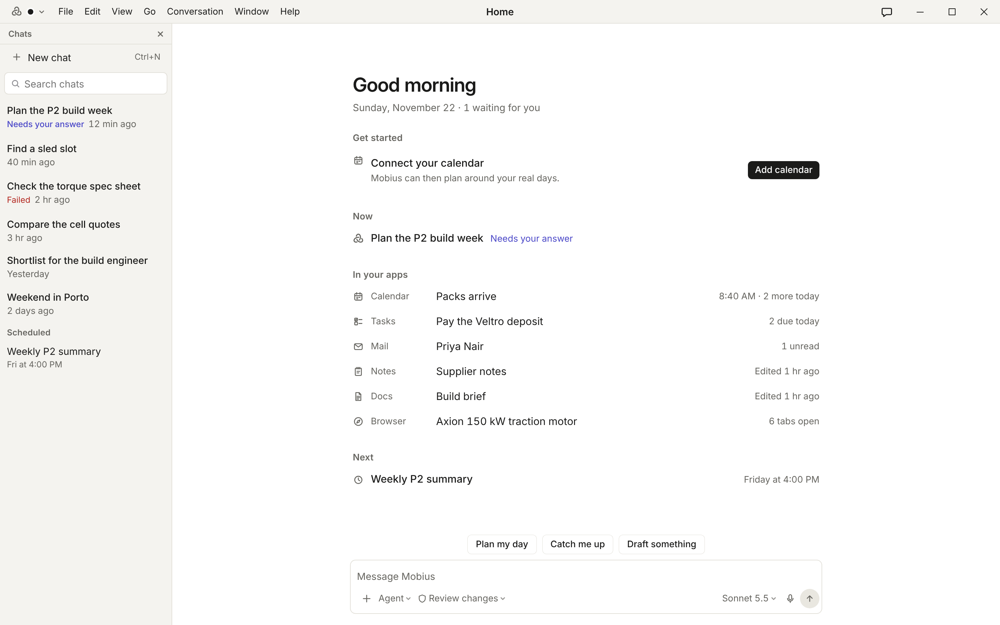
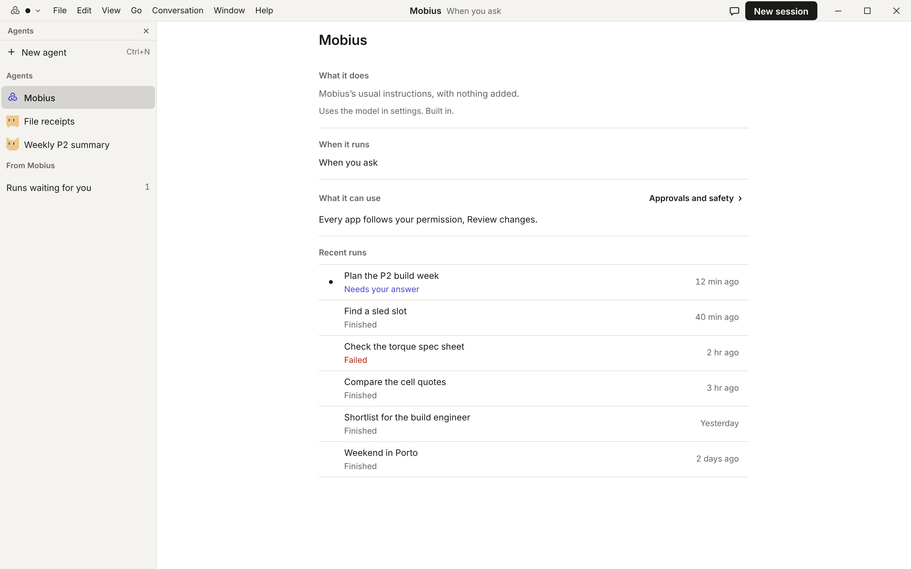
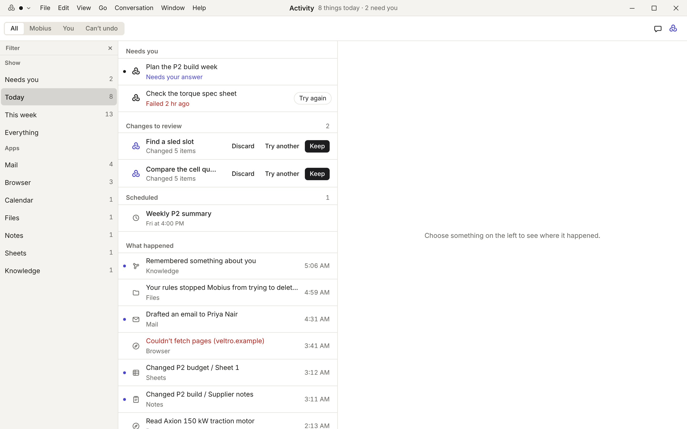
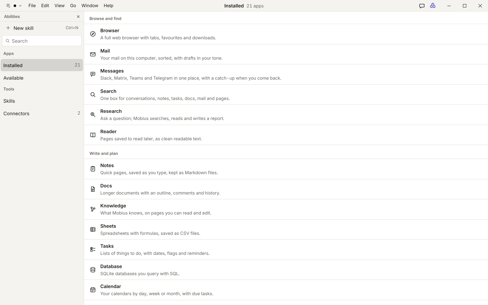

# Assistant apps

## Agent

The Agent app is Mobius's home, named **Home** in Go and Ctrl+K. It opens on the **desk** and holds your conversations.

- **The desk** opens with one greeting ("Good afternoon"), the date and what is in flight ("3 waiting for you · Mobius
  is working"), and suggestions to start from, just above where you type. Under it:
  - **Inbox**: everything across your apps that waits on you, in one list. Chats with a question or an approval
    (answered in place, with Allow), apps Mobius changed while you were away (the row goes once you look), replies Mobius drafted in Mail,
    and mail you sent with no reply by the day you chose (open it, or Stop waiting). As Linear's Inbox, it also
    gathers tasks due today or overdue, calendar invitations you have not answered (Answer opens the event, with Going?), mail Get to zero marked as needing
    a reply, project updates that are due, and suggested Knowledge changes. Each has **Done** (a task is ticked off;
    the rest leave the Inbox) and **Later** (later today, tomorrow at 8:00 or next Monday at 8:00, as Linear's
    snooze). What is set aside folds under "N set aside for later", where **Bring back** returns it. Up and Down (or J
    and K) move through the rows, E is Done and H is Later until tomorrow. Done and Later are kept on this computer.
  - **Working**: what Mobius is doing now, with Stop.
  - **In your apps**: the one thing in each worth a look (your next event, who wrote your newest
    mail, the note or doc you edited last); one press opens it.
  - **Continue**: the last things you opened in other apps. **Next**: what is scheduled.
- **The Chats panel** starts with a search, then your conversations (grouped by agent once you have more than one),
  what is scheduled, and the ones you archived. **New conversation** (Ctrl+N) at its head starts one. **Agents** and
  [Activity](#activity) open from **Go** or Ctrl+K.
- **The message box** takes text, pictures and files, dictation (hold Ctrl+Shift+Space), `/skill` names, the mode
  (Shift+Tab), the model and the effort.
- **In a turn**, Mobius shows its plan as a checklist, each tool it uses as a plain sentence ("Added 6 tasks to P2
  build"), and, at the end, a card naming each app it changed.

The same conversation is available in every app in the Mobius panel beside your work, which starts closed (the Mobius
icon at the end of the tool row shows and hides it), or in **Little Mobius** (Ctrl+Shift+M).

## Agents

Agents are named helpers for jobs you repeat. Open them from **Go**, or type "Agents" in Ctrl+K. The **Agents** panel lists your agents, then **From Mobius**: the runs of your agents waiting for you to review.

- Choosing an agent opens **its page**. The toolbar shows its name, when it runs, and **Run now**, which starts a new
  session with it and sends its instructions. The page has four parts: **What it does** (its instructions and model,
  with **Edit**), **When it runs**, **What it can use** (from Settings › Approvals and safety) and **Recent runs**, its sessions,
  each opening with one press. Each run says where it stands: a question for you, Working…, Finished, or **Failed**
  in red.
- **+** beside the list makes a new agent, on the same page.
- Each agent has a name, its instructions, a model (type one, or pick from the models you have), and how it starts:
  **When you ask**, or **On a schedule** (weekdays or every day, at a time; it still starts when you ask, too). A
  schedule runs as the agent, with its instructions and model.
- An agent's **More** button (⋯), or a right-click on it, has New session, Edit, Move up, Move down and Remove. Mobius
  itself is built in, so its menu only starts a session.
- **Make an agent from a conversation**: its name comes from the conversation's title and its instructions from what
  you first asked.
- An agent works under the same permission and per-app settings as Mobius. Its card says what it may touch ("Off: Mail.
  Always asks: Browser. Everything else follows your permission, Review changes.").
- In a [project](write-and-plan.md#projects), **Ask a bot** sends an agent off to do something on the side, and what
  it reports comes back into the thread.

## Activity

Activity is the history of what Mobius did, and what is waiting for you. Open it from **Go**, or type "Activity" in the
launcher (Ctrl+K).

- **The list** is laid out like Mail's inbox. In **Today** it leads with what **needs you**, what is **running**, the
  **changes to review** (Keep or Discard), what finished today and what is scheduled, then what happened. Each line is
  the app's icon, one sentence ("Sent an email to Sam Okafor") and the time. An indigo dot marks a change Mobius made;
  something that failed is shown in red, and a run that failed is listed with what needs you, with **Try again** to
  send the same request once more. A changed file is listed under the app it belongs to (a sheet under
  Sheets). **Open** on a line takes you to its app.
- **The right side** shows what you chose: a line's app, who did it and when, with **Rewind to here** to undo a
  change Mobius made, or a conversation with its turns and
  [Rewind to here](../guide/working-with-mobius.md#rewind-to-here).
- **The Filter panel** chooses where to look: **Needs you**, **Today**, **This week**, **Everything**, then each app.
- **The toolbar** chooses who did it: **All**, **Mobius**, **You**, or **Can't undo** (sending, paying, deleting and
  running commands).
- It reads the same log as **Settings › Approvals and safety › Activity**, which stays on this computer.

## Store

Where you add apps, skills, connectors and plugins (it was called Abilities). Store is a place, like Settings: open it from **Go › Store…** or Ctrl K, not from All apps. See the [Store guide](../guide/abilities.md).

