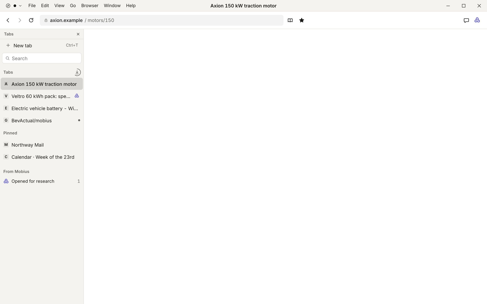
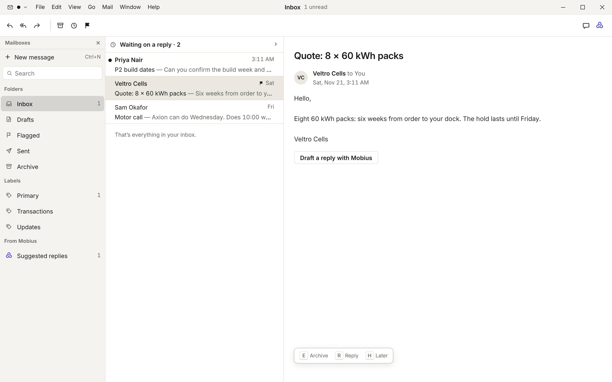
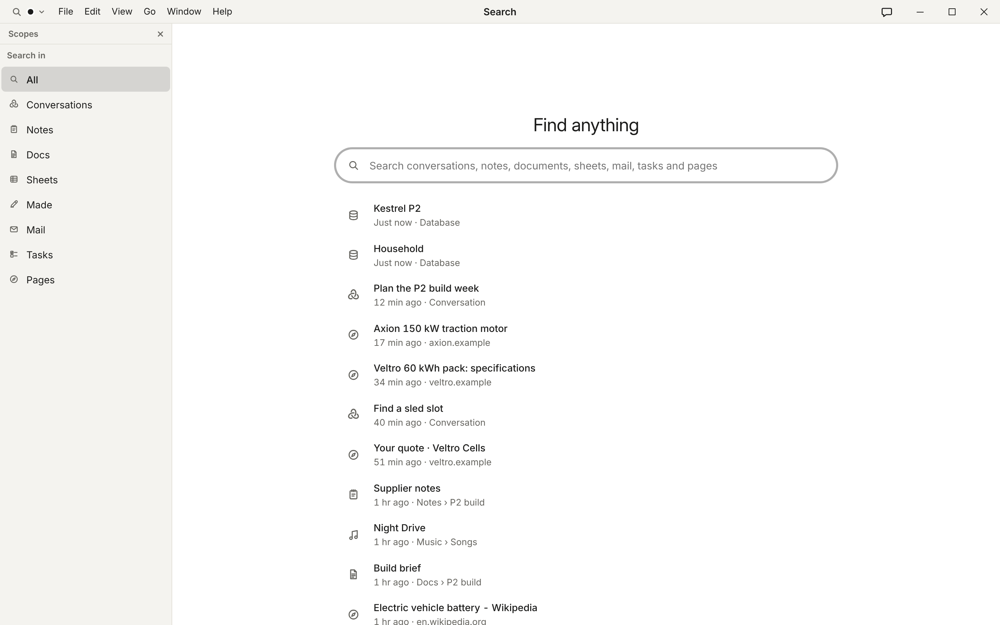
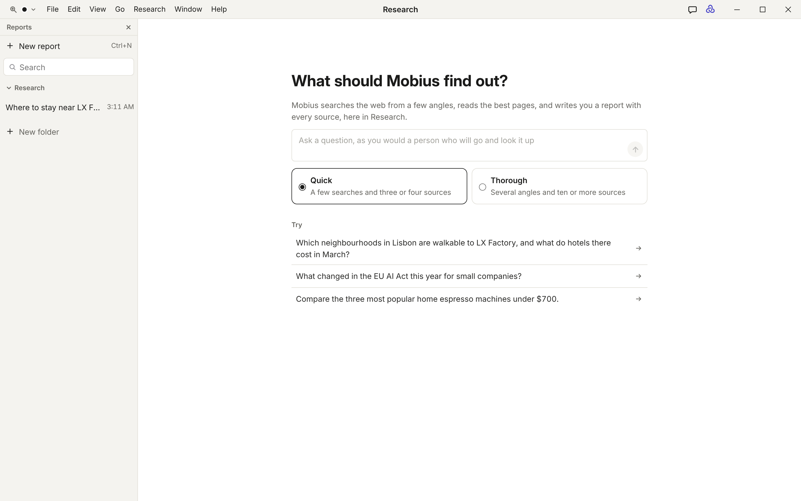
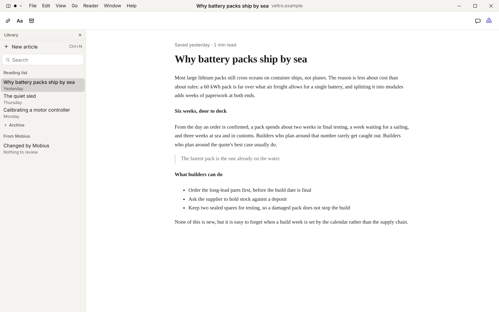
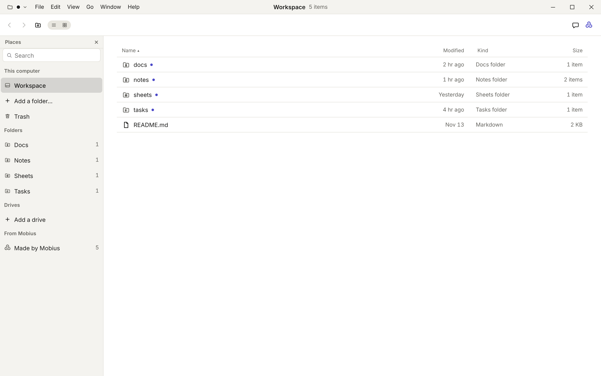

# Browse and find

## Browser

A full web browser, with Mobius able to read and work on pages for you.

- **The toolbar** has back (Alt+Left), forward (Alt+Right) and reload (Ctrl+R), the address (Ctrl+L; the site in full
  ink, the rest of the address in grey) and the star. Everything else about the page (Save to Read later, selected text,
  pin to the Tabs panel) is in **⋯**. The address suggests open tabs, bookmarks and history as you type.
- **The Tabs panel** holds New tab (Ctrl+T), a search for your tabs and bookmarks, then **Tabs**, **Pinned**, **Read
  later** and **From Mobius**. Tabs live in this panel, as in Safari and Arc: each is a plain row whose buttons (pin, duplicate, close)
  show when the pointer is on it, and right-clicking a tab gives the rest. Drag a tab to reorder it or across the line
  to pin it. The Mobius mark shows only on tabs Mobius opened or is using; **From Mobius › Opened for research** shows
  just those.
- **A new tab** opens Mobius's start page: your favourites, other sites you visit most, and your reading list. It is drawn
  by Mobius, so none of it is shown to a web page.
- **Bookmarks** with the star beside the address, **Find** (Ctrl+F), downloads and history. To pin a page, right-click
  its tab and choose **Pin tab**. **Reopen closed tab** is in the same menu (Ctrl+Shift+T).
- **Mobius on the page.** Ask about the page, or select text and act on it. Opening a site the agent hasn't been allowed
  asks first, and clicking or typing on a page asks every time. When a page needs a sign-in, you sign in yourself.
- Pages are shown by the system web view (WebView2) in the installer, or by Chromium (CEF) in a build from source that includes it.

- **History** (Ctrl+H, or History in the Tabs panel's ⋯) shows the pages you visited in the Tabs panel, under Today,
  Yesterday and each earlier day, with a search. A click goes there in the open tab, a middle-click opens a new tab, and
  right-click copies the address or removes the page (or Delete on the row). **Clear history…** asks first. Escape or the head goes back to
  your tabs. Searching your tabs (Ctrl+Shift+A) also finds pages you visited before, under History.

Settings: **Settings › Browser** (allowed sites, local addresses, bookmarks, history).

## Mail

Your mail, mirrored to this computer, sorted for you, with drafts Mobius can write and you send.

- **Accounts** are in **Settings › Mail**, and sign in with an app password. Ready-made settings for iCloud, Fastmail, Gmail and Yahoo, or any provider by its IMAP and SMTP servers.
- **The Mailboxes panel** holds New message, Search, your mailboxes (Inbox, Drafts, Flagged, Sent and Archive), Labels, and From Mobius. Flagged and Archive gather your flagged and archived mail.
- **The list** shows each conversation in two lines: who it is from (with how many messages it holds) and the date, then the subject and its first words. Unread mail is in bold with a small dot. Hover a row for Done and Later. A short list ends with one line and New message.
- **Conversations:** opening one shows its latest message, with the earlier ones folded above it; click one to read it. Done and Later act on the whole conversation.
- **Attachments** are chips under the message with their size. Click one to save it to Downloads. Programs are never saved.
- **Labels:** Mobius sorts the Inbox into Primary, Transactions and Updates; the Inbox shows them all. Move a message to another from the toolbar’s ⋯ or from its right-click menu.
- **The message toolbar** in the window's top row, as in Apple Mail: Reply, Reply All and Forward; Archive and Flag; and, at the top of the toolbar’s ⋯, Mark as Unread, Remind Me Tomorrow and moving it to another category. Archive and Remind Me Tomorrow can be undone from the note that appears at the bottom. Right-click a message in the list for the same actions without opening it.
- **Replies quote the message** under where you write, and forwards carry who it was from and to. Attachments are not forwarded yet.
- **Keys:** the up and down arrows move through the list; E archives, R replies, Shift+R replies to all, F forwards, U marks it unread and H brings the message back tomorrow at 8:00. Menus and tooltips show each key.
- **Email is shown safely:** no scripts, and nothing loaded from the web, so tracking pixels don't fire.
- **Suggested replies** sit under the message as one dashed block, marked Draft from Mobius, until you choose **Keep and edit** (it opens as your draft), **Discard** or **Try another**. **From Mobius › Suggested replies** in the Mailboxes panel lists the ones waiting. A reply you kept, here or with Keep all, waits under the message it answers with **Send** and **Edit**.
- **Take care of this** (in the Mobius panel with an email open) does the whole job in one ask: to-dos go to Tasks with their due dates, a meeting it asks for goes in Calendar (at the time the email names if you are free, otherwise at a free time it picks), and a reply is suggested. Each waits for you.
- **Get to zero** (in the Mobius panel while no email is open) proposes a plan for the whole inbox, dashed until kept.
- **Triage** (in the Mobius panel: *Triage the unread*, or *Triage this message* with one open) sends its turn in Mail's [Triage mode](../guide/working-with-mobius.md#app-modes): Mobius sorts into Reply, Later and Archive and drafts the replies, and never sends. Triage is also in the composer's Mode menu while you are in Mail.
- **Ask about your mail** in the Mobius composer: the answer lists the messages it came from, and each one opens.
- **Send later:** tomorrow at 8:00, Monday at 9:00, or when the person is usually on mail.

Mobius never sends mail itself. It writes drafts; you press Send.

**Kept in:** `workspace/mail/<account>/`, a copy of each account's recent Inbox and Sent mail, with your drafts.

## Messages

Slack, Matrix, Teams chats and Telegram in one place, with a catch-up when you come back. Add it from **Store**.

- **Accounts** use each service's official API: Slack, Matrix (encrypted rooms and bridges included), Teams chats and Telegram. Until one is added, Messages says so. Signing in to some of them waits on Mobius being registered with the service ([what it needs](../reference/messages-sign-in.md)).
- **Conversations** has a rail down its left: **All conversations**, then **Mobius space**, then one mark for each account. The list beside it shows the chosen one's channels, then group and direct messages, most recent first. A number shows mentions, or else unread messages. **Find a conversation** narrows the list.
- **Mobius space** is your own space, run on this computer. The first time you choose it, Mobius downloads its server (about 44 MB, checked against a pinned hash) and shows the progress. After that it opens straight to its first channel.
- **A channel** shows each person's messages together under their name, with reactions. **N replies** opens the thread in place, and **Back to #channel** returns.
- **Write** at the bottom. Enter sends and Shift+Enter starts a new line. Only you send: Mobius never sends a message.
- **Catch me up** (in the toolbar) attaches the open channel as someone else's words, which Mobius treats as data, as it does an email. It puts the ask in Mobius's box: at most five lines on what was said and decided, and a reply drafted to anything that waits on you, for you to send.

- **Ask Mobius about your chats** from anywhere ("anything urgent in Ops?"). It lists your chats and reads the ones it needs, as someone else's words. It has no way to send: a reply it suggests is yours to send.

**Kept in:** nothing beyond what the service gives back. Messages are read from the service as you open them.

## Search

One box for everything Mobius keeps: conversations, notes, tasks and pages. The **Scopes** panel narrows it to one kind of thing.
Type a question instead and Search hands it to Mobius.

## Research

Ask a question and Mobius searches the web from several angles, reads the best pages and writes a report with its
sources. The report is a page like any other, and follow-up questions add to it. What Mobius wrote waits for you to
keep.

- **Reports** are on the left, and **Sources**, numbered as the report cites them, are on the right. Each is a panel you can hide or resize.
- **The toolbar** shows how many sources the report has and how many facts are marked as coming from the web. It also has **Edit**, which shows the report's text so you can change it.
- **While Mobius works**, the report shows each search it runs and each page it reads. When the report is written,
  they fold into one row ("Read 6 sources") that you can open again.
- **Each fact from the web** has a small number after it, the same as its place in Sources. Hover the number for the
  page's title and site, or click it to open the page.
- **Ask next** under the report suggests three follow-up questions. Choose one, or type your own below it.

**Kept in:** `workspace/research/`, each report a Markdown file.

## Reader

Reader is the Browser's reader mode: pages saved to read later, shown as plain readable text with where each came
from. Press **Reader mode** in the toolbar to keep the page in **Read later** and read it there; press it again to go
back to the page. Reader in Ctrl+K opens the same thing.

- **Read later**, in the Browser's Tabs panel, lists the articles you kept, newest first. The article you are reading
  shows as the current row.
- **The article** is set in a serif at reading width. Above its title, a quiet line says when you saved it and how many
  minutes are left; it opens where you stopped. The toolbar shows its title and the site it came from (click the site
  to open the original in the Browser).
- **In the toolbar:** Save a link, **Aa** (text size, sans serif or serif, and the page colour: Match Mobius, Sepia,
  Grey or Night) and **Done reading** (E), which moves it to Archive, opens the next article and offers Undo.
- **Highlights:** select a passage and press Highlight (or H). They collect in the **Highlights** panel of the
  [inspector](../getting-started/tour.md#the-inspector), where each can be asked about and all copied to Notes. **Ask Mobius** on a
  selected passage starts a message with it quoted, the article attached.
- **J** and **K** move to the next and previous article in the list.

**Kept in:** `workspace/reading/`, each article a Markdown file.

## Files

Your whole workspace as a drive.

- **The drive** is a list like Finder's: Name, Kind and Size columns (click one to sort; folders stay first), and each
  file wears the icon of the app that opens it. A file Mobius made is dashed until kept; a folder holding such files
  has an indigo dot (hover it for how many).
- **Select, then open.** A click selects, a double-click or Enter opens: folders in place, files in their own app. The
  arrow keys move, Backspace (or Alt+Up) goes up a folder, and Back and Forward (Alt+Left, Alt+Right) walk the folders you visited.
- **The toolbar** names the open folder with how many items it holds, and has Back, Forward and New folder. The
  **path bar** at the foot shows where the folder is; click any part to go back up.
- **Search**, at the top of the Places panel, narrows the open folder by name. **Right-click** a row to open (Enter), rename (F2), copy its path
  (Ctrl+Shift+C), show it in Explorer, ask Mobius about it, or move it to the Trash (Delete).
- **New folder** (Ctrl+Shift+N) is named in place; **F2** renames; **Delete** moves to the Trash, with Undo in a toast
  at the foot of the page. The Trash is
  `workspace/.trash/`, hidden from Files' folders and from Mobius.
- **Drag** a file or folder onto a folder row, a folder in the Places panel, or a folder in the path bar to move it there, with
  Undo in a toast. The folder it would land in is ringed while you hover. From the keyboard, **Cut** (Ctrl+X) and then
  **Paste** (Ctrl+V) in another folder; Escape lets go. Something Mobius made stays put until you keep or discard it.
- **Pick several**, as in Explorer: Ctrl+click adds or takes out one row, Shift+click (or Shift with the arrows) picks
  the rows between, and Ctrl+A picks everything in the folder. Delete, Cut, Copy, Duplicate and dragging act on all of
  them, with one Undo. The Info panel says how many are picked and how big the files are together.
- **Copy** (Ctrl+C) and **Paste** (Ctrl+V) make copies in the folder open; the originals stay, and you can paste again.
  **Duplicate** (Ctrl+D) copies beside the original, named as Explorer names them ("Plan - Copy.md", then
  "Plan - Copy (2).md"). Undo takes the copies away.
- **Type a name** to go to it: the first letters typed within a second; the same letter again goes on to the next
  name that starts with it.
- **Trash**, under Places, lists what you moved there, when, and where it was. **Put Back** (Ctrl+Backspace, or a
  double-click) returns it to that folder; **Empty Trash** (Ctrl+Shift+Backspace) and **Delete Immediately** (right-click, or Delete) delete for good, and
  always ask first. Mobius cannot empty the Trash. An app's own folder (notes/, docs/...) is never renamed or
  trashed from here.
- **Date Modified** shows when each file and folder last changed. The agent's own `files.list` leaves dates out.
- **The Places panel** has Workspace and Trash under Places, the workspace's folders (Notes, Docs, Sheets...) under Folders, a dot on
  a folder holding something new from Mobius until you look in it, and Made by Mobius under From Mobius.
- **Made by Mobius** collects what Mobius created, dashed until you keep it, with a count of what is waiting.
- **Drives** are folders on storage you already use. **Add a drive**, under Drives in the Places panel, offers each kind:
  - **Server (WebDAV)**: Nextcloud, ownCloud, a Synology or QNAP, Fastmail Files, or any WebDAV server. It asks for the
    server's address, your user name and an app password (for Nextcloud and ownCloud the address alone is enough;
    Files finds your folder).
  - **Bucket (S3)**: Amazon S3, Cloudflare R2, Backblaze B2, Wasabi or your own MinIO, with the service's address, the
    bucket, a folder in it if you like, and an access key.
  - **Dropbox** and **OneDrive or SharePoint**: you sign in on Dropbox's or Microsoft's own page, so Mobius never sees
    your password. For SharePoint, paste the library's or folder's link. These show once a build of Mobius is
    registered with each service ([drive sign-in](../reference/drive-sign-in.md)).

  Passwords and sign-ins are kept in your computer's secret store and sent only to that service. A drive's folders list like the workspace's, with New
  folder, F2 to rename, and drag to move within it. Each request goes to the server; nothing is mirrored.
- **Copy between a drive and the workspace** by dragging: a drive's file onto Workspace or a folder in the Places panel
  copies it there, and a workspace file onto a drive there copies it to the drive's top. Neither ever writes
  over a file already there. Double-click a drive's file to open a copy in its app (it lands in `workspace/Drives/`).
- **Save Back to <drive>**: right-click a copy of a drive's file, once you've changed it, and it goes back over the
  file it came from. Files does that only while the drive's file is still the version that was copied. If someone
  changed it there since, nothing is replaced and Files says so; copy it again to see their version.
- **Delete** on a drive deletes from the server for good, after asking. If someone changed the file on the server
  since Files listed it, the delete is refused and Files says so; the server's version stays. Right-click a drive in
  the Places panel to remove it: Files forgets its password, and everything on the server stays.
- **Sync a folder with a drive**: right-click a workspace folder and choose **Sync with a Drive…**, then the drive and
  the folder on it. From then on changes go both ways. When both sides changed a file, both are kept: yours as a
  `(conflict, Mobius, …)` copy beside it, with **Open both**, **Keep mine** and **Keep theirs**. A round that would
  delete more than 10 files asks first. Right-click the folder for **Sync Now** and **Stop Syncing…**.
