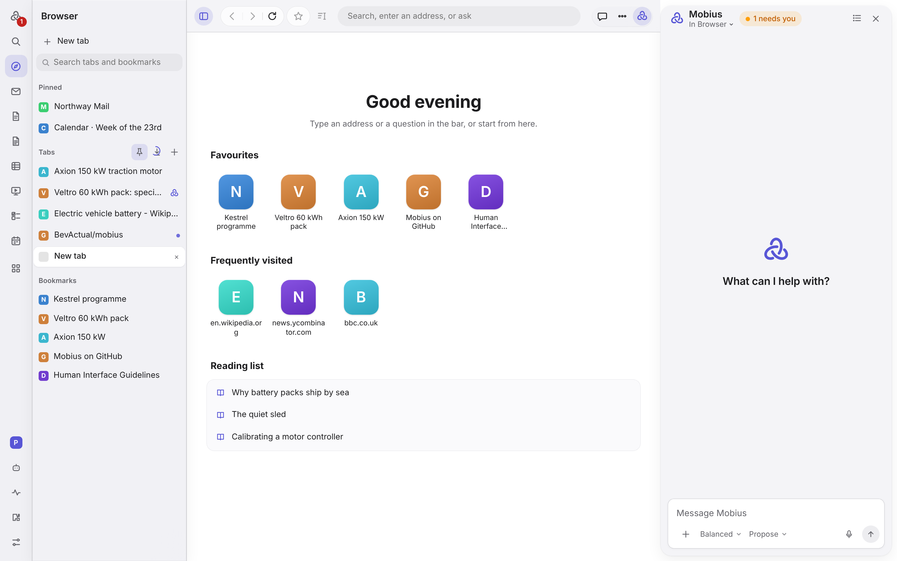
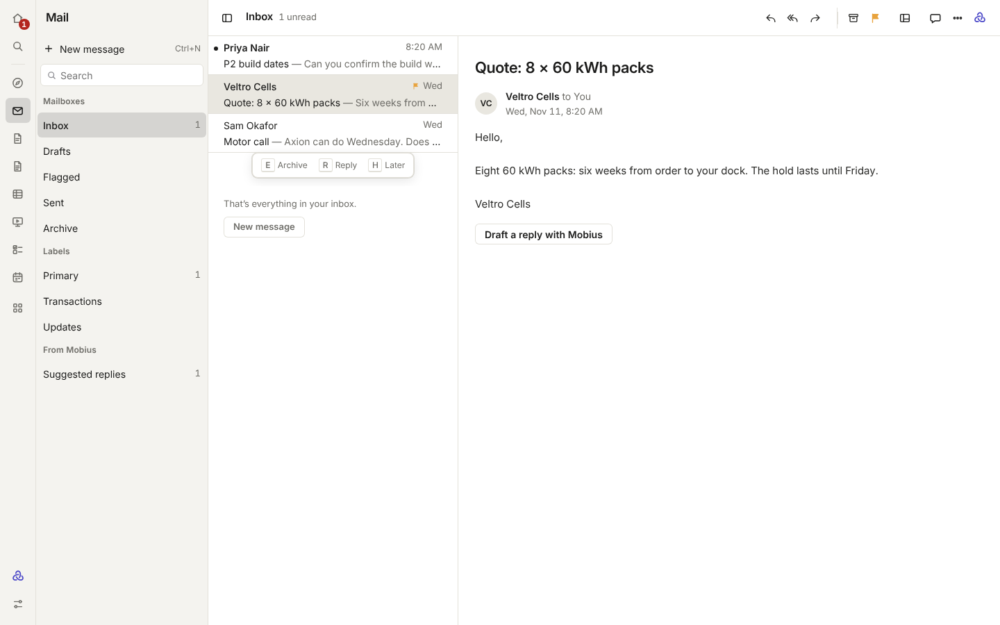
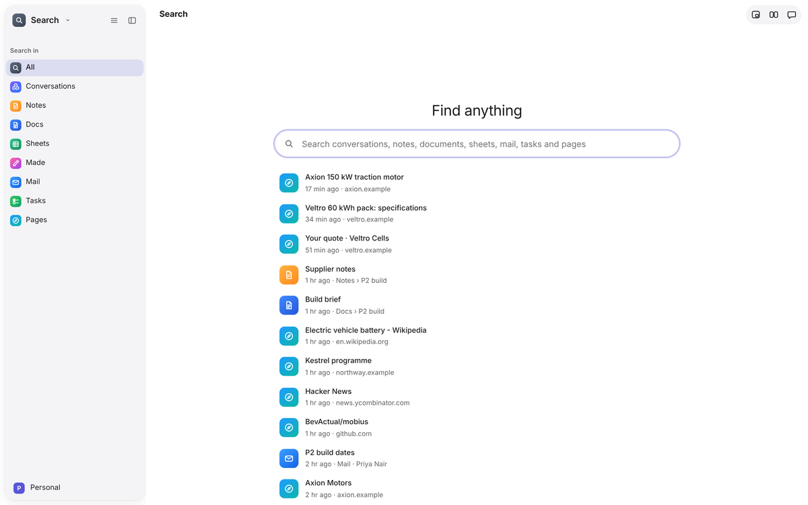
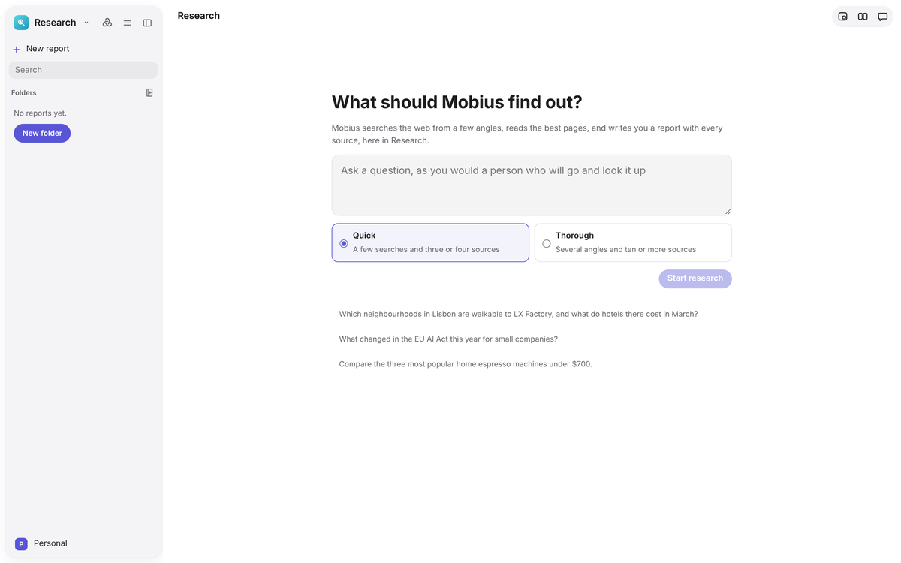
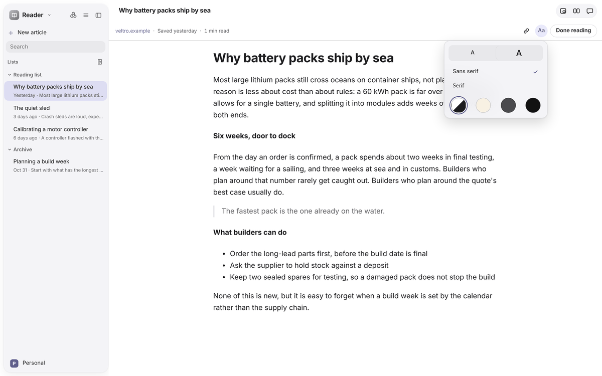
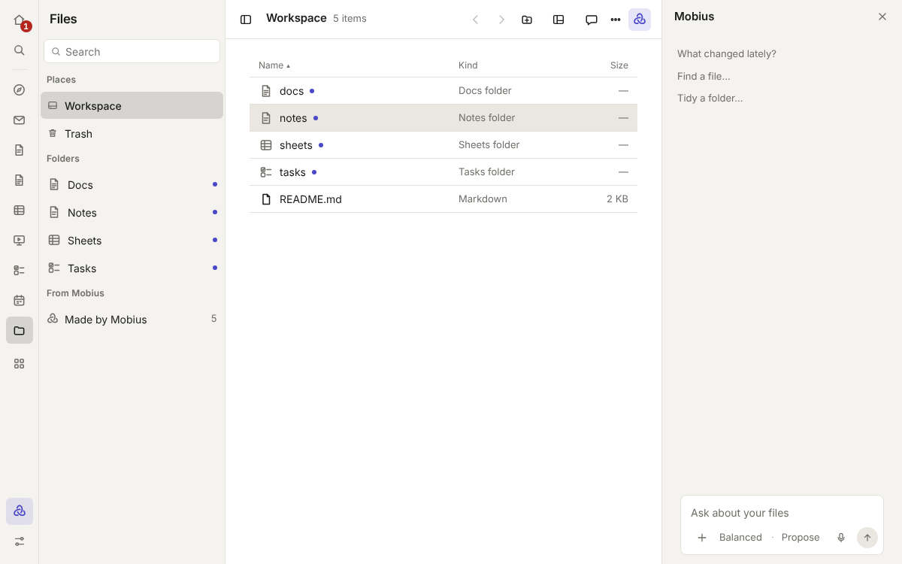

# Browse and find

## Browser

A full web browser, with Mobius able to read and work on pages for you.

- **Tabs** live in the sidebar, as in Safari and Arc. Pinned tabs sit in their own group above the rest; drag a tab to
  reorder it or across the line to pin it.
- **A new tab** opens Mobius's start page: your favourites, the sites you visit most, and your reading list. It is drawn
  by Mobius, so none of it is shown to a web page.
- **Bookmarks** with the star beside the address, **Find** (Ctrl+F), downloads and history.
- **Mobius on the page.** Ask about the page, or select text and act on it. Opening a site the agent hasn't been allowed
  asks first, and clicking or typing on a page asks every time. When a page needs a sign-in, you sign in yourself.
- Pages are shown by the system web view (WebView2) in the installer, or by Chromium (CEF) in a build from source that includes it.

Settings: **Settings › Browser** (allowed sites, local addresses, bookmarks, history).

## Mail

Your mail, mirrored to this computer, sorted for you, with drafts Mobius can write and you send.

- **Accounts** sign in with an app password. Ready-made settings for iCloud, Fastmail, Gmail and Yahoo, or any provider by its IMAP and SMTP servers.
- **Mailboxes:** Inbox, Drafts, Flagged, Sent and Archive. Flagged and Archive gather your flagged and archived mail.
- **Categories:** Primary, Transactions, Updates and All. Move a message to another with **Move to…** in its toolbar or its right-click menu.
- **The message toolbar** in the window's top row, as in Apple Mail: Reply, Reply All, Forward, Archive, Flag, Mark as Unread and Remind Me Tomorrow. Right-click a message in the list for the same actions without opening it.
- **Replies quote the message** under where you write, and forwards carry who it was from and to. Attachments are not forwarded yet.
- **Keys:** the up and down arrows move through the list; E archives, R replies and H brings the message back tomorrow at 8:00.
- **Email is shown safely:** no scripts, and nothing loaded from the web, so tracking pixels don't fire.
- **Suggested replies** are dashed until you keep one (it opens as your draft), discard it or ask for another.
- **Get to zero** (in the Mobius panel while Mail is open) proposes a plan for the whole inbox, dashed until kept.
- **Ask about your mail** in the Mobius composer: the answer lists the messages it came from, and each one opens.
- **Send later:** tomorrow at 8:00, Monday at 9:00, or when the person is usually on mail.

Mobius never sends mail itself. It writes drafts; you press Send.

**Kept in:** `workspace/mail/<account>/`, a copy of each account's recent Inbox and Sent mail, with your drafts.

## Search

One box for everything Mobius keeps: conversations, notes, tasks and pages. The sidebar narrows it to one kind of thing.
Type a question instead and Search hands it to Mobius.

## Research

Ask a question and Mobius searches the web from several angles, reads the best pages and writes a report with its
sources. The report is a page like any other, and follow-up questions add to it. What Mobius wrote waits for you to
keep.

**Kept in:** `workspace/research/`, each report a Markdown file.

## Reader

Pages saved to read later, shown as plain readable text with where each came from. Save the page you're on from the
Browser, or give Reader an address.

- **The article has the page.** The bar above it says where it came from, when you saved it and how many minutes are
  left; a thin line fills as you read, and each article opens where you stopped. Opening Reader shows your newest
  article.
- **Aa** sets the text size, the font (sans serif or serif) and the page colour (Match Mobius, Sepia, Grey or Night),
  as in Safari Reader. Your choice is kept on this computer.
- **Save a link** (the link button, or New › Save a link) shows the link field; with nothing open it is always there.
  **Save this tab** keeps the page open in the Browser.
- **Highlights:** select a passage and press Highlight (or H); they are listed under the article and can be copied to
  Notes. **Done reading** (E) moves the article to Archive.

**Kept in:** `workspace/reading/`, each article a Markdown file.

## Files

Your whole workspace as a drive.

- **The drive** shows the workspace's folders. Files open in their own app. A file Mobius made is dashed until kept; a
  folder says how many such files it holds.
- **Made by Mobius** collects what Mobius created, dashed until you keep it, with a count of what is waiting.
