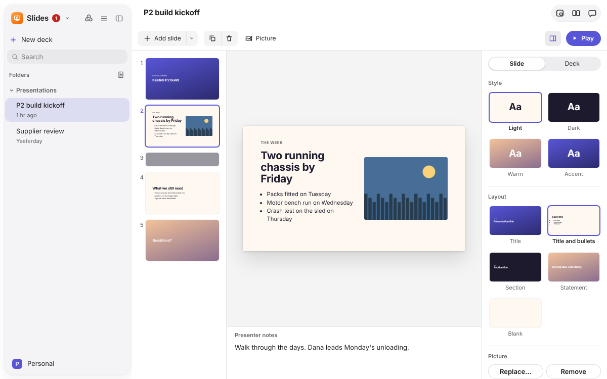
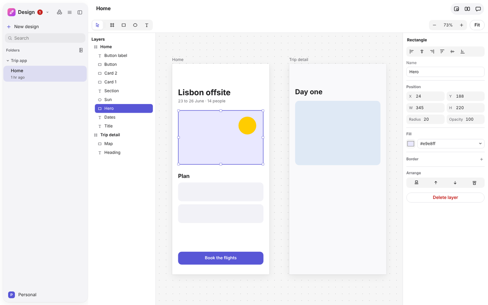
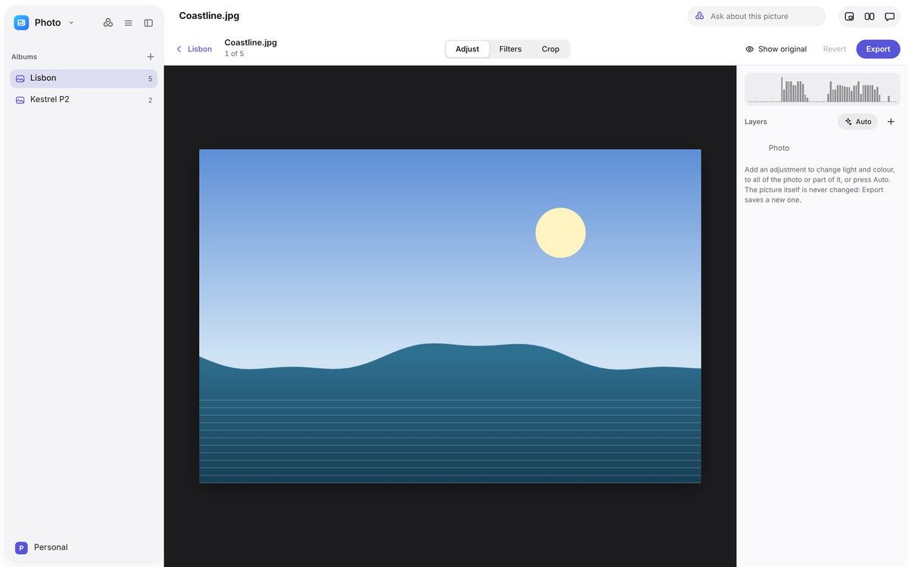
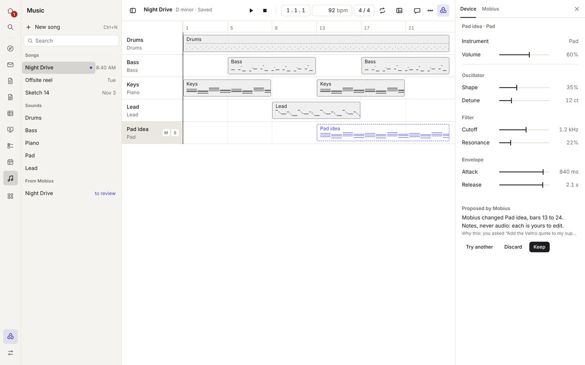
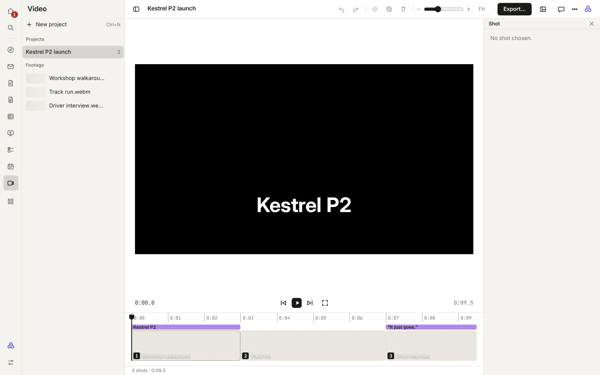
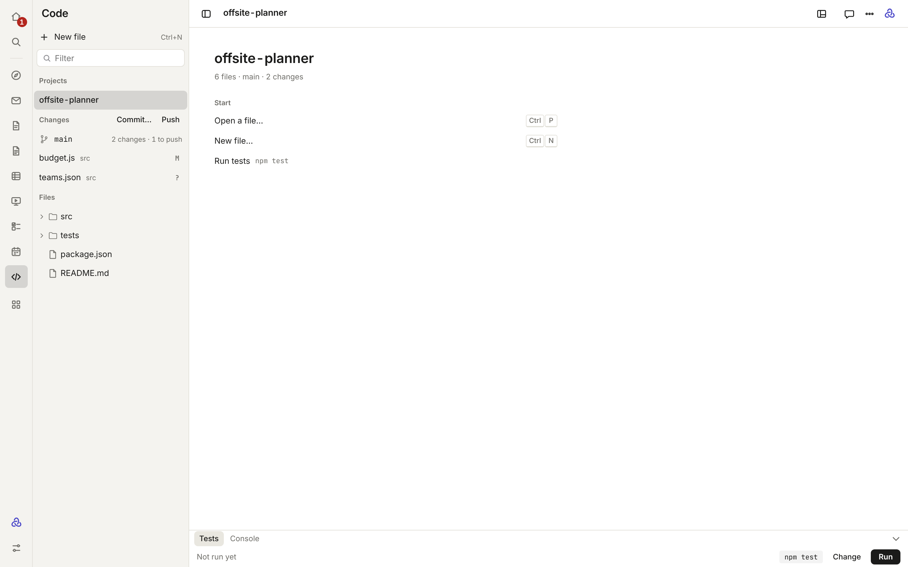
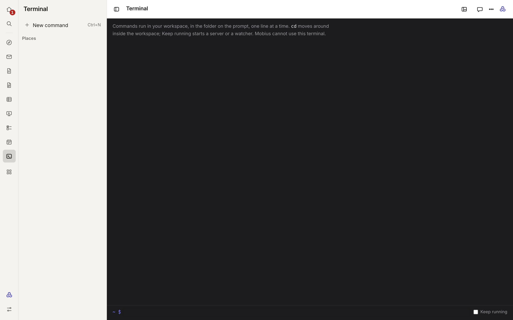
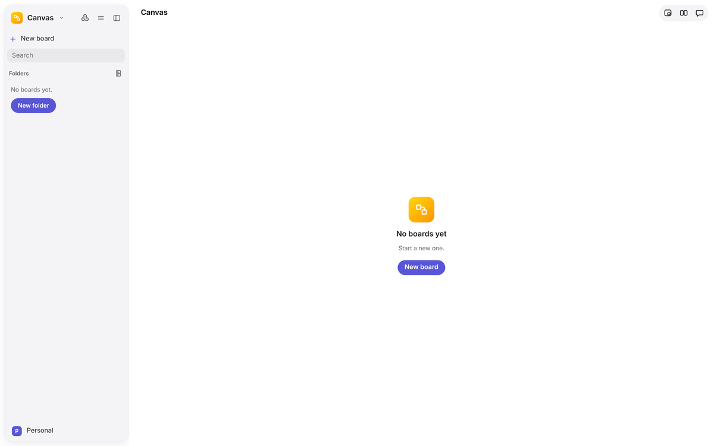

# Create

## Slides

Presentations, played as Keynote plays them.

- **Slides** down the side, the chosen one at 16:9 to edit, its presenter notes, and a **Format** inspector with two
  panes: **Slide** (its style and layout) and **Deck** (how long it runs, Play from the start, and Ask Mobius). New
  slides start from a menu of layouts. Bullets keep their dots while you type them.
- **Keys:** ↑ ↓ pick a slide, Alt+↑ ↓ moves it, Ctrl+D duplicates, Delete removes, and Ctrl+Enter plays from the
  picked slide. The same keys show in each slide's right-click menu and the toolbar's tooltips.
- **Play** shows each slide full screen. Arrows, Space or a click go on (a click on the left third goes back), a
  number and Return jumps, **B** blacks the screen, **P** shows the presenter view with the next slide, notes and the
  clock, and **Esc** stops.
- **Ask Mobius** about the deck; what it changes comes back as dashed slides, and **Keep** keeps every slide it changed.

**Kept in:** `workspace/slides/`, each deck a Markdown file with slides split by `---`.

## Design

Frames on a canvas, as in Sketch and Figma.

- Draw with a tool (**V** move, **F** frame, **R** rectangle, **O** oval, **T** text) or add from the toolbar.
- Pick with a click, Shift-click or a box. Move with smart guides, size from any edge, line layers up from the
  inspector, copy and duplicate. Double-click a text layer to type on the canvas.
- Rename layers and frames in the layer list. Each layer row has **Lock** and **Hide** buttons (or Ctrl+Shift+L and
  Ctrl+Shift+H): a hidden layer is not drawn, and a locked one stays put while you work around it.
- Right-click a layer, a frame or the canvas for cut, copy, paste, duplicate, rename, bring to front, send to back,
  hide, lock and delete, each with its shortcut. **Shift+1** fits everything, **Shift+2** zooms to what is picked.
- Give a frame or shape a **Border** from the inspector (colour or style, and width). Drag layers up or down the layer
  list to change what is in front, or onto another frame to move them there.
- Mobius's changes are dashed to keep or discard. It can also make pictures with your
  [Images model](../guide/models-and-gateways.md#a-model-for-each-job).

**Kept in:** `workspace/designs/`, each design a JSON file.

## Photo

Your pictures, with edits you can always take back.

- **Albums** are folders in `workspace/photos/`, shown as a grid. Your original files are never changed.
- **Adjust** (exposure, highlights, shadows, contrast, saturation, warmth and more), **Filters** and **Crop** (turn,
  flip, straighten). An adjustment can apply to all of the picture or to part of it.
- Edits are kept beside each photo in a small file, so every change can be put back. **Export** writes a new file next
  to the photo.
- Pictures made with your Images model are saved here.

**Kept in:** `workspace/photos/<album>/`, your original files untouched, with edits beside each in `<photo>.edits.json`.

## Music

A small studio for writing songs as notes.

- **Tracks** laid out by bar, each with an instrument (Piano, Bass, Pad, Lead or Drums), volume, mute and solo.
- **The piano roll** for the chosen track: draw, move and stretch notes, select with a box, snap to the grid. Drums
  get a lane per drum.
- **Transport** to play, with the song's tempo and key.
- Mobius writes songs as notes, never audio. A song is a JSON file it can read and write like a score.

**Kept in:** `workspace/studio/`, each song a JSON file of notes.

## Video

Cut footage into a short film.

- **Projects** in the sidebar, each with its footage. Add a clip to the cut or drag it into the timeline.
- **The timeline** shows each shot as a filmstrip. Trim from either end, split, move and remove shots.
- **The viewer** plays the shots in order, and the chosen shot's details sit beside it.

**Kept in:** `workspace/video/<project>/`, the cut as `cut.json`. Your clips are never changed.

## Code

A code editor for projects in your workspace.

- **Projects** with their files as a tree. Files Mobius changed in its last turn have the same dot as in every app.
- **The editor** types like a text field and reads like code, as in Xcode: the current line is lit, brackets and quotes
  close themselves, Tab and Shift+Tab indent, Ctrl+/ comments lines, Ctrl+F finds and Ctrl+G goes to a line. Every
  change can be undone with Ctrl+Z.
- **Review Mobius's change** as removed and added lines, keeping or putting back each one.
- **Source control**: the branch, each file changed since the last commit with git's mark (M modified, A added,
  D deleted, R renamed, ? not tracked yet, C in conflict) in the list and in the file tree, **Commit** and **Push**.
  Mobius asks before either.
- **Shortcuts** show as your computer writes them: Ctrl on Windows and Linux, ⌘ on a Mac.
- **Console**: Mobius can run a command in the project's folder (it asks every time, and stops after five minutes)
  beside your own.

**Kept in:** `workspace/code/<project>/`, ordinary folders that git and other editors can use.

## Terminal

Run commands in a folder of your workspace.

- `cd` never goes past the workspace.
- Long-running commands are listed in the sidebar so you can come back to them.
- When Mobius wants to run a command, it asks every time.

## Canvas

A whiteboard for thinking out loud.

- Stickies, shapes, text, arrows between them and pen lines, on a board you pan and zoom.
- Copy items between boards.
- Mobius's additions are dashed until kept, and the change bar says what it added and took away.

**Kept in:** `workspace/boards/`, each board a JSON file.
