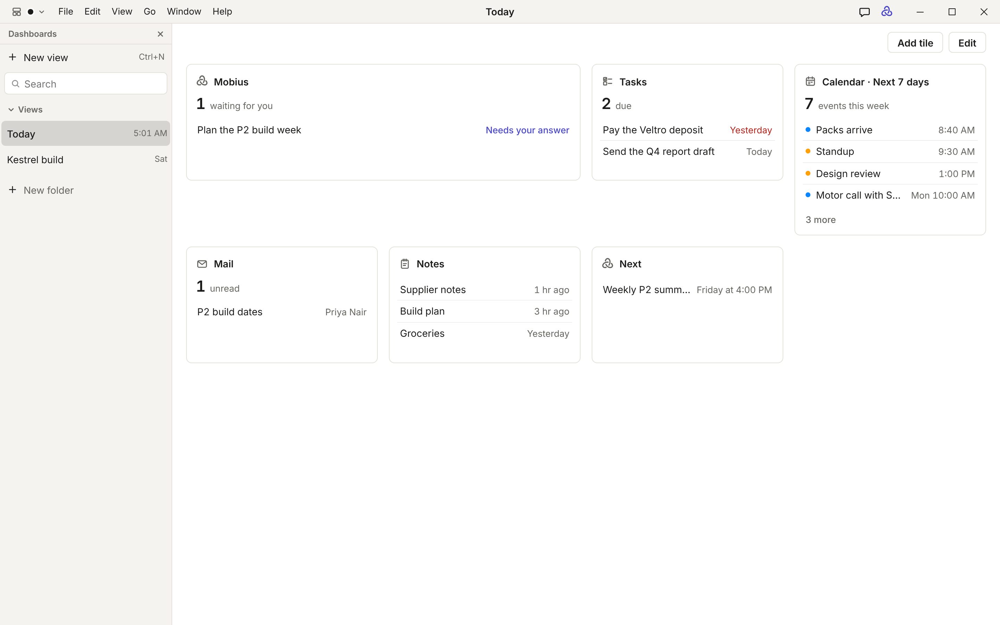

# Review

The Review app is now **Changes**, in Home beside Agents and Activity: see [Changes](assistant.md#changes).

## Views

Dashboards of live tiles from your other apps.

- **A view** is a grid of tiles. Each tile shows something live from one app: **Mobius** (what waits for you and what
  is working), **Tasks** (due today, scheduled, flagged or all), **Calendar** (the rest of today, or the next seven
  days), **Mail** (unread in the inbox), **Notes** (the newest, or one notebook's) and **Next** (schedules that run
  next). Click a row to open it in its app.
- **Add tile** adds one at the end. A tile's **…** menu (or a right-click) makes it wide or small, changes what it
  shows, moves it, or removes it. **Edit** shows a remove button on every tile and lets you drag tiles into a new order;
  **Alt+←/→** moves the focused tile. Removing a tile can be undone.
- **Keys on a tile:** Enter opens its app, Delete removes it, and Shift+F10 opens its menu.
- **A new view** starts with the usual tiles. Views are kept in folders in the Dashboards panel, like notes.

Views only point at things: the tasks, events, mail and notes stay in their own apps, and a view never changes them.
Each view is a JSON file in `views/<folder>/<view>.json`, so Mobius can make one ("Make a view for the Kestrel build")
or add tiles to the open one. Its changes show dashed, to keep or discard.

## Comments

Comment on anything in Mobius, as you would in a design tool.

1. Press **C**, choose **View › Comments**, or click the speech-bubble button in the toolbar to turn on comment mode. A dashed ring follows the pointer.
2. Click a thing (a cell, a mail message, a note's paragraph, a layer) to drop a pin and start a thread beside it.
3. Choose what the thread is for:
   - **Send to Mobius.** Its reply comes back into the thread, and keeping the change it made resolves the thread.
   - **Keep as a note for people.** Mobius does not read these.
   - **Delete.**

The Comments icon shows how many threads are open in the app, and the **Comments** panel lists them. Threads
are kept per document in a `.comments` folder in the workspace.
