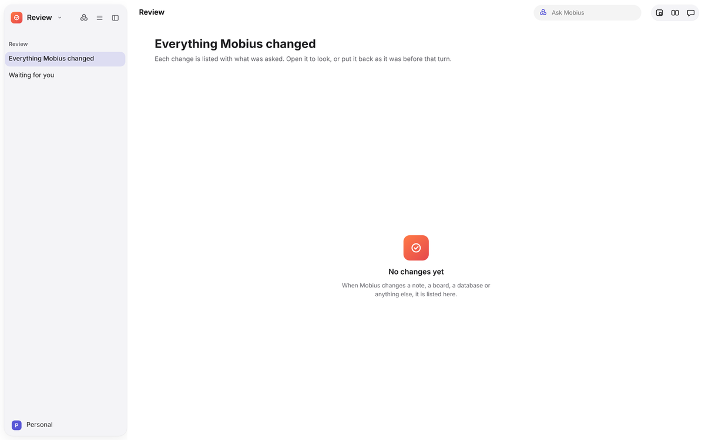

# Review

## Review

Everything Mobius changed, from every conversation, in one place.

- **The sidebar** filters to everything, what still waits for you, or one app's changes, with counts.
- **The list** groups changes by day. Each turn shows what you asked, and each file it changed opens in its app or can be
  put back from here.

Review is the place to check what Mobius did while you were away. Changes themselves are kept or discarded in their
apps; see [Keep, Discard, Try another](../guide/working-with-mobius.md#keep-discard-try-another).

## Comments

Comment on anything in Mobius, as you would in a design tool.

1. Press **C**, or the speech-bubble button in the toolbar, to turn on comment mode. A dashed ring follows the pointer.
2. Click a thing (a cell, a mail message, a note's paragraph, a layer) to drop a pin and start a thread beside it.
3. Choose what the thread is for:
   - **Send to Mobius.** Its reply comes back into the thread, and keeping the change it made resolves the thread.
   - **Keep as a note for people.** Mobius does not read these.
   - **Delete.**

The comment button shows how many threads are open in the app, and the sidebar lists them under **Comments**. Threads
are kept per document in a `.comments` folder in the workspace.
