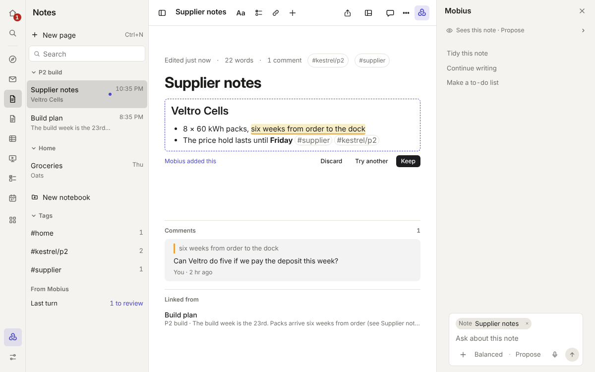
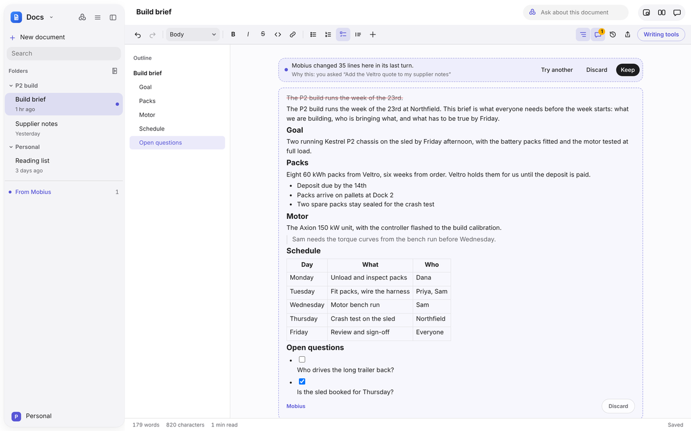
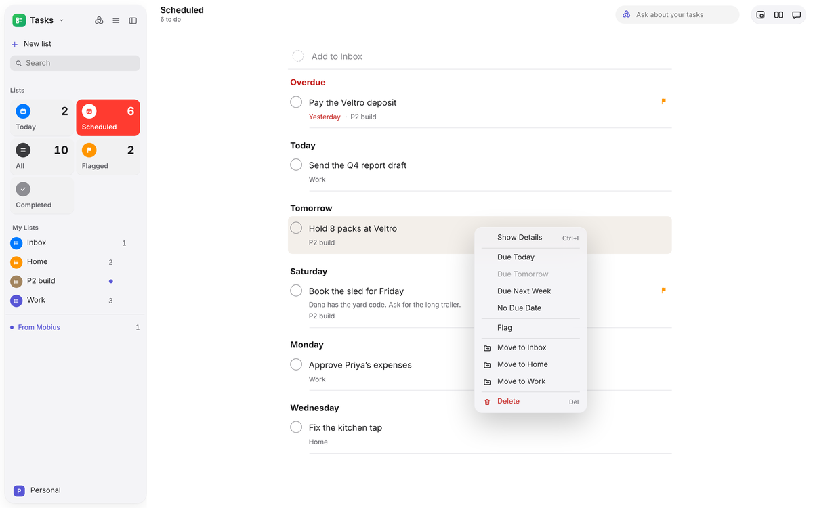
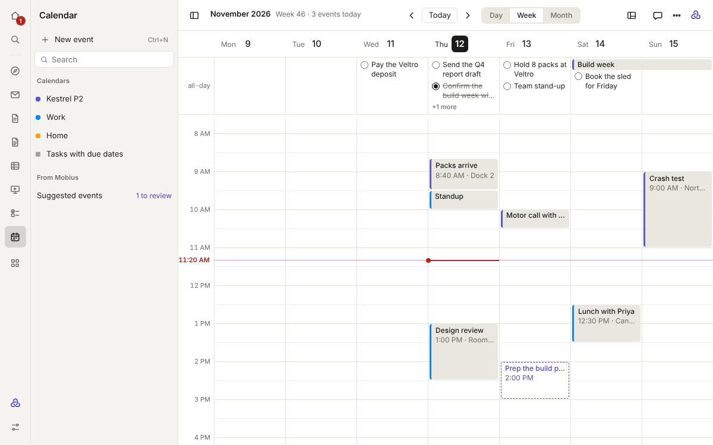
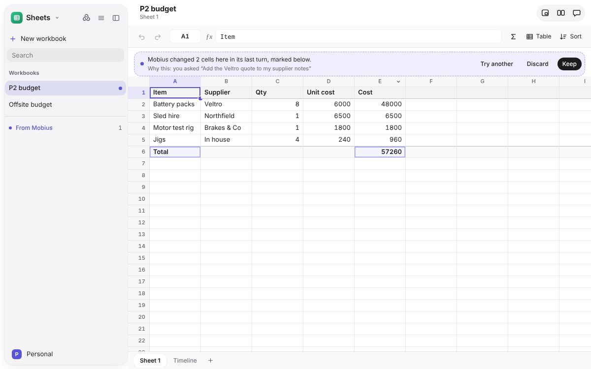
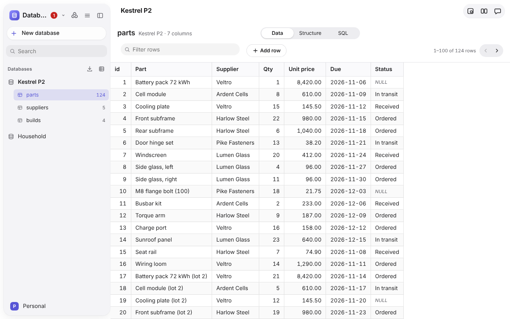
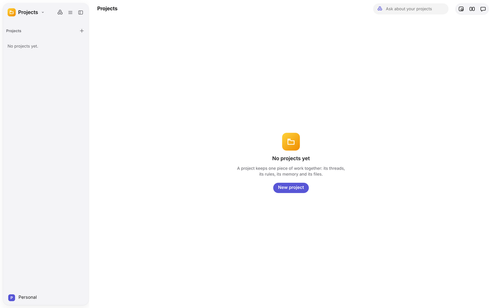
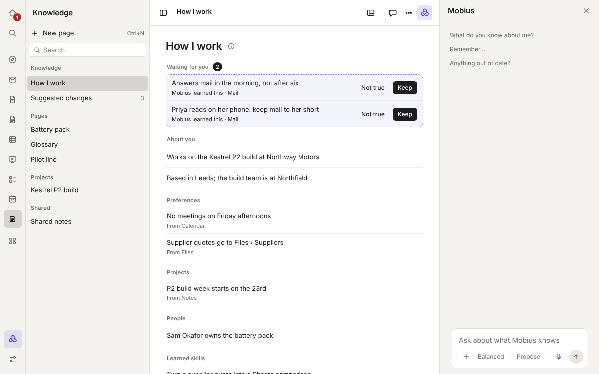

# Write and plan

## Notes

Quick pages, saved as you type.

- **Notebooks** in the sidebar, newest pages first, with search, **Pinned** pages at the top and a **Tags** section
  built from every `#tag` you write.
- **Formatted as you write**: headings, lists, checklists you tick, tables, pictures, links between notes, and
  recordings (up to ten minutes). The **Markdown** button shows the file itself.
- **History** lists earlier versions by day, compares one with the page now, and **Restore** puts it back (and can be
  undone the same way).
- **Share** copies the page, exports it as a web page or Markdown, or prints it.
- Select text for Mobius's actions right where it is. A page Mobius changed shows its edits to keep or discard, line by
  line if you like, and is never overwritten while you type.

**Kept in:** `workspace/notes/<notebook>/`, each page a Markdown file that opens in any editor.

## Docs

Longer documents, with an outline and comments.

- **A page to write on**: headings, lists, checklists, tables, pictures and links to other documents, kept as Markdown.
- **The outline** of headings sits beside the page; hide it if you prefer.
- **Comments** in the margin. **Ask Mobius** on a comment and its answer comes back in the thread; open comments are
  sent along with the document when you ask Mobius about it.
- **Mobius's writing tools** work on the selection or the whole document. What Mobius changes comes back as
  proposals, old text struck and new text marked, each with its own Discard.
- **History** puts an earlier version back. **Share** copies, exports as a web page or Markdown, or prints and saves as
  PDF.

**Kept in:** `workspace/docs/`, each document a Markdown file.

## Tasks

Lists of things to do, as in Apple's Reminders.

- **Smart lists**: Today, Scheduled, All, Flagged and Completed, then your own lists with how many are open.
  **Scheduled** sorts tasks under day headings: Overdue, Today, Tomorrow, each day of the coming week, then by month.
- **Right-click a task** to show its details, set it due today, tomorrow or next week, flag it, move it to another
  list or delete it.
- **Keyboard**: the up and down arrows move between tasks (down from the add field reaches the first one), Space ticks
  the selected task, Enter renames it, Ctrl+I (⌘I on a Mac) shows its details and Delete deletes it.
- **Completing a task** fills its check and leaves the row for a moment, so a second click takes it back.
- **The inspector** beside the list holds a task's notes, when it is due (today, tomorrow, next Monday or any date), its
  flag, its list and its subtasks. Drag tasks to reorder them or move them between lists.
- Tasks Mobius added are dashed until kept. **Discard** puts the list back as it was before that turn.

**Kept in:** `workspace/tasks/`, each list a Markdown file of checkbox lines.

## Calendar

Your calendars by day, week or month.

- **Calendars it works with**: its own (`.ics` files in the workspace), subscribed links (`webcal://` or `https://…ics`,
  read only), and CalDAV accounts with an app password, such as iCloud, Fastmail and Nextcloud. Google and Outlook can
  be subscribed to through their private iCal address; signing in to them directly needs app registrations (see
  [calendar sign-in](../reference/calendar-sign-in.md)).
- **Make an event** by sweeping across the hours, or with New event. Drag an event to move it, in any view.
- **Suggestions from Mobius** are drawn dashed. Open one to see why, then **Keep** (add it), **Discard** (decline it) or
  **Try another**.

**Kept in:** `workspace/calendar/`, as `.ics` files that other calendar apps can open.

## Sheets

Spreadsheets with formulas.

- Type in the cell or the formula bar. Formulas such as `=SUM(B2:B4)`, `=D2/People!B1` and `=IF(A1>0,"yes","no")` work
  across sheets, with a hint for the function you are in.
- Columns size themselves to fit, and a first row of words over numbers reads as a header.
- Sheets are tabs below the grid. Insert and remove rows and columns; Ctrl+Z undoes any step.

**Kept in:** `workspace/sheets/`, each workbook a folder and each sheet a CSV file that any spreadsheet app can open.

## Database

SQLite databases to query with SQL. Make one, or import one, then run any statement and see the result as a table.

Mobius reads databases through a read-only connection, so a query it writes cannot change anything. Changing data is a
separate tool that asks like any change, and **Keep** or **Discard** applies to the whole file.

**Kept in:** `workspace/databases/`, as SQLite files.

## Projects

A place for one piece of work.

- **Rules**: how much Mobius may do in each app inside the project (Ask first, Propose or Act). Paying, sending,
  deleting and running commands always ask, whatever a project says.
- **Threads**: the project's conversations. Move an existing conversation in and the project's rules apply to it.
- **Memory**: the project's page in [Knowledge](#knowledge). What Mobius proposes in its threads waits dashed until
  kept.
- **Files**: the project's folder in Files, and a list of what its threads made or changed, newest first.
- **Ask a bot** sends one of your [Agents](assistant.md#agents) off to do something on the side.

The page opens with one line about the project (its threads, what they made, what waits on you and when it last
moved), **New thread**, and **More** (⋯): Rename, Show the folder in Files, Open memory in Knowledge and Delete
project. Right-click a project in the sidebar for the same Rename and Delete. Each part is a grouped list: a thread
shows how many messages it has and when it last moved, and something made shows its app's icon.

Renaming a project renames its folder and its memory page too. Deleting a project asks first, and keeps its threads,
its folder and its memory page: only the project and its rules go. **Rules** lists the apps you have added from
Abilities, plus any other app that already has a rule of its own.

## Knowledge

What Mobius knows: your private **How I work** page and shared pages such as each project's memory. See
[Memory and Knowledge](../guide/memory-and-knowledge.md).

