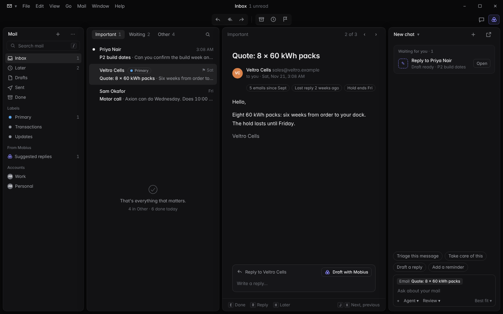
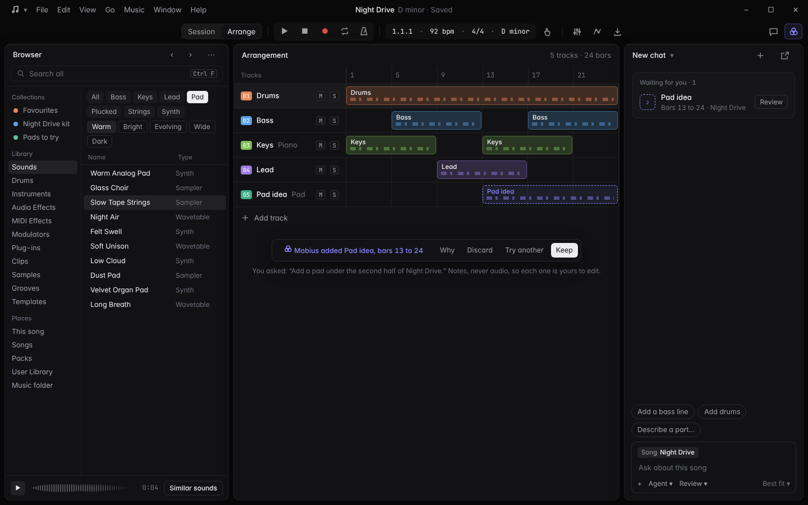
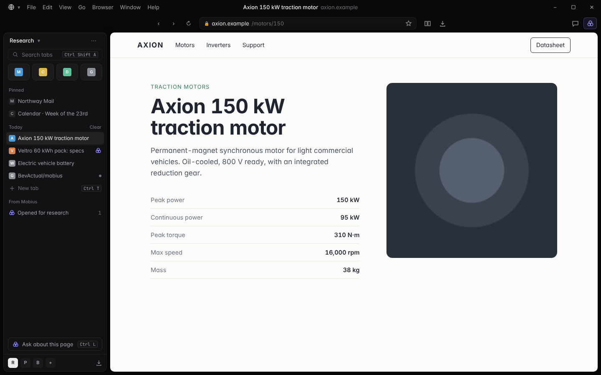
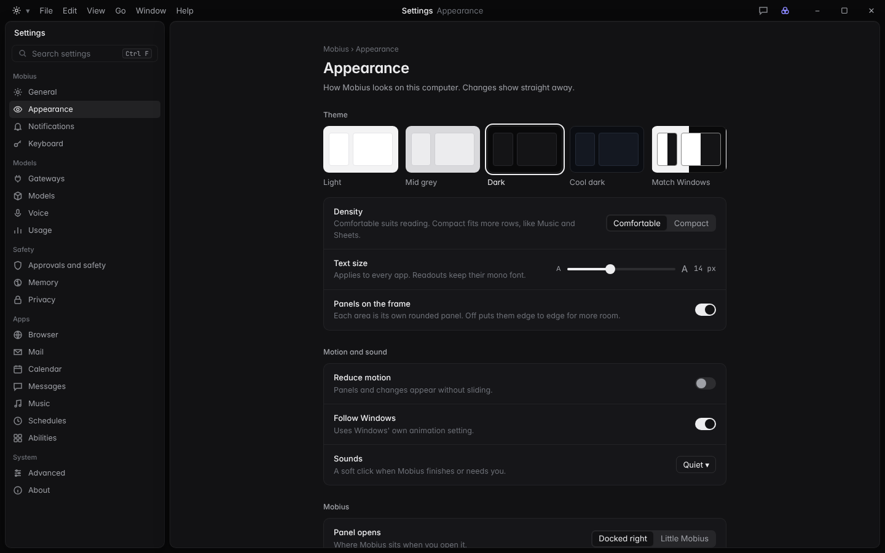
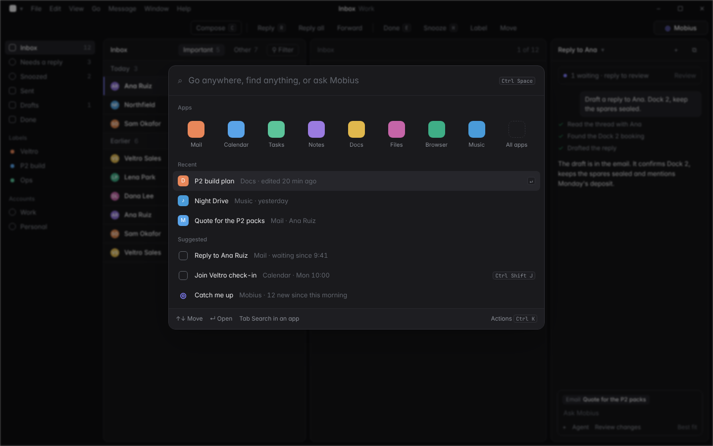

# The panel look

Andrew agreed this look on 22 November 2026 ("yea i think this all works"), after a round on the Design lead's
canvas. It keeps Instrument's sizes, type and rules, and changes how the window is put together: every area is a
calm, rounded panel on a darker frame, in the spirit of Linear, with Ableton's top bar and browser where the work
needs them. Where this page and [rules](rules.md) or [Instrument](../design/instrument.md) disagree, this page wins.

The mocks are in `panel-look/` (source `refined2.html` and `refined2.css`, open with `?s=mail|music|browser|settings`
and `&t=dark|light`). They use the real apps' content as it is on main, so every feature shown exists or is listed
under "New in the apps" below.

## The frame

- **Panels on a frame.** The window background is the frame. Each area (an app's list, its content, the Mobius panel)
  is its own panel with rounded corners, a hairline edge and an 8 px gap around it. Panels hold the content; nothing
  sits loose on the frame. Settings › Appearance has "Panels on the frame" to turn the gaps off for more room.
- **Two top rows, as today.** The title row holds the Go icon, the menus, the open file's name in the centre and the
  window buttons. The tool row holds the app's tools, **centred**. An app with no tools (Settings) has only the title
  row.
- **No command bar on screen.** Ctrl K (and the Go icon) open the command window; nothing waits in the top bar for it.
- **Mobius is an icon** at the right end of the tool row (the title row when there is none), lightly tinted indigo,
  with a **Comments** icon right beside it. Their names and keys are in the tooltips.
- **Icons for familiar actions, words for modes and values.** Reply, Done, Later, Loop, Mixer, Automation, Export,
  Reader and Downloads are icons with a tooltip that names the key ("Automation (A)"). Session/Arrange, Important/
  Waiting/Other and readouts such as `1.1.1 · 92 bpm · 4/4 · D minor` stay in words. Related icons sit in a small
  group.

## Colour and surfaces

- **Indigo means Mobius, only.** Selection, unread dots, switches, segmented controls and focus use ink and grey.
  Indigo appears on the Mobius icon, on what Mobius made (dashed until kept), and on From Mobius rows.
- **Dark.** Near-black frame, panels one step above it, edges as faint white lines (6 to 10 % white) with a soft
  shadow and a thin top highlight. No solid grey borders. Text in three steps: ink, secondary, faint.
- **Light** keeps the same structure: a light grey frame and white panels.

## Inside panels

- Each panel has a short header (40 px): its name on the left, its few tools on the right. No line under it.
- List rows float: no lines between them, a selected row is a rounded grey fill. Side lists use 28 px rows with
  outline icons.
- A short list ends with a quiet note ("That's everything that matters", with counts), not an empty panel.
- Reading and settings pages are one centred column (about 600 px for reading, 720 px for settings), with grouped
  rows: name, one line of explanation, the control on the right.

## Naming panels

Andrew, 24 November 2026: no panel is called a sidebar; each is named for what it holds, the same way in every app
and in Mobius itself.

- **A panel's name is what it holds, as a plural noun or a place**: Mailboxes, Notebooks, Layers, Mixer. Never
  "Sidebar", "Panel", "Pane" or "List" on its own, and never the app's name (the frame already says which app).
- **One name everywhere**: the panel's header, its Hide button ("Hide Mailboxes"), the View menu, the Panels button on
  macOS, the guide and tooltips all use the same word.
- **The View menu ends with the panels by name**, each with a tick that shows whether it is on screen now, read from
  the panel itself, never from a saved setting. There is no generic "Sidebar" or "Agent panel" item above them.
- **A panel that can't be hidden** (Settings' Sections) is not in the View menu at all, so it can't show a tick that
  does nothing.
- **Mobius is "Mobius"** in menus and tooltips, and "the Mobius panel" in Settings and the guide. Not "agent panel"
  or "chat panel". Its two modes are Docked and Floating.
- Code may keep "side" or "sidebar" in names of files, classes and settings keys; the rule is for words people read.

| App | Left | Right | Bottom |
| --- | --- | --- | --- |
| Home | Chats (Agents, Filter in those views) | Mobius | |
| Mail | Mailboxes | Mobius | |
| Messages | Conversations | Thread, Person, Mobius | |
| Calendar | Calendars | Mobius | |
| Tasks | Lists | Details, Mobius | |
| Notes | Notebooks | Mobius | |
| Docs | Documents | Mobius | |
| Files | Places | Mobius | |
| Browser | Tabs | Mobius | |
| Reader | Library | Mobius | |
| Research | Reports | Sources, Mobius | |
| Knowledge | Knowledge | Mobius | |
| Projects | Projects | Mobius | |
| Views | Dashboards | Mobius | |
| Review | Changes | Mobius | |
| Store | Store | Mobius | |
| Sheets | Sheets | Mobius | |
| Database | Tables | Record, Mobius | Query |
| Code | Explorer | Outline, Mobius | Tests, Console |
| Terminal | Sessions | Mobius | |
| Canvas | Boards | Mobius | |
| Design | Designs, Layers, Assets | Inspector, Mobius | |
| Slides | Decks | Mobius | Presenter notes |
| Photo | Albums | Mobius | Filmstrip |
| Music | Songs, Browser (Live's name) | Mobius | Mixer |
| Video | Videos | Mobius | Timeline |
| Search | Scopes | Mobius | |
| Settings | Sections (always shown) | | |

## Mobius

- **The panel starts closed in every app** (Andrew, 24 November 2026: "the mobius pannel should default to staying
  closed"). The Mobius icon at the end of the tool row, its key (Ctrl Shift M) or a Mobius action in the app opens it,
  docked right. Home and the Agent app are Mobius at full size and need no panel.
- Once open, it shows **Waiting for you** as real objects (the Pad idea, the reply to Priya) with Open or Review, then
  the ideas as chips above the composer. Opened, it is never an empty column.
- A change Mobius made stays dashed where it happens, with one floating **Why · Discard · Try another · Keep** bar near
  it and the request in one line under it. No banners across the top.
- Browser has "Ask about this page (Ctrl L)" at the foot of its Tabs panel; nothing floats over the web page.

## The apps

| App | Shape |
| --- | --- |
| Mail | Mailboxes panel (search, Inbox, Later, Drafts, Sent, Done, Labels, From Mobius, Accounts) · list with split tabs Important, Waiting, Other · centred reading column with a facts row under the sender and the reply box inside the message ("Draft with Mobius" in it) · keys bar at the foot |
| Music | Browser panel after Live 12's browser ([manual](https://www.ableton.com/en/live-manual/12/working-with-the-browser/)): search, Collections, Library categories, Places (This song, Songs, Packs, User Library, folders), tag filters by sound type and character, name and type list, preview strip with Similar sounds · Arrangement panel · tool row: Session/Arrange, transport group, one mono readout, icons for loop, metronome, tap, mixer, automation, export |
| Browser | Tabs panel after Arc: spaces switched at its foot, favourites as tiles, Pinned, Today with Clear, From Mobius, Ask about this page · the page fills its panel · address bar in the middle of the tool row |
| Settings | Sections panel with search and icons · centred page with grouped rows |

## Command window

Ctrl Space anywhere on the PC, Ctrl K inside Mobius: one centred window. Opened empty it shows app tiles, Recent and
Suggested; typing a command turns it into fields (Tab moves between them) with a quick answer, matches from every app,
and a dashed "Ask Mobius" row that answers in place (Ctrl Enter). See [launcher](../design/launcher.md).

## New in the apps

Not just restyling; each is app work: Music's browser (tags, preview, Similar sounds), Mail's split tabs, built-in
reply box and facts row, Browser's spaces and favourite tiles, the Mobius panel's Waiting for you objects, and the
"Panels on the frame" setting.

## Order

1. Builder: the shared frame (panels on the frame, centred tool row, Mobius and Comments icons, dark surfaces, the
   indigo-only rule in tokens). Every app gets the look at once.
2. Apps lead, one PR per app: Mail, then Music's browser (with the parity work), Browser, Settings, then the rest in
   the same style. Design lead reviews each against this page.
