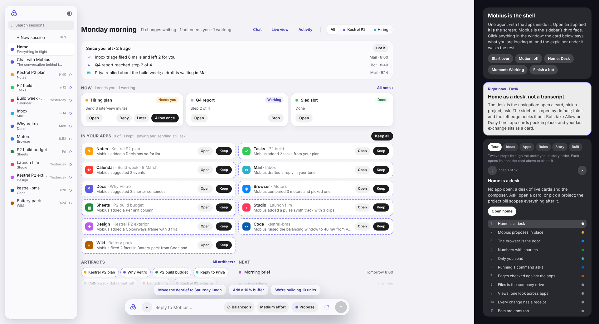

# The Mobius canvas, v172

> Copied from the claude.ai design canvas "Mobius" on 14 November 2026, when the project moved to the repo. The canvas was
> the design prototype of the shell and every app. It led the code until 10 November, then paused at v172 as a reference.
> Since then the app has led, and the style it used (an Apple, HIG-inspired look) has been replaced by
> [Instrument](../instrument.md). Don't work from it.

The prototype tells the Kestrel P2 story at Northway Motors. Home is a desk of live cards and the composer; the explainer on
the right walks through twelve steps (Tour, Ideas, Apps, Rules, Story, Built). Its note on the canvas read: "Click around,
change the mode, change Units, open Files, Design, Code and Wiki, try the Browser's command bar and split view, and use the
explainer on the right."

## Files

| File | What it is |
| --- | --- |
| [`Shell.dc.html`](Shell.dc.html) | The prototype source, one interactive board of 1920×1040 |
| [`canvas.json`](canvas.json) | The canvas layout: the board's position and the title note |
| [`home.png`](home.png) | A screenshot of the board's opening state |

`Shell.dc.html` loads `./support.js`, the design canvas runtime. That runtime belongs to the canvas tool, not to Mobius, so
it is not in the repo. Without it the file shows its template placeholders (`{{...}}`); the screenshot shows how it looked.
