# Mobius design gaps, 13 November 2026

> Copied from the claude.ai page "Mobius Design Gaps" on 14 November 2026, when the project moved to the repo. It is a
> record of the review that drove the frame and app redesigns on 13 November. Since then every app has passed its
> Instrument round, so don't work from it: the source of truth is [Instrument](../instrument.md) and the
> [design rules](../rules.md).

I compared main (13 November, after the flat frame, themes and panels stage 1) with the adopted mocks. I checked the daily
apps in Light, Mid grey, Dark and Cool dark. In every picture the mock is on the left and main is on the right. The plan was
to redesign one app at a time until each one passes its "done" bar. The shared frame comes first, because every app sits
inside it.

## Update: where it stood at 08:15 (main at 0490a52)

All seven frame gaps below were fixed on main: the plain Mobius panel, line icons, the one-row toolbar, the app-switch bug,
the dashed change block in Docs, the rail and sidebar, and Mid grey. **Mail was signed off.** It matched both mocks zone by
zone.

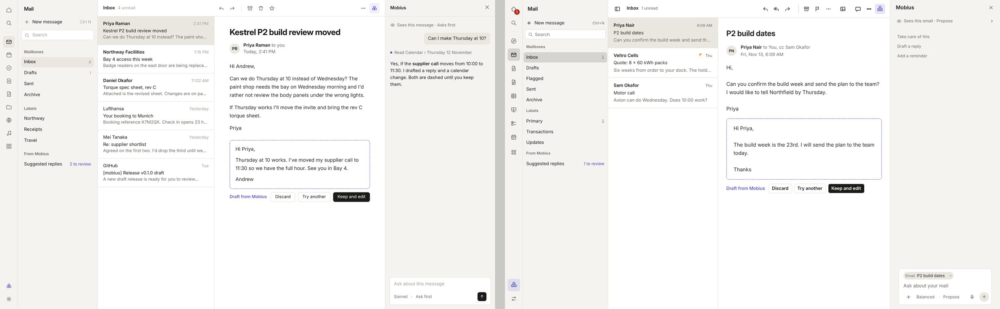

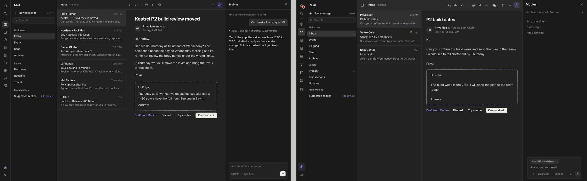

Still open at that point:

- **Calendar (next):** the mini-month, the crowded all-day row, the extra + button, and loud event fills.
- **Frame:** Tasks and Notes still showed the "Mobius changed" banner (only Docs had moved to the block). Files lit both its
  own icon and All apps. In Settings, Mobius still suggested Mail's "What needs me? · Summarise my inbox".
- **Docs:** the page was still a card on grey.
- **Settings:** each page still had a large centred icon and title.
- **Tasks:** "Clear 2 completed" was a bordered button in the toolbar.

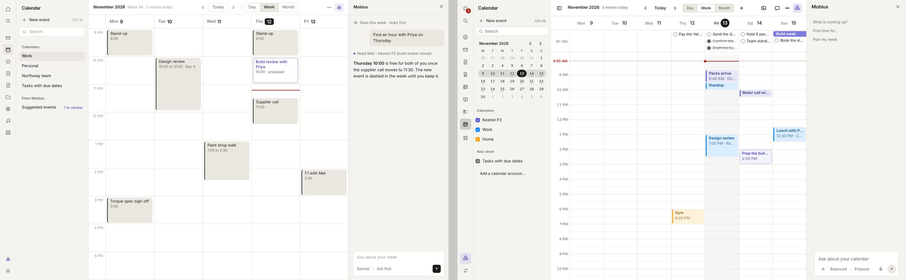

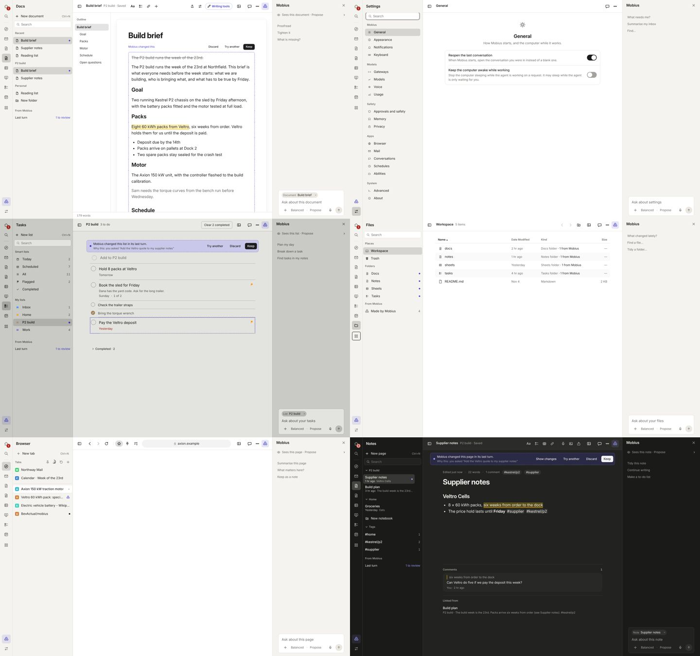

The original review from 06:45 follows.

## Order

1. **Shared frame (Builder).** The rail, the toolbar, the Mobius panel, line icons and the change banner. These are fixed
   once and every app gets them for free.
2. **Mail, first app.** It has a full mock in light and dark, it is the start of the launch demo, and it uses every zone,
   so it proves the frame.
3. **Calendar**, then **Docs**. Both have mocks.
4. **Tasks, Notes, Files, Settings, Home.** These have no mock of their own, so each follows Mail's pattern.
5. The other apps, in the existing round order.

## 1. Mobius panel carries too much chrome (shared frame)

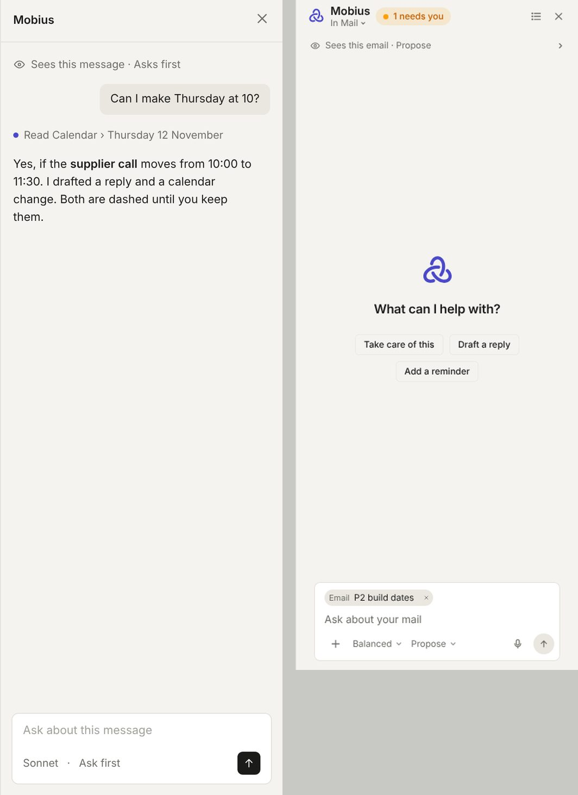

- The header should be the word "Mobius" and a close button. Main had the logo, "In Mail ⌄", an orange "1 needs you" pill
  and a list icon.
- Main showed a large centred logo with "What can I help with?" and suggestion chips. The mock has a plain context line
  ("Sees this message · Asks first") and then the conversation.
- The composer in the mock reads "Sonnet · Ask first". Main had + Balanced ⌄ Propose ⌄, a microphone and a context chip.
- Main's panel was about 380px wide. The mock's is about 320px, so the content gets the room.

## 2. App icons are coloured tiles, not line icons (shared frame)

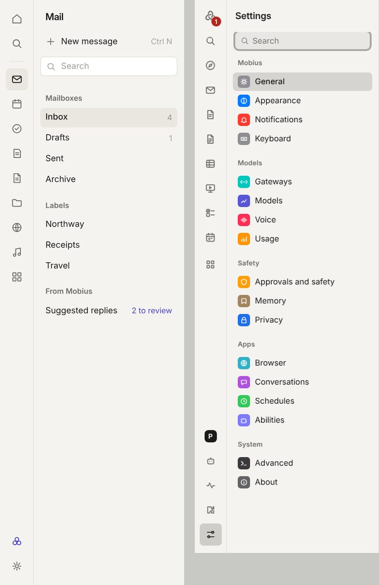

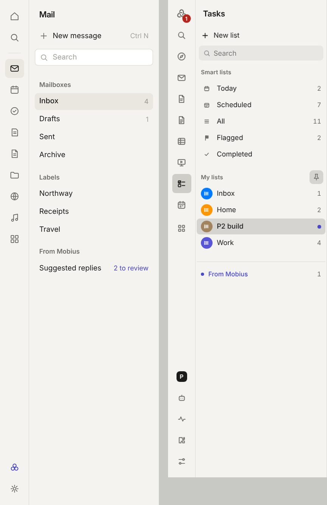

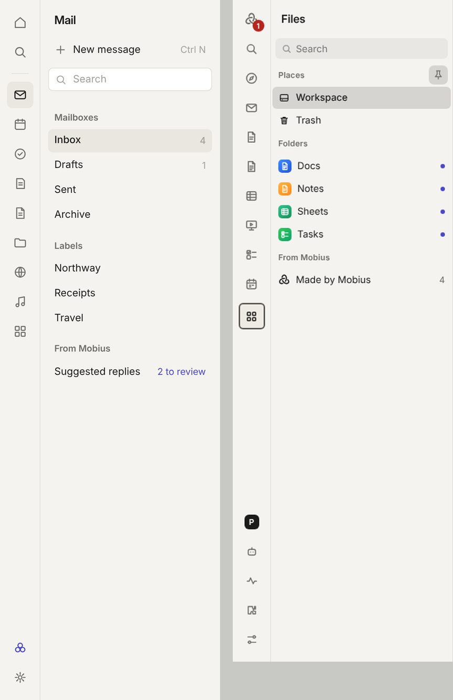

Colourful app tiles showed up in Settings, Tasks lists, Files folders, Home's "In your apps", the launcher and Mail's empty
state. Together they were the biggest reason main didn't look like the mocks. The mock's frame is neutral: sidebar rows are
plain text, the rail uses line icons, and colour is used only for the person's own content and for indigo Mobius.

## 3. Toolbar: the title takes two lines and controls sit in capsules (shared frame)

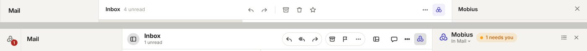

- The title should sit on one line with the grey line beside it ("Inbox  4 unread"). Main stacked the two.
- App controls should be bare icons with a hairline between groups. Main wrapped them in outlined capsules.
- The sidebar toggle sat in a filled grey circle. The Panels icon added one more button. The mock shows only ⋯ and Mobius at
  the trailing end, plus Comments by our rule.
- Segmented controls should mark the chosen segment with a light fill, as Calendar's Week does in the mock. Main filled it
  black.

## 4. Bug: the toolbar and Mobius keep the last app's state (shared frame)

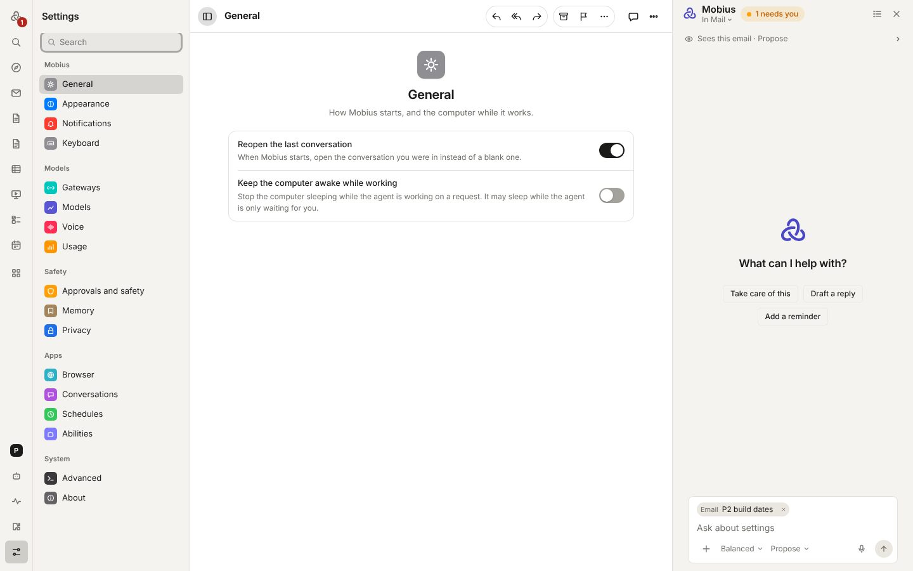

I opened an email and then went to Settings. Settings still showed Mail's Reply, Reply all, Forward, Archive and Flag.
Mobius still said "In Mail · Sees this email" with an Email chip. The state was the same after 4 seconds.

## 5. Rail and sidebar pieces (shared frame)

- **Rail.** The mock has Home, Search, a hairline, the apps, and Mobius and Settings at the foot. Main had the Mobius logo
  with a red badge at the top and no Home icon. Its foot held five items: a "P" profile block, Agents, Activity, Abilities
  and Settings. Apps opened from the launcher, such as Files, lit up the grid icon instead of their own.
- **Section headers.** Main put pin, refresh and + buttons in the headers. The mock has quiet headings only.
- **Search field.** The mock has a white field with a hairline. Main had a filled grey field.
- **New button.** The mock shows the shortcut ("Ctrl N") beside New. Main didn't.
- **From Mobius.** The mock has a heading and a row such as "Suggested replies · 2 to review". Main showed a blue link with
  a dot.

## 6. Mobius changes: a banner and purple tints instead of the dashed block (shared frame)

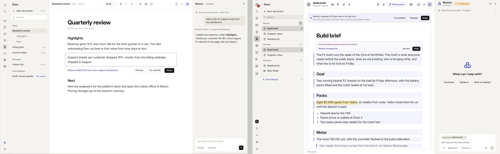

The mock shows a proposal once, where it happens: a dashed indigo outline with "Discard · Try another · Keep" underneath.
Main added a full-width "Mobius changed 35 lines" banner over Docs, Notes and Tasks. In Docs it also tinted every changed
paragraph and added a left bar. Docs also drew the page as a bordered card on grey, while the mock puts the page straight on
the content.

## 7. Mid grey loses the three surfaces (themes)

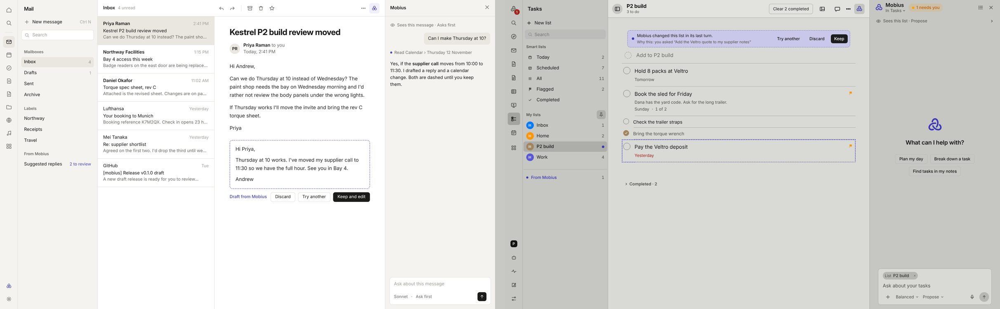

In Mid grey, the content was the same grey as the sidebar, so the frame read as one flat slab. The indigo banner was also
much stronger there. Dark and Cool dark held up well: the dark Mail pair below was the closest match of any theme.

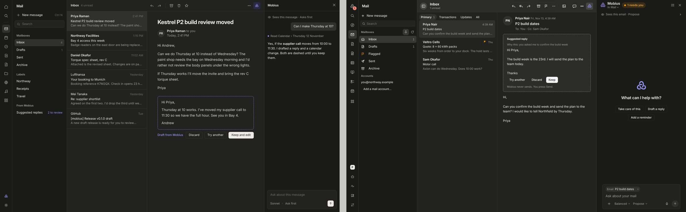

## Mail

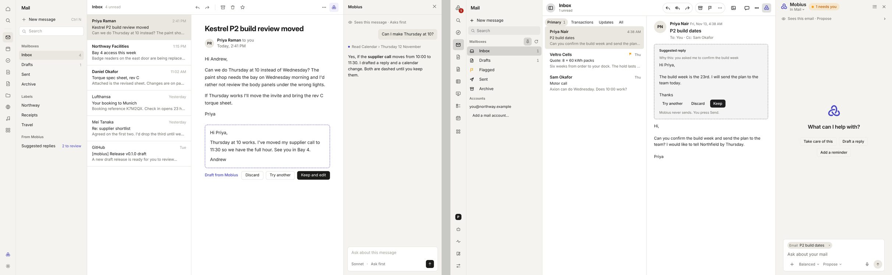

- Main had a second row inside the content (Primary, Transactions, Updates, All). The mock has none. Move these filters to
  the sidebar or a toolbar menu.
- Sidebar rows had icons and an orange flag. "Accounts", the email address and "Add a mail account…" belong in Settings.
  The mock has Mailboxes, Labels and From Mobius as plain text.
- The message list should have hairlines between rows, a bold sender, then the subject and preview.
- The message view should have a large subject heading, then the sender row. The suggested reply should sit under the
  message as the dashed block, not above it.
- The empty state used a glossy blue mail tile. Use a line icon, or open the newest message.

**Done when** Mail in Light and Dark at 1440×900 matches the two mocks zone by zone: the same sidebar sections, one toolbar
row, a list with hairlines, the message as the mock lays it out, the reply as one dashed block, and no coloured icons.

## Calendar

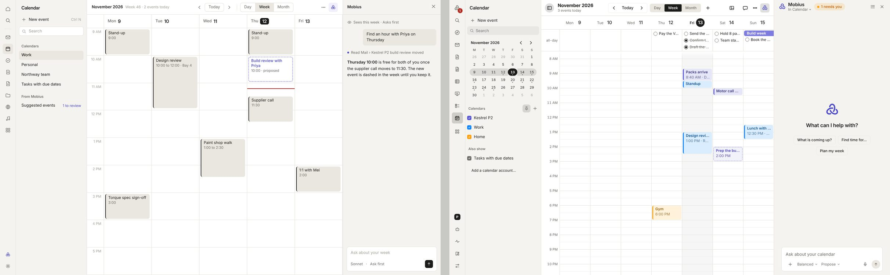

- The sidebar mini-month isn't in the mock. Calendars should be plain rows, with "From Mobius · Suggested events" below
  them.
- The all-day row was crowded with cut-off tasks ("Send the …").
- Week showed as a black segment and there was an extra + button. The mock has Today in a quiet button and Day, Week and
  Month in a light segmented control.
- Events: the mock uses one neutral fill with a dark edge, dashed indigo for proposals, and a red now-line. Main used
  calendar colours. That's allowed as the person's content, but the fills were loud.

**Done when** the week view matches the mock: a quiet header, no mini-month, readable all-day items, muted event fills, and
proposals dashed in indigo.

## Docs

See gap 6. The page should sit straight on the content with no card, the change banner and tints should go, and there
should be one dashed proposal block. The toolbar should hold Body ⌄, B, I, U, lists, table, link, then Share, ⋯ and Mobius.
"Writing tools" should move into ⋯ or Mobius.

**Done when** Docs matches the Docs mock, including the Outline tab beside Mobius in the right panel.

## Tasks, Notes, Files, Settings, Home (no mock of their own)

- **Tasks:** coloured list icons, the change banner, and "Clear 2 completed" as a bordered button in the toolbar. Clear
  completed belongs in ⋯.
- **Notes:** the change banner, and eight toolbar icons. Keep Aa, list, link and insert. Dictate, image, table and share go
  to ⋯.
- **Files:** coloured folder icons in the sidebar and the list.
- **Settings:** coloured icon tiles on every row, and each page repeated its name as a large centred icon and title under
  the toolbar.
- **Home:** coloured app tiles in "In your apps". Each conversation also sat in its own bordered card.

**Done when** a screenshot laid next to Mail looks like the same product: the same sidebar, toolbar and panel, line icons,
and no banners.
