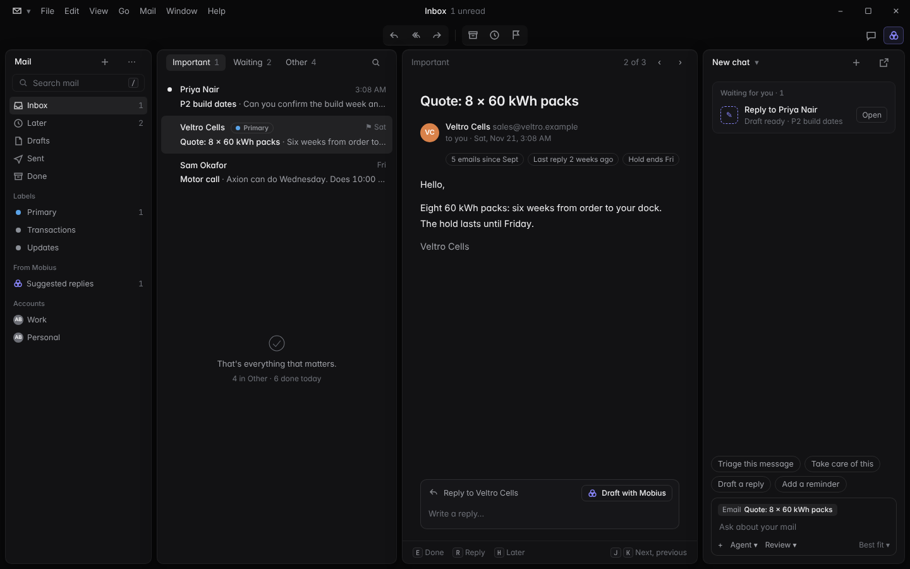

# The Mobius design guide

This is the one design guide for Mobius. Every app follows it, so the apps feel like one product: calm, precise and
labelled, with colour only from your own work and from Mobius, in the spirit of Linear and as if Apple had built it.

On 24 November 2026 it replaced five pages that overrode one another: Design rules, the panel look, Theme tokens,
Panel layouts and Workspace layout. Their text is kept in [the archive](../archive/) for history. Nothing else
overrides this page. [Instrument](instrument.md) stays as the detailed reference for the Mobius panel, its composer,
cards and pop-out; where it and this page differ, this page is right and Instrument gets fixed.

Values live in `apps/desktop/src/tokens.css` and the frame's styles; this page names them and says when to use them.
Never hand-set a colour or a size in an app.

Before you open a pull request for an app, check its screenshots against this page in light and dark, at full width
and in a narrow window. When a design pull request changes an app's look, it updates [Where the style stands](#where-the-style-stands)
in the same pull request.

## Principles

Eight principles, in priority order. When two pull against each other, the higher one wins. Each has a test a
reviewer can apply to a screenshot.

| # | Principle | What it means in Mobius | The test |
| --- | --- | --- | --- |
| 1 | **The work comes first.** | Controls sit around the content and stay quiet. One tool row. Calm panels. No help text in the frame. | Squint. Is the content the first thing you see? |
| 2 | **Same place in every app.** | The Go icon, the menus, the title, Comments and the Mobius icon never move. | Flip between two apps. Does anything in the frame jump? |
| 3 | **One obvious way.** | Each action has one home. Mobius has one icon. No second tool row, no duplicate New. | Can you find two controls that do the same thing? |
| 4 | **Familiar first. Spend the novelty on Mobius.** | Each app works the way its best rival does: Mail like Superhuman, Music like Ableton Live, Browser like Arc. New ideas go into what only Mobius does. | Could a user of the rival work here in the first minute? |
| 5 | **The app shapes the tools. The frame holds.** | Apps differ in their tools, panels and views. Nothing else. | Is the difference inside a panel, or did the app redraw the frame? |
| 6 | **Mobius is beside you, never in the way.** | Three sizes only: full (Home and the Agent app), beside (the Mobius panel, closed until asked for) and in place (verbs on a selection). Every app works fully with Mobius closed. | With Mobius open, can you still see and use everything you could before? |
| 7 | **You are the pilot.** | What Mobius is doing is always visible. What it changed is dashed until you Keep it. Why is one click away. Undo always works. | Can you tell what Mobius did, why, and how to put it back? |
| 8 | **Plain and honest.** | The interface shows what is really there, drawn as simply as it can be. Nothing is decoration. | Can you remove it without losing meaning? If yes, remove it. |

One working rule follows: **fix it once, in the shell.** A problem seen in three apps is a missing shared piece, not
three app fixes. It goes to the Builder.

## Where the style stands

The panel look (agreed by Andrew on 22 November 2026) is the current style. The shared frame landed in #770, so every
app already sits on the frame as rounded panels. "In the look" below means the app itself was redesigned for it.
Checked 24 November 2026; pull requests not merged yet are marked (open).

| App | In the look | Done in | What's left |
| --- | --- | --- | --- |
| Mobius panel | Yes | #771 | Starts closed in every app (Andrew, 24 November; this pull request) |
| Mail | Yes | #772 | Threads, attachment chips, Done and Later on hover (review B4 to B8) |
| Music | Yes | #782 | Engine parity work, not look |
| Browser | Yes | #783 | Nothing for the look |
| Settings | Yes | #786, #863, #873, #872, #875, #877 | Nothing for the look; the Accounts page and Back and Forward follow [their spec](settings-accounts.md) |
| Calendar | Yes | #798, #800, #862, #901 | Nothing for the look; what is Later is in [its spec](calendar.md) |
| Tasks | Yes | #801 | Part B: When and Deadline, Things-style views |
| Notes | Yes | #804, #862, #881, #884, this pull request | Notebooks, the Trash, Ctrl+O, note links, citations, sorting, version history, templates and meeting notes follow [its spec](notes.md); History as a panel is on hold |
| Docs | Yes | #809, #862, #899 | Nothing for the look; what is Later is in [its spec](docs.md) |
| Files | Yes | #865 | Screens from a PC check |
| Messages | Spec written | [Its spec](messages.md) | The app work |
| Home | No | | Next: its spec is in the Hub's review files |
| Everything else | Frame only | #770 | Each app's own pass, after the seven folded apps move to their new homes |

## The frame

The window background is the **frame**. Each area (an app's panels, its content, the Mobius panel) is its own
rounded panel on it, with a hairline edge and an 8px gap. Nothing sits loose on the frame. Settings › Appearance ›
Panels on the frame turns the gaps off for more room.

```
+------------------------------------------------------------------+
| [icon •] File Edit View Go Mail Window Help   Inbox · 3 unread    |   title row
|                  app tools, centred                  Comments  M  |   tool row
+---------+------------------------------------------+------+--------+
| left    | content (the current view)               | right| Mobius |
| panels  +------------------------------------------+ panel| (when  |
|         | bottom panels                            | s    | opened)|
+---------+------------------------------------------+------+--------+
```

- **Title row:** the Go icon (the open app's icon, a dot while something waits anywhere; it opens the command
  window), the menus (File, Edit, View, Go, the app's own, Window, Help), and what is open, centred, with its grey
  subline. On macOS the menus are in the system menu bar and a Panels button takes their place.
- **Tool row:** only tools, **centred**. At the trailing end: Comments and Share where they apply, ⋯ only when a tool
  did not fit, then the Mobius icon, lightly tinted indigo. An app with no tools (Home, Settings) has only the title
  row, with that trailing end at its right.
- **Content:** the current view. It is the app's.
- **Docks:** left, right of the content, and bottom. They hold the app's panels. A dock with nothing shown takes no
  space. The bottom dock runs under the content only.
- **Mobius:** always the far right edge, docked, and nothing but Mobius. See [Mobius](#mobius).
- **No command bar on screen.** Ctrl K (and the Go icon) open the command window; see [launcher](launcher.md).
- **Icons for familiar actions, words for modes and values.** Reply, Done, Later, Loop, Mixer and Export are icons
  with a tooltip that names the key ("Mixer (Ctrl Alt M)"). Session and Arrange, Important, Waiting and Other, and
  readouts such as `1.1.1 · 92 bpm · 4/4` stay in words.

A badge (a filled count) means "needs you", and only that. A dot means "Mobius changed something here" and has a
tooltip that says so.

### Narrow windows

| Window width | What happens |
| --- | --- |
| 1440px and up | Everything as placed |
| 980 to 1439px | The right dock and Mobius share one column: whichever was brought forward last shows |
| Under 1200px with Mobius open | An app's left panel starts hidden so the page keeps a readable column; Home keeps its Chats |
| 720 to 979px | The left dock becomes an overlay; Mobius slides over the content and closes when the content is clicked |
| Under 720px | One thing at a time: content, or one panel full width |

Folding for width never changes the saved layout.

## Panels

A panel is a named, self-contained piece of an app: a list of places, an outline, an inspector, a timeline. Each can
be shown or hidden (View menu, its key, or Hide in its header), resized (drag its edge; double-click for the default
size), moved to another dock, tabbed with others in a dock, and popped out into its own window.

- **The header** is 40px (34px compact) with no line under it: the panel's name (or its tabs) on the left, its few
  tools and Hide on the right. A panel's own controls go in its body, not the header.
- **Lists inside panels float:** no lines between rows; a selected row is a rounded grey fill.
- **A short list ends with a quiet note** ("That's everything that matters", with counts), not an empty panel.
- **Keys:** Ctrl \\ the left dock, Ctrl Alt \\ the right dock, Ctrl J the bottom dock, Ctrl Shift M Mobius.
- **Layouts** are kept per app. Once a person moves a panel, their layout wins until View › Reset layout.
- An app's inspector-style panels (Inspector, Adjust, Outline, Details) go in its right dock; wide or long ones
  (timelines, filmstrips, mixers, terminals, speaker notes) go in the bottom dock. Never as a column drawn inside the
  content.
- A panel that can't work hidden (Settings' Sections) is fixed: no Hide, and not in the View menu.

### Naming panels

Andrew, 24 November 2026: no panel is called a sidebar; each is named for what it holds, the same way in every app
and in Mobius itself.

- **A panel's name is what it holds, as a plural noun or a place**: Mailboxes, Notebooks, Layers, Mixer. Never
  "Sidebar", "Panel", "Pane" or "List" on its own, and never the app's name (the frame already says which app).
- **One name everywhere**: the panel's header, its Hide button ("Hide Mailboxes"), the View menu, the Panels button on
  macOS, the guide and tooltips all use the same word.
- **The View menu ends with the panels by name**, each with a tick that shows whether it is on screen now, read from
  the panel itself, never from a saved setting. There is no generic "Sidebar" or "Agent panel" item.
- **Mobius is "Mobius"** in menus and tooltips, and "the Mobius panel" in Settings and the guide. Never "agent panel"
  or "chat panel". Its two modes are Docked and Floating.
- Code may keep "side" or "sidebar" in file, class and setting names; the rule is for words people read.

| App | Density | Left | Right | Bottom |
| --- | --- | --- | --- | --- |
| Home | comfortable | Chats (Agents, Filter in those views) | | |
| Mail | comfortable | Mailboxes | | |
| Messages | comfortable | Conversations | Thread, Person | |
| Calendar | comfortable | Calendars | | |
| Tasks | comfortable | Lists | Details | |
| Notes | comfortable | Notebooks | | |
| Docs | comfortable | Documents | Outline, Comments | |
| Files | comfortable | Places | | |
| Browser | comfortable | Tabs | | |
| Reader | comfortable | Library | | |
| Research | comfortable | Reports | Sources | |
| Knowledge | comfortable | Knowledge | | |
| Projects | comfortable | Projects | | |
| Views | comfortable | Dashboards | | |
| Review | comfortable | Changes | | |
| Store | comfortable | Store | | |
| Search | comfortable | Scopes | | |
| Settings | comfortable | Sections (fixed) | | |
| Sheets | compact | Sheets | | |
| Database | compact | Tables | Record | Query |
| Code | compact | Explorer | Outline | Tests, Console |
| Terminal | compact | Sessions | | |
| Canvas | compact | Boards | | |
| Design | compact | Designs, Layers, Assets | Inspector | |
| Slides | comfortable | Decks | | Presenter notes |
| Photo | compact | Albums | | Filmstrip |
| Music | compact | Songs, Browser (Live's name) | | Mixer |
| Video | compact | Videos | | Timeline |

Every app also has Mobius at the right edge, closed until asked for, except Home and the Agent app, which are Mobius.

### What an app declares

An app passes its panels to `PanelLayout` as `PanelSpec`s (`apps/desktop/src/ui/PanelLayout.tsx`): `id`, `name` (the
header and every menu use it), `dock`, `shown` (whether it starts open), optional `keys`, `group` (panels that share a
place as tabs), `fixed` and `size`. Mobius is added by the frame; no app can put a panel into it.

## Colour and surfaces

- **Indigo means Mobius, only.** It is on the Mobius icon, on what Mobius made (dashed until kept) and on From Mobius
  rows. Selection, unread marks, switches, segmented controls and focus use ink and grey.
- **Controls and state are ink.** A primary button is ink, inverted. An active tool, a muted track or a selected clip
  is shown by inverting ink, not by a colour.
- **Red means record, error, delete, overdue** and Calendar's current-time line. Nothing else.
- **Colour belongs to the person's content**: calendars, labels, tags, folders, tracks and clips, from one palette
  of nine (`--c-amber` to `--c-stone`), shown as a dot, a 3px edge or a soft tint. Text on a content colour is
  `#1b1b1a` in every theme. A content colour is never a button, a selection or a tool.
- **Surfaces:** `--frame` (the window), `--paper` (panels and content), `--raised` (menus, popovers, dialogs). Text in
  three steps: `--ink`, `--muted`, `--faint` (`--faint` only for disabled text and placeholders). `--sel` for a
  selected row or a pressed control; text on it is ink.
- **Dark:** a near-black frame, panels one step above it, edges as faint white lines (6 to 10 % white) with a thin top
  highlight. **Light:** a light grey frame and white panels, the same structure.
- **Themes:** Light, Mid grey, Dark and Cool dark, from the same token names; Follow the system is on by default. A
  theme may only change token values; it never adds tokens.
- No glass, no blur, no gradients in the frame. App icon tiles with colour appear only in the command window and on
  Home.

### Mobius marks

| Thing | How it is drawn |
| --- | --- |
| Something Mobius proposes | 1px dashed `--mobius` edge (dash 4, gap 3), `--mobius-wash` fill |
| A proposed value on a control | A dashed `--mobius` tick on the slider or field; the person's value stays ink |
| A proposed region (mask, cut, range) | Dashed `--mobius` edge with a 45 degree hatch at 12 % `--mobius` |
| Something Mobius made, waiting to be looked at | The grey Mobius mark in the row (Files, From Mobius) |
| The Mobius icon | The trefoil, lightly tinted; `--sel` fill while its panel is open |
| Mobius working | The dashed edge moves along its path; still with Reduce Motion |

The dashed edge marks only what Mobius made or changed that waits for you, and comes first, indigo second, so it
reads beside violet content and for people who can't tell the colours apart.

## Type and density

Inter for the interface and Inter Display from 17px up, bundled so every platform looks the same. Weights 400, 500 and
600. Hierarchy comes from size, weight and space before colour. Numbers that change in place (times, tempo, meters,
table cells) use tabular figures; the mono face is only for pro readouts and code.

Two densities from the same tokens, set as `data-density` on the root. Each app has a default (see the table above)
and the person can change it.

| | Comfortable | Compact |
| --- | --- | --- |
| Body text (`--fs-md`) | 14px | 13px |
| Rows in a side panel (`--row-side-panel`) | 28px | 28px |
| Rows in a content list (`--row-list`) | 40px | 32px |
| Two-line content rows (`--row-list-2`) | 56px | 48px |
| Controls (`--control-h`) | 28px | 24px |
| Panel header | 40px | 34px |
| Tool row (`--toolbar-h`) | 44px | 40px |

- **Side-panel rows are 28px in both densities**, as in Finder, Linear and Live: they hold short names with an outline
  icon, and the whole row is the target, so it still meets the 28px target size. Content lists keep their taller
  rows. This replaces the old 30px and 36px row minimums.
- Reading pages (Home's conversation, a note, a message) use 15px text (`--fs-reading`) and 44px rows where rows are
  read.
- No text is smaller than 11px, and nothing you must read to use the app is smaller than 12px.
- One row height per density in a view. Rows never change height to fit decoration.

### Column widths

| Page | Width |
| --- | --- |
| A reading column: a mail, a note, a conversation in Messages, Tasks' list | 680px |
| A settings page, search results | 720px |
| Home and the Agent app's conversation | 760px |
| A Docs page | 816px (a Letter page) |

## Shape, lines and shadows

- **Corners:** 3px on small things (tags, checkboxes), 6px on controls and rows, 8px on panels, menus, popovers and
  dialogs. Only round things are round: avatars, dots, switches. Corners are concentric: inner radius = outer radius
  − inset.
- **Lines:** 1px hairlines (`--line`) around controls and panels. Rows inside a panel have no lines between them.
- **Shadows show height, in two steps.** A panel docked on the frame has its hairline, a thin light along its top and a
  soft contact shadow (`--panel-card-shadow`), just enough to sit on the frame. Things that float over others (menus,
  popovers, the floating change bar, dialogs, a floating Mobius panel, popped-out panels) have a real shadow
  (`--shadow-2` for menus and popovers, `--shadow-3` for dialogs and windows). Nothing else casts a shadow. With
  Panels on the frame off, docked panels lose theirs.
- **Focus** is a 2px ink ring with a 1px paper gap, in every theme, on the control's own shape.
- Where content scrolls under a bar, fade it with the scroll-edge mask rather than a hard line.

## Toolbars and menus

- One tool row, centred. Don't add a second action row inside the content.
- The tools are for what is open: Aa and Insert in an editor; Day, Week, Month and Today in Calendar; back, forward,
  reload and the address in the Browser; transport in Music.
- Group related icons with a gap between groups. Every icon has a tooltip with its name and key, and an accessible
  name. Don't mix text and icons in one group.
- At most one primary (filled) action per view.
- When an action doesn't apply, hide it. Never leave an empty or half-filled group.
- Menus and popovers grow out of what opened them. Context menus open on right-click, Shift F10 and the Menu key, and
  their top items match the row's hover actions.
- Standard actions use the same words, icon and key in every app: Open, Copy, Duplicate (Ctrl D), Rename, Pin, Share,
  Move to…, Delete (the Delete key, with Undo). In a menu, every item has an icon or none does.
- Keys show in menus and tooltips. The one other place is the shared key-hint bar at the foot of a list in a daily app,
  which hides itself once you use the keys.

## Controls

- **One of a few values:** a pop-up button showing the value with chevrons. A segmented control only to switch views.
- **On or off:** a switch at the trailing edge of its row, with no "On" or "Off" next to it.
- **Settings rows:** grouped cards. Name and one grey line on the left, the control on the right, controls sharing one
  width.
- **Saving:** changes in Settings, a popover or an inspector are kept as made. Esc puts back what was there. A sheet
  that creates something can have Cancel and an action button.
- **Destructive actions** are never a one-click inline icon: a context menu, the Delete key with Undo, or red text at
  the end of a sheet. What can't be undone asks first.
- **Undo:** after a change Ctrl Z can take back, the shared Undo pill (`ui/UndoToast`): one line, Undo and ×, at the
  bottom, never covering content and never taking focus.
- Use the shared controls in `apps/desktop/src/ui/`; don't draw your own.

## Lists, grids and empty states

- Section headers in a panel are sentence case, small, semibold and grey ("Notebooks"). No all-caps, except
  parameter labels in a pro app's panels ("DECAY").
- Rows of a fixed kind (mailboxes, settings sections) have one outline glyph. Rows of the person's content have a
  title and, in content lists, one grey line under it.
- A count is a plain grey number at the trailing edge. One mark per row.
- Search in a panel is the shared field (`SidebarSearch`).
- No help text, storage notes or explanations in a panel. They go in Help, a tooltip or the empty state.
- Overlapping items in a grid (calendar events) sit side by side.
- A grid of data is an ARIA grid: one Tab stop, arrows move, Enter or F2 edits, Esc cancels.
- Numbers are right-aligned with one number of decimals per column, in the regional format.
- An empty view uses the shared empty state: a small grey drawing, one short line, and the New action. No sample
  data, no wall of suggestions, no instructions.
- Loading shows placeholder bars, never a spinner in content.

## Editors

- Text editors use the tool row: **Aa** (styles, formats, lists), then a few inserts (checklist, table, link,
  picture), then history. Notes and Docs share the same Aa.
- The page font is Inter unless the person picks a serif, which changes body and headings together.
- A document's outline is a panel, not a list drawn inside the page.
- Versions show the text as people read it, never the stored Markdown.

## Mobius

- **Three sizes:** full (Home and the Agent app), beside (the Mobius panel) and in place (verbs on a selection, with
  the result dashed where it lands). There is no fourth.
- **The Mobius panel starts closed in every app** (Andrew, 24 November 2026: "the mobius pannel should default to
  staying closed"). The Mobius icon, Ctrl Shift M or a Mobius action in the app opens it, docked right. It is just
  Mobius: the chat, its cards and the composer, never an app's tabs.
- **Once open, it is never an empty column**: it shows **Waiting for you** as real objects (the reply to Priya, the
  Pad idea) with Open or Review, then ideas as chips above the composer.
- **The message box says what Mobius would look at** ("Ask about your mail"); with nothing in particular, "Message
  Mobius".
- **Working is always visible:** numbered steps that name each app, the dot-matrix working indicator, and Stop.
- **Results are real objects** (the task, the event, the draft), with Keep all or Discard per turn. Questions and
  approvals are buttons.
- **A change Mobius made stays dashed where it happens**, with one floating **Why · Discard · Try another · Keep** bar
  near it and the request in one line under it. Keep is in ink and is the primary action. No banners across the top
  and no second copy of the proposal elsewhere.
- **The composer** has four controls: the plus button, Mode (Agent, Ask, Plan and the app's own), Permission (Ask each
  time, Review changes, Apply changes, Auto) and the model. Paying, sending, deleting for good and running commands
  ask every time, and a "never" rule always wins.
- An app extends the panel only through the shared slots and cards in [Instrument](instrument.md#the-mobius-panel-shaped-by-the-app).
- Browser has "Ask about this page (Ctrl L)" at the foot of its Tabs panel; nothing floats over the web page.

## Text, dates and numbers

- Plain words in full sentences, using the names people see. Titles, buttons and menu items are sentence case.
- Dates and times go through `apps/desktop/src/dates.ts` and follow the computer's regional format. A screen never
  mixes 13:00 with 1:00 PM.
- Don't show file formats or storage details where a person's word will do.

## Motion

Motion shows what is live (the playhead, meters, Mobius working) or where something came from or went. Nothing else
moves.

- Use the tokens: `--dur-fast` (120ms) for small changes, `--dur-med` (200ms) for panels and views, `--ease` to
  arrive, `--dur-exit` (150ms) with `--ease-exit` to leave. React uses `spring` and `quick` from `motion.tsx`.
- Things leave the way they came, a little faster. Moving through time slides in the direction you moved.
- Keep settles a proposal solid in place; Discard fades it out and the space closes.
- Only one thing loops at a time: Mobius working, or the playhead.
- Hover and press change colour only.
- With Reduce Motion, slides and scales become a short fade and loops stop.

## Icons

One set of outline icons, 1.5px stroke on a 16px grid, in `currentColor`: grey at rest, ink when current or hovered.

## Accessibility

- Everything works from the keyboard and shows the focus ring.
- Text keeps 4.5:1 contrast and icons 3:1 in every theme.
- Click targets are at least 28px.
- With Increase Contrast or forced colours, hairlines get stronger and fills become outlines.
- Test with Reduce Motion, Increase Contrast and a narrow window.

## How this guide changes

The Design lead checks each app's pull request screenshots against this page and the other apps. A problem in three
apps goes to the Builder as a shared piece. When a review or Andrew settles something new, it goes here in a pull
request, with the date and, for Andrew's decisions, his words.

The panel look's mocks are in `panel-look/` (`refined2.html`, open with `?s=mail|music|browser|settings` and
`&t=dark|light`).


