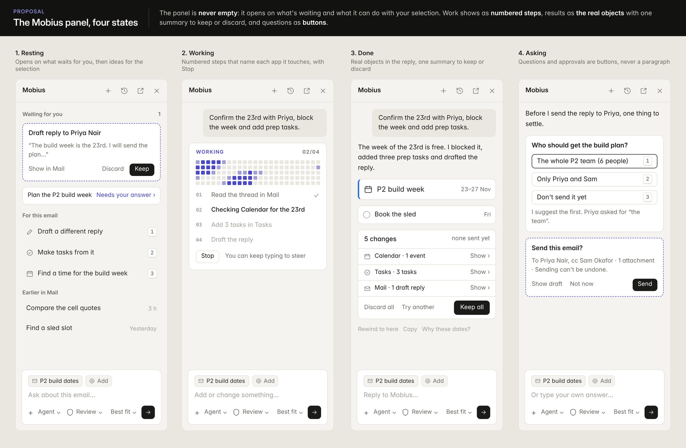
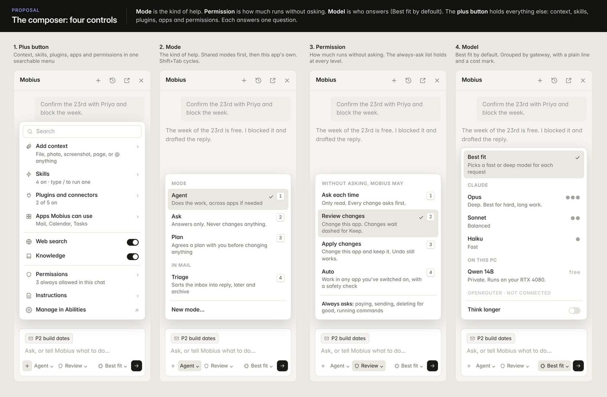
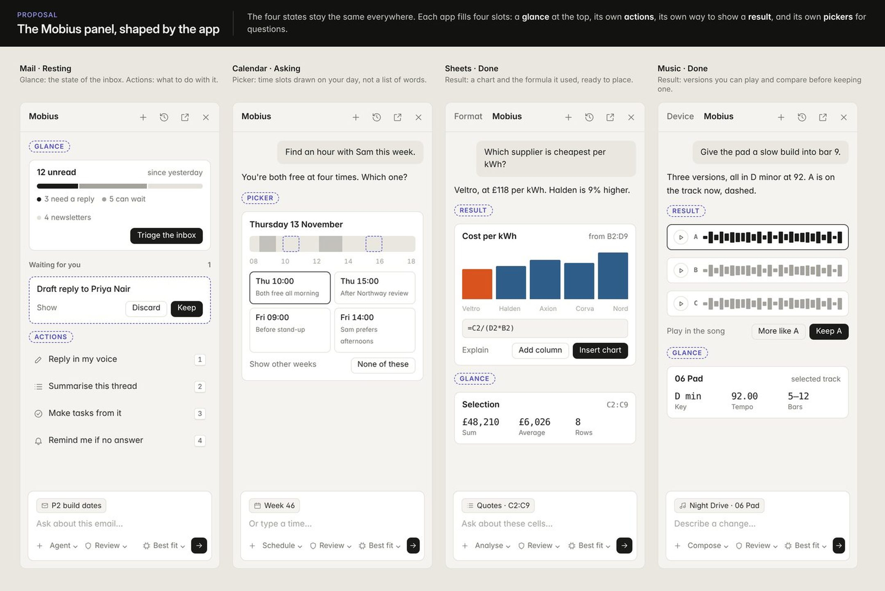
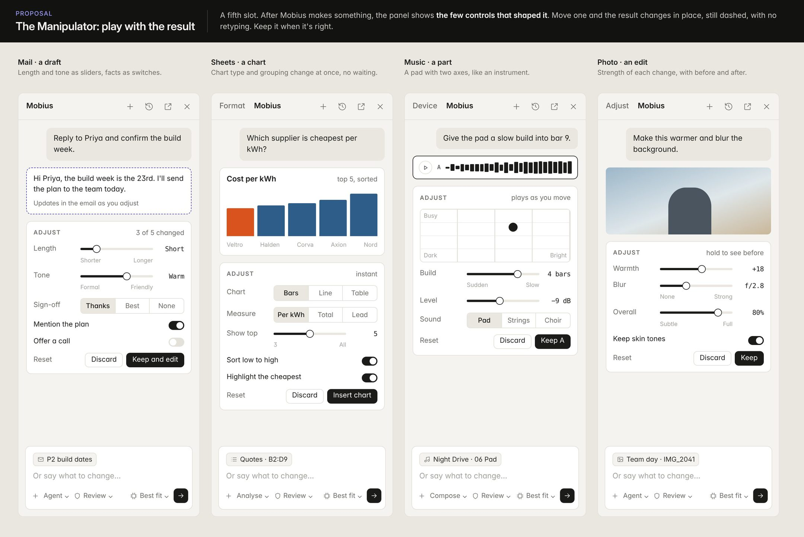
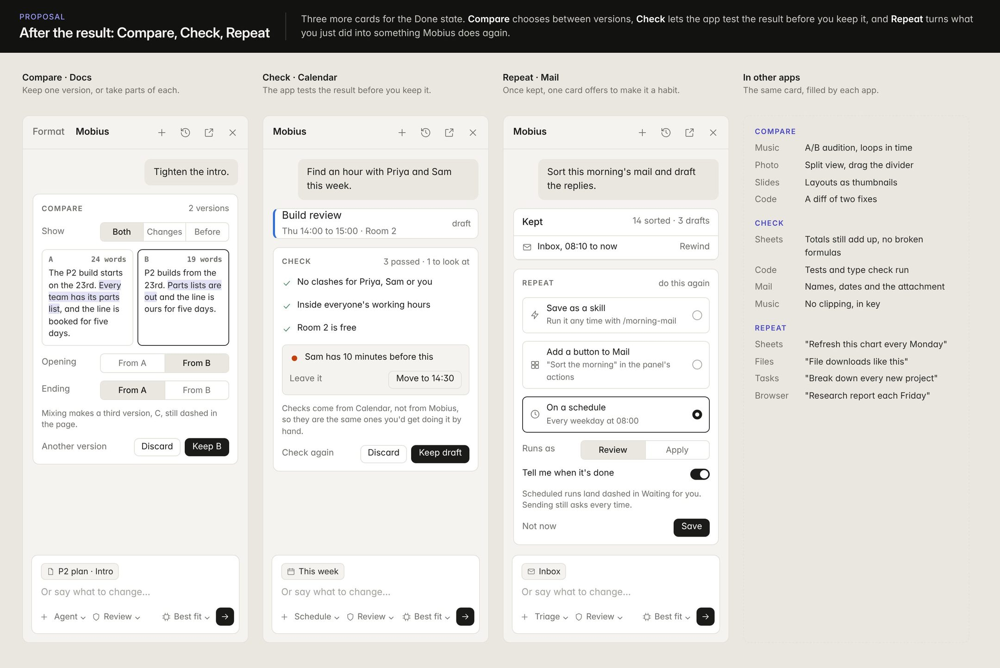
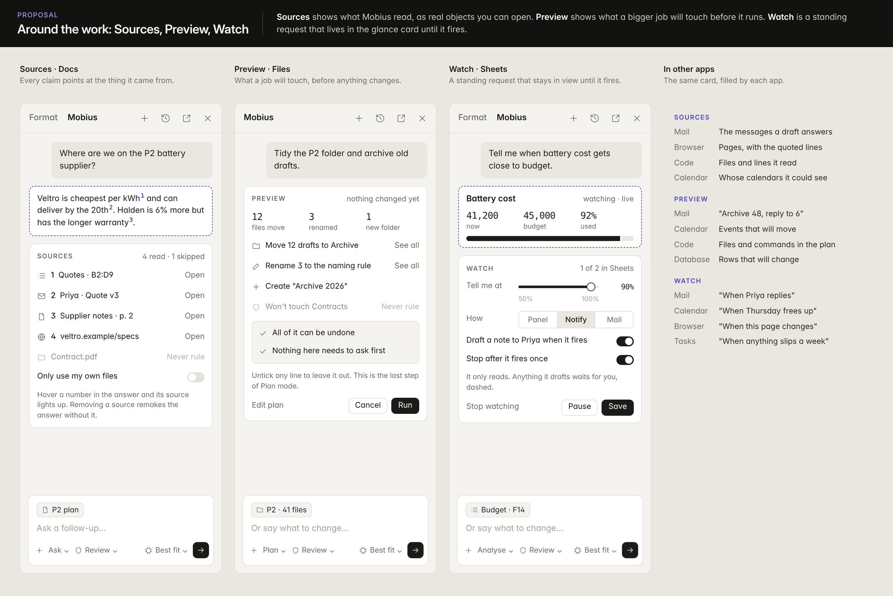

# Instrument: the Mobius design style

Instrument is the agreed look and behaviour of Mobius: calm, precise and labelled, with colour only from your own work
and from Mobius. Andrew agreed it on 13 November 2026, with the decisions listed [at the end](#decisions).

This page is the full specification: sizes, colour, every element, pop-out, the Mobius panel and its composer.
[Design rules](rules.md) is the short checklist reviewers use on a pull request, and it follows this page.
[Workspace layout](workspace-layout.md) describes the five zones, which Instrument does not change.

> **While the shell catches up.** The Builder makes the shell changes once for every app (see
> [How it rolls out](#how-it-rolls-out)). Until a size, control or card described here exists in the shell, an app
> does not build its own version of it. Parts of the Mobius panel described here are the design to build towards and
> are not in the app yet.

## The style in one line

**Instrument: Mobius looks and behaves like a well-made instrument. It is calm, precise and labelled, and the only
colour comes from your own work and from Mobius.**

The name replaces "timeless" as the name of the look. "Timeless" stays as the goal.

The test for any screen is one question: does this look like part of a good instrument, or like decoration? If a line,
colour, icon or animation doesn't help someone read or operate the screen, it goes.

Three words sum up what an instrument is:

- **Calm.** A neutral frame, generous spacing and nothing moving unless something is live.
- **Precise.** One grid, one row height per density, numbers that line up, and exact labels.
- **Alive.** It responds at once, shows its state honestly, and has a little character in the few places where character
  helps.

## How this differs from the rules before it

Most of it is the same system, made larger, more exact and more complete. "Before" means the design rules as they stood
on 13 November 2026.

**Stays the same**

- The five zones, and Mobius on the right as the last tab.
- The neutral frame, three flat surfaces, hairlines, and no glass or blur.
- Ink for state, indigo with a dashed edge for Mobius, and colour for the user's content.
- The four themes, Inter, single-weight line icons, and two densities.
- Motion only for live state, with today's timings, and today's accessibility rules.
- Keep, Discard, Try another, and the shared undo pill.

**Changes**

| Topic | Before | Instrument |
| --- | --- | --- |
| Name of the look | "Timeless" | "Instrument", with timeless as the goal |
| Comfortable density | 13px text, 30px rows | 14px text, 36 to 40px rows |
| Compact density | 12.5px text, 26px rows | 13px text, 30 to 32px rows |
| Toolbar | 48px tall, 13px title | 52px tall, 15px title |
| Reading pages | Same sizes as lists, except 44px rows on Home | A centred column, 15 to 16px text and a large page heading |
| Corners on floating things | 8px | 10 to 14px |
| Section labels | Sentence case, never all-caps | Small all-caps allowed in pro apps' panels only. Sidebars stay sentence case. |
| Empty state | An icon, a bold title, a grey line and New | A small line drawing per app, one line and New. Also shown at the end of short lists. |
| Mobius working | A looping progress cue | The dot-matrix pattern with numbered steps and Stop |
| Red | Record, errors and deleting | Adds overdue items and Calendar's now line |
| Loading | Spinners allowed | Placeholder bars in content, no spinners |
| Pop-out | Panels can pop out, and Little Mobius is the example | Anything with a tab or title can pop out, and panels grow with their window |

**New, with no rule before**

- A spacing scale, alignment to the toolbar title, three font weights and a minimum text size.
- One table of states: hover, pressed, disabled, dragging, drop target, unread.
- Tabular figures everywhere, and a mono face for readouts.
- Keys shown in menus, tooltips and the New button, plus the key-hint bar.
- A shared palette of eight content colours, shown as a dot, an edge or a tint.
- The four places personality is allowed.
- Element-by-element specs, including the launcher's layout, content tabs, the Settings-style pane and pro app readouts.
- Voice rules, optional sound, and the table of what each app may change.

## Where it comes from

The family is functional minimalism: the Swiss typographic style and Dieter Rams' "less, but better". We take one
specific thing from each reference and never copy its look.

| Reference | What we take | Where it shows in Mobius |
| --- | --- | --- |
| Ableton Live | Honest, flat representation. Colour belongs to the user's content. | The whole frame, Music |
| Linear | Density that still looks finished: strong text contrast and one row height | Lists in Tasks, Mail, Files, Database |
| Things 3 | Comfortable spacing, big clear headings, designed empty states | Home, Tasks, Notes |
| Teenage Engineering | Labelled, numbered controls, monospace numbers, character in small places | Music, Video, Mobius working state |
| Notion Calendar | One accent, tabular times, soft event tints | Calendar |
| Zed and Figma UI3 | Panels that dock, tab and hide around one canvas | Slides, Design, Photo, Code |
| Raycast and Superhuman | Keyboard first, with the keys shown where you need them | Launcher, menus, tooltips |

## Type and density

The biggest change is that comfortable density gets larger. Today's 13px text on 30px rows is why many screens look
small and sparse next to the mocks.

| Setting | Before | Instrument |
| --- | --- | --- |
| Comfortable text | 13px | 14px |
| Comfortable row height | 30px | 36px in sidebars, 40px in content lists |
| Compact text | 12.5px | 13px |
| Compact row height | 26px | 30px in sidebars, 32px in content lists |
| Toolbar height | 48px | 52px comfortable, 44px compact |
| Toolbar title | 13px semibold | 15px semibold |
| Sidebar app name | 15px | 17px Inter Display |
| Two-line row, for a list beside a reading pane (Mail, Notes) | None | 56px comfortable, 48px compact (`--row-list-2`) |
| Reading pages (Home, a note, a doc) | Same as lists | 15 to 16px body, 44px rows, a column at most 680px wide |
| Page heading on reading pages | None | 28 to 34px Inter Display, bold |

Rules that go with the sizes:

1. Text contrast is strong. Primary text is full ink. Grey is only for secondary information such as dates, counts and
   hints.
2. There is one row height per density in a view. Rows never vary in height to fit decoration.
3. Daily apps (Mail, Tasks, Notes, Calendar, Files, Home) default to comfortable. Pro apps (Music, Video, Code,
   Database, Sheets) are compact, and the frame makes them so, toolbar included. Apps never set their
   own density selector.
4. A short list is centred in a reading column or ends with a designed empty state. It never leaves a blank grey field.
5. A list that sits beside a reading pane uses the two-line row: the title with the date at the trailing edge on line
   one, the grey detail on line two. A list with the full width uses the one-line row.

## Colour

These mostly restate the adopted theme. Rules 4 and 5 are new.

1. The frame is neutral in every theme: rail, sidebar, toolbar and panels carry no colour.
2. Ink shows state. Selection is a grey fill, primary buttons are ink, and the current app in the rail is ink.
3. Indigo with a dashed edge means Mobius and nothing else.
4. Colour belongs to the user's content: calendar colours, list colours, track colours, labels, charts. Content colours
   come from one shared palette of eight, so apps match each other.
5. Content colour is shown as a small dot, a 3px edge or a soft tint. Solid colour blocks are only for things that are
   themselves coloured objects, such as a clip on a Music track.
6. Red has two jobs only: something overdue or failed, and the current-time line in Calendar.
7. Status has no other colour. A calm state ("Connected", "Key saved", "Signed in") is grey words with no dot. Only a
   problem gets a red dot.
8. One exception for content themes: Reader's Sepia, Grey and Night page colours are the reader's own and live in
   Reader's stylesheet, named once. Text on any highlight tint must reach 4.5:1 in every page colour.

## Labels, numbers and keys

1. **Every control has a name.** An icon-only button always has a tooltip with its name and its key. In pro apps,
   parameters show their label above the value.
2. **Numbers line up.** Times, dates, counts, sizes, money and cell values use tabular figures everywhere.
3. **Monospace is for instrument readouts.** Tempo, timecode, position, coordinates and code use the mono face. Ordinary
   lists and prose never do.
4. **Keys are shown where you act.** Every menu item with a shortcut shows it. The sidebar's New and Search show their
   keys. Tooltips show the key after the name.
5. **Lists can show a key-hint bar.** List views in daily apps may show a small bar of the four or five most useful keys
   at the bottom. It can be turned off in Settings.
6. **Numbering means order.** Tracks, slides and steps are numbered because their order matters. Nothing is numbered for
   decoration.

Section labels: small all-caps labels ("TUNE", "DECAY") are allowed in pro apps' panels only. Sidebars and daily apps
keep sentence case.

## Personality

Character is allowed in exactly four places. Everywhere else the instrument stays quiet.

| Place | What it looks like | Limit |
| --- | --- | --- |
| Empty states | A small single-weight line drawing, one short line of text, and the New action | One drawing style for all apps, drawn in grey ink |
| Mobius working | A small dot-matrix pattern in indigo that moves while Mobius works, with numbered steps and Stop | Only while live. It stops the moment the work ends. |
| Finishing something | A brief tick or strike-through when a task is completed or a change is kept | Under 200ms, and off when reduced motion is on |
| Readouts in pro apps | Large mono values, step dots and meters in Music and Video | Shows real state only, never ornament |

Rules that go with it:

1. Motion is only for live state, as the adopted theme says. A screen at rest is still.
2. Wording is plain and warm, never cute. "That's everything for today." is right. Jokes and exclamation marks are not.
3. No mascots, no illustrations with faces, and no sparkle icon.

## Panels and launcher

The panel rules are already in the docs and are repeated here so the style reads as a whole. The launcher rules are new.

**Panels**

1. An app's own panels (Format, Device, Inspector, Outline) are tabs before Mobius in the right panel. Mobius is always
   the last tab.
2. Notes, comments and detail views live in the bottom area. Nothing sits as an extra column inside the content.
3. One Panels menu shows, hides, moves and pops out every panel and saves layouts. Each panel has a shortcut.

**Launcher**

1. One search finds apps, actions, files and messages. Results are grouped under short section labels, with one top hit.
2. Every row shows what Enter will do, and its own key if it has one.
3. "Ask Mobius" is always the last row, with the dashed indigo mark.
4. A footer shows the keys for moving, opening and closing.

## Popping things out

**Anything with a tab or a title can become its own window, and can come back.** Little Mobius is just the first example
of this, not a special case.

| What can pop out | Example | What the window holds |
| --- | --- | --- |
| Any panel | Mobius, Format, Device, Inspector, Outline | That panel alone, at panel width |
| The bottom area | Notes in Slides, the mixer in Music, a terminal in Code | That area alone |
| Any view of an app | Calendar's month beside its week, a second Sheets tab | The view with its toolbar row, and no rail or sidebar |
| One item | A mail you're writing, a note, a doc, a task's detail, a browser tab | The item with its toolbar row |
| A whole app | Music on a second screen | The full five zones |

How you do it, the same way everywhere:

1. **Drag** a tab or a title out of the window, and it becomes a window where you drop it.
2. **Menu:** "Open in new window" is in every panel's menu, every item's right-click menu and the Panels menu.
3. **Key:** one shortcut pops out whatever has focus, and the same shortcut puts it back.
4. **To put it back,** drag its title onto the main window, or close it. Closing a popped-out panel docks it where it
   came from. It never just disappears.

How a popped-out window looks and behaves:

1. It's the same instrument: the same toolbar row, sizes and states. It has no rail and no sidebar unless it's a whole
   app.
2. Its title says what it is and where it's from ("Format · Kestrel P2 update").
3. It stays live. A popped-out panel follows the selection in its main window, and a popped-out item saves as you work.
4. A popped-out item, view or app has its own Mobius button. Mobius opens inside that window and sees what that window
   shows. A popped-out Mobius is different: it follows the main window.
5. A pin button keeps it above other windows. This is off by default, except for Little Mobius.
6. Mobius's changes show dashed in whichever window holds the thing that changed.
7. Windows are remembered. A saved layout includes which things are popped out, their size and which screen they're on.
   If that screen is missing, they dock back.
8. Small windows fold the same way the main one does: the toolbar's middle controls move into the more menu first.

### What pop-out is for

The main reason is more than one screen: the work stays on your main screen and something else gets a screen of its own.
These are the cases the rules have to serve well.

| Use | What's on the main screen | What's popped out |
| --- | --- | --- |
| Mobius on its own screen | The app you're working in | Mobius, full screen on the second monitor, still following the main window |
| Reference beside the work | A doc you're writing | A mail, note or web page you're reading from |
| Controls on a second screen | Music's tracks, or Video's timeline | The mixer, the device panel or the preview |
| Presenting | Your notes and the next slide | The slides, full screen on the projector |
| Writing while browsing | Your inbox | The message you're writing |
| Watching while working | Any app | Activity, or a dashboard from Views |

### A popped-out panel grows with its window

A popped-out panel isn't stuck at panel width. It uses the room it's given, and Mobius is the main case.

| Mobius window width | Layout |
| --- | --- |
| Under 480px (Little Mobius) | The panel as it is: context line, chat, composer. Stays on top by default. |
| 480 to 900px | The chat in a centred reading column, with a wider composer. |
| Over 900px or full screen | Three parts: past chats at the left, the chat in a centred column, and at the right a live list of what Mobius is changing, with Keep and Discard on each. |

A popped-out Mobius always follows the main window. Its context line names the app and item it sees there ("Sees Mail ·
Inbox, on the main window"), and it updates as you move between apps. Other panels grow the same way: Format and Device
show more controls at once instead of scrolling.

## Every element

This is each piece of the interface with its look. Sizes are
comfortable first, then compact. Comment on a row to change it.

### The frame

| Element | How it looks and behaves | Size |
| --- | --- | --- |
| App rail | Neutral strip on the far left. Home and Search at the top, then pinned apps, with Mobius and Settings at the foot. Never folds away. | 52px wide |
| Rail icon | Single-weight line icon in grey. The current app gets a grey fill and ink icon. Only one is lit at a time. A dot marks an app that needs you. | 36px button, 18px icon |
| Sidebar | Same surface as the rail, with a hairline between. Order is always: app name, New, Search, places, lists, From Mobius. | 240px, folds below 980px |
| Sidebar app name | The app's name in Inter Display. No icon tile and no switcher. | 17px semibold |
| New button | Bordered white button across the sidebar, a plus icon, a verb-led label ("New task") and its key at the right. | 34px / 30px tall |
| Search field | Shared field with a magnifier and the "/" key shown. | 32px / 28px tall |
| Sidebar row | Line icon, label, and an optional grey count at the right. Selected is a grey fill with medium-weight ink. | 32px / 28px |
| Sidebar section label | Small grey semibold label above a group ("Lists"). Sentence case. Small all-caps only in pro apps' panels. | 11 to 12px |
| From Mobius row | Always the last group. Dashed Mobius icon, with an indigo note at the right such as "2 new". | Same as a row |
| Toolbar | One row. Title at the left, the app's controls in the middle, then the trailing group. A hairline below and no fill. | 52px / 44px tall |
| Toolbar title | The name of what is open, with a grey detail after it ("Today · Thursday 13 November"). Never repeats the app name. | 15px semibold |
| Trailing group | Fixed order: Comments, Share, the more menu, Mobius. Apps without comments or sharing leave those out. | 32px buttons |
| Mobius button | The only tinted button in the frame: indigo icon on a pale indigo wash. Opens and closes the right panel. | 32px |
| Right panel | Same surface as the sidebar. Tabs across the top with the app's own panels first and Mobius last, and a close button. | 340px, resizable to 280px |
| Bottom area | Optional strip under the content for notes, comments or detail. It has its own small tab row and a close button. | 150px by default, resizable |
| Hairlines | One line colour separates zones. Zones never use shadows or different fills to separate. | 1px |

### Controls

| Element | How it looks and behaves | Size |
| --- | --- | --- |
| Primary button | Solid ink with paper-coloured text. One per view at most. Never indigo. | 30px / 28px tall, 6 to 8px corners |
| Secondary button | White with a hairline border and ink text. | Same |
| Quiet button | Text or icon only, with a grey fill on hover. Used in toolbars and rows. | Same |
| Icon button | A line icon with no border. Hover is a grey fill. It always has a tooltip with its name and key. | 32px / 28px, 18px icon |
| Text field | White with a hairline border. Focus is an ink border, not a glow. The unit or hint sits grey at the right. | 30px / 28px tall |
| Pop-up (select) | Looks like a field with up and down chevrons at the right. Opens the shared menu. | Same |
| Segmented control | A grey track. The chosen segment is paper with a hairline and ink text. Used for view switches such as List, Board, Calendar. | 30px / 28px tall |
| Checkbox | Rounded square. Checked is solid ink with a paper tick. Task circles in Tasks are the one round exception. | 18px |
| Switch | Ink when on and grey when off. It sits at the trailing end of its row. | 32 by 18px |
| Slider | A 6px grey track with an ink fill from zero to the value. The thumb is a 4 by 16px ink tick, not a round knob, so the fill reads at small values. The hit area is 24px. The value sits at the trailing edge in tabular figures, grey at zero and ink once moved. Both ends can be named ("Shorter", "Longer"). | 6px track |
| Meter | The slider's track with no thumb. The bar stays ink; only the part past a threshold turns red. | 6px track |
| Two-axis pad | One point sets two values. A frame-grey square with a quarter grid, a 14px ink point, crosshair lines to the edges, and a hollow mark where the value started. Both ends of both axes are named in words, and the values read out under it in mono. Arrows nudge, Shift+arrow nudges further, Home returns to the start. | 120px tall at least, square up to 240px |
| Date field | Shows the date in words ("Thu 20 Nov") and takes typing ("tomorrow", "fri 3pm"). Opens a popover with quick picks first (Today, Tomorrow, Next week, No date, each with its key and the date it means in grey), then a month: month name with previous and next buttons, grey weekday letters, day cells in tabular figures. Today is an ink badge, the chosen day a grey fill. Week start and date format come from the shared date helpers. Arrows move by day, Page Up and Down by month, T jumps to today. | 280px popover, 32px day cells |
| Time field | Takes typing ("9:30", "3pm") and opens a list of quarter hours scrolled to now. For a start and end, the end moves with the start and shows the length in grey ("1 hr"). 12 or 24 hour from the shared date helpers. | 30px rows |
| Menu | White, a hairline border, 10px corners and a soft shadow. Mobius actions come first where they exist, then the app's. Every item shows its key. | 30px rows |
| Tooltip | Small ink label with the control's name, then its key. | 12px text |
| Key cap | A small bordered cap with a heavier bottom edge. Used in menus, tooltips, the New button and the hint bar. | 11px text |
| Chip (label or tag) | An outlined pill with a small colour dot and grey text. Never a solid colour fill. | 12px text |
| Count | A plain grey number at the trailing edge. Never a black or coloured badge, except a dot on the rail. | 12.5px, tabular |
| Avatar | A grey circle with initials, or the photo. | 24px in one-line rows, 32px in two-line rows, 40px on a card |
| Focus ring | A 2px ink outline on keyboard focus only. | 2px |

### Content

| Element | How it looks and behaves | Size |
| --- | --- | --- |
| Content surface | The brightest surface in the window (paper). The frame around it is one step dimmer. | Fills its zone |
| List row | One line: the control or icon, the title in full ink, then grey details and the date at the right. A hairline sits between rows, and selected is a grey fill that runs the full width, under any trailing date or button. Text ends with an ellipsis. | 40px / 32px |
| Two-line row | For a list beside a reading pane. Line one: the title, with the date at the trailing edge. Line two: the grey detail. | 56px / 48px |
| Group header | A quiet band with the group name, a grey count, and a plus at the right to add to that group. | 40px / 32px |
| Table and grid | Hairline grid, a header row in grey semibold, and numbers right-aligned with tabular figures. The selected cell has an ink outline. | 32px / 28px rows |
| Page heading | Only on reading pages such as Home, a note or a doc. Large Inter Display with a grey line of context under it. | 28 to 34px |
| Reading column | Prose and short lists are centred in a column instead of stretching across the window. | 680px at most |
| Card | Only for things that are objects in their own right: a file thumbnail, a board card, a dashboard tile. A list of rows is never drawn as cards. | 8 to 10px corners |
| Empty state | A small line drawing, one short line of text, and the New action. It appears when a view is empty, and in a quieter form at the end of a short list. | Drawing about 112 by 72px |
| Selection | A grey fill for rows and an ink outline for objects on a canvas. The canvas selection handles are the one place blue is allowed, because blue there is a tool convention. | 1.5px outline |
| Dates and times | Always from the shared formatter, in tabular figures, grey unless overdue. | 12.5 to 13.5px |
| Scrollbars | Thin, grey, and visible only while scrolling or on hover. | 8px |

### Mobius

| Element | How it looks and behaves | Size |
| --- | --- | --- |
| Mobius panel header | The word "Mobius" as the last tab, with a close button. No logo, gradient or status pill. | 52px / 44px tall |
| Context line | Replaced by context chips in the composer. Until the shell changes: one grey line with an eye icon that says what Mobius can see ("Sees Tasks · Today"). | 12.5px |
| Your message | A grey bubble, right-aligned. | 9px corners |
| Mobius's reply | Plain text on the panel with no bubble. Names of things it touched are indigo links. | 14px, 1.6 line height |
| Working indicator | The dot-matrix pattern, "Working" and a step count such as 02/04, the numbered steps, and Stop. | 24 by 6 dots |
| Change block | A dashed indigo edge around what Mobius changed, in place in the content. It carries one line: Mobius changed this, Discard, Try another, Keep. | 1.5px dashed |
| Proposed item | A new row, event or clip that Mobius added shows dashed and unfilled until you keep it. | Same as the item |
| Composer | A white box at the foot of the panel with a hint, context chips above it, then one row: the plus button, Mode, Permission, the model and an ink send button. | 9px corners |
| Suggestions | Up to three quiet text rows above the composer when the chat is empty. No coloured pills. | Row height |

### Things that float, and feedback

| Element | How it looks and behaves | Size |
| --- | --- | --- |
| Launcher | Centred over a dimmed window. A large search line, grouped results, "Ask Mobius" as the last row, and a footer of keys. | 680px wide, 44px rows |
| Sheet and dialog | White with 12 to 14px corners and a soft shadow. A title, one short sentence, and buttons at the trailing end with the primary last. | 480px wide by default |
| Confirmation | Only for paying, sending, deleting and running commands. The button names the action ("Delete 3 files"). | Same as a sheet |
| Undo pill | The shared pill at the bottom centre: what happened, Undo, and a close button. It is opaque and never covers content. | 36px tall |
| Key-hint bar | A small floating bar at the bottom of a list with four or five keys. | 36px tall |
| Progress | A thin ink line for known progress. Mobius's work uses the working indicator instead. No spinners in the frame. | 2px line |
| Error | A plain sentence saying what went wrong and what to do, with a red dot. Shown where the problem is, not in a banner. | Text size |
| Shadows | Only on things that float: menus, the launcher, sheets and pills. | One soft shadow |

### Pro app readouts

| Element | How it looks and behaves | Size |
| --- | --- | --- |
| Parameter cell | A small label above, a large mono value with its unit, and a thin meter below. A letter or number in the corner matches its key. | 30px value |
| Step dots | A row of 16 dots. On is ink, off is grey, and an accented step uses the track's colour. | 16 per row |
| Track header | The track's number in a small cap, then its name. | Row height |
| Clip | A solid block in the track's colour with its name. A clip Mobius proposed is dashed and unfilled. | Fills the lane |
| Transport | Play, position in mono, then tempo, time signature and key as one segmented group. | Toolbar height |

## Foundations

Sizes for elements need a grid to sit on. These rules give it.

| Foundation | Rule |
| --- | --- |
| Spacing scale | Every gap and padding is one of 4, 8, 12, 16, 24, 32 or 48px. Nothing in between. |
| Zone padding | Sidebar and panels have 10 to 16px inside. Content lists have 22px at the sides. Reading pages have 56px at the top. |
| Alignment | In a list, every row's text starts on the same line as the toolbar title above it. |
| Corners | 6px on controls and rows, 8px on panels and cards, 10 to 14px on things that float. Inner corners are the outer radius minus the inset. |
| Icons | One icon set for the whole app: 1.5px stroke, round joins, drawn on a 24px grid. Shown at 18px in the frame and 16px in rows. Never filled, never two-tone. |
| Surfaces | Three only: the frame, paper for content, and raised for things that float. This is today's rule and it stays. |
| Themes | Light, Mid grey, Dark and Cool dark. Every rule on this page must hold in all four, so mock-ups and reviews check Light and Dark at least. |
| Type faces | Inter for text, Inter Display for headings of 17px and up, and the mono face for readouts only. |
| Weights | Three only: regular, medium for the selected thing, and semibold for titles and labels. Bold is only for page headings. |

## States

Every control and row shows the same states in the same way.

| State | How it shows |
| --- | --- |
| Rest | No fill and no border, unless the control is a field or a bordered button. |
| Hover | A light grey fill, half the strength of selected. No colour change and no movement. |
| Pressed | The selected grey fill for as long as it's held. |
| Selected | A grey fill with medium-weight ink text. |
| Selected, window not focused | The same fill, one step lighter. |
| Keyboard focus | A 2px ink outline. Never shown for mouse clicks. |
| Disabled | Text and icon at 40% strength. No hover, and the tooltip says why it's unavailable. |
| Loading | Grey placeholder bars the shape of the content that's coming. No spinners in content. |
| Dragging | The dragged thing follows the pointer at 90% opacity with the raised shadow. |
| Drop target | A 2px ink line where the thing will land, or an ink outline around the row or folder that will take it. |
| Changed by Mobius | A dashed indigo edge until you keep or discard it. |
| Error | A red dot and one plain sentence next to the thing that failed. |
| Unread or new | Semibold title. No coloured dot except on the rail. |

## More elements

These were missing from the element tables above.

| Element | How it looks and behaves | Size |
| --- | --- | --- |
| Window title bar | Part of the frame, not a separate strip. The window buttons sit in the toolbar row on Windows, and the toolbar's empty space drags the window. | Toolbar height |
| Content tabs | For apps that open several things at once (Browser, Code, Files). Plain text tabs above the content. The open one is ink with a 2px ink underline, and each has a close button on hover. | 36px / 32px tall |
| Resize handle | The hairline between zones. On hover it thickens to a 2px ink line and the pointer changes. Double-click resets the width. | 1px, 6px grab area |
| Settings-style pane | One shared grouped list for Settings, Abilities and Knowledge: a white group with hairlines between rows, the label at the left and its control at the right. | 44px rows |
| Comment pin | A small ink circle with the commenter's initial, placed on the thing it's about. The thread opens beside it. | 22px |
| Notification | A row in Activity, plus a dot on the rail. System notifications use one line that names the app and what happened. | Row height |
| Images and thumbnails | Shown with square 6px corners and a hairline, with no shadow. Missing images show a grey box with a line icon. | 6px corners |
| Charts | Colours come from the shared content palette. Grid lines are hairlines, labels are grey 12px, and values are tabular. | 12px labels |
| Little Mobius | The Mobius panel popped out as its own small window, following the pop-out rules above. It has the same header, context line and composer, and stays on top by default. | 360px wide |
| Status line | Only in pro apps. One grey line at the bottom with facts such as line and column, or zoom. No hints or tips. | 24px tall |
| First run of an app | The empty state does the teaching: the drawing, one line on what the app is for, and the New action. No tours or coach marks. | Same as empty state |

## Voice and sound

An instrument also has a way of speaking. These cover the words and the sounds.

1. **Buttons say what they do.** "Send", "Delete 3 files", "Keep". Never "OK" or "Yes".
2. **Sentence case everywhere**, with no full stop on labels and buttons.
3. **Mobius speaks in the first person and plainly.** "I added KP-122, due tomorrow." It never says "Sure!" or praises
   the request.
4. **Errors say what happened and what to do next**, in one or two sentences.
5. **Numbers and dates use the shared formatter**, with the person's own locale.
6. **Sound is off by default.** If turned on, there are three short sounds only: Mobius finished, something needs you,
   and a message was sent. Each is under half a second.

## What each app may change

The frame holds and the app shapes its tools. This draws the line, so app threads know what's theirs.

| Fixed for every app | The app decides |
| --- | --- |
| The five zones and their order | Which views it has and what the content looks like |
| Sizes, spacing, corners, faces and weights | Which controls go in the toolbar's middle slot |
| The states table | Which of its own panels sit before Mobius |
| Ink for state and indigo for Mobius | How the user's content colours are used inside the content |
| Shared controls, menus, the undo pill and the empty state | Its empty-state drawing and one line of text |
| Comfortable or compact row heights | Which density it starts in |

## The Mobius panel, improved

The panel should never be empty, and it should show Mobius's work as things you can act on. Today it opens as three grey
suggestions, a blank column and a composer, even when a draft is waiting in the content beside it.

### What's weak today

| Today | Why it's a problem |
| --- | --- |
| An open panel is mostly blank | It looks unfinished, and it hides what Mobius has already done |
| Pending changes show only in the content | You can't see or settle them from the panel, or know about ones off screen |
| Context is stated twice: "Sees this email" at the top and an "Email" chip in the composer | Two places to read, and they can disagree |
| The mode (Propose) also shows twice | Same problem |
| No New chat, history or pop-out in the header | You have to go to the Agent app to find an earlier chat |
| Other chats that need you show only as a badge on Home | You don't know Mobius is waiting unless you look there |
| Suggestions are the same three per app | They don't respond to what you've selected |
| "Balanced" sits in the composer | It's a model setting most people never change, taking prime space |

### The four states

| State | What the panel shows |
| --- | --- |
| Resting | "Waiting for you": each pending change as a dashed card with Show, Discard and Keep. Then any other chat that needs you. Then three ideas for the current selection, with number keys. Then earlier chats in this app. |
| Working | The dot-matrix pattern and numbered steps. Each step names the app it touches ("Checking Calendar for the 23rd"). Stop is always there, and you can keep typing to steer. |
| Done | A short reply in plain words, then the real objects it made, drawn with the shared designs. One summary lists the changes by app with Show on each, and Discard all, Try another and Keep all. |
| Asking | A question is a card with up to three buttons, the suggested one outlined, and number keys. An approval for sending, paying or deleting is a dashed card that says exactly what will happen and that it can't be undone. |

### Rules

1. **Never empty.** An open panel always shows what's waiting, what it can do here, or the chat.
2. **Context lives in one place.** Chips at the top of the composer show what Mobius sees. Select something and its chip
   appears. "Add" attaches anything else. The separate "Sees" line goes away.
3. **The mode lives in one place:** the composer. This is now four composer controls: plus, Mode, Permission and Model.
4. **The header has four buttons:** New chat, History, Pop out, Close.
5. **Results are objects, not descriptions.** A task Mobius made appears as a task row you can tick. An event appears as
   an event you can open.
6. **One summary per turn.** Every turn that changed something ends with one summary to keep or discard. "Show" scrolls
   the content to the change and flashes its dashed edge.
7. **Settle from either side.** Keep or Discard in the content updates the panel, and the other way round.
8. **Under each reply:** Rewind to here, Copy, and one follow-up worth asking.
9. **Other work is visible.** A chat elsewhere that needs you shows as one row in the resting panel, and as a dot on the
   Mobius button when the panel is closed.
10. **Keyboard first.** Ctrl+J opens the panel with the cursor in the composer. Number keys pick a suggestion or an
    answer. Escape goes back to the content.

## Modes, permissions, model and tools

**"Ask first, Propose, Act" mixed two different questions into one switch. This splits them into two controls, and adds
a model picker and a plus button for everything else.**

The two questions are: what kind of help do you want, and how much may Mobius do without asking. Cursor answers the
first with its modes ([Agent, Ask, Plan and Debug](https://cursor.com/help/ai-features/agent)). Claude Code answers the
second with its [permission modes](https://code.claude.com/docs/en/permission-modes). Today's switch can't say "just
answer, don't touch anything" or "plan it with me first", and it can't say "do the work but check with me before leaving
this app".

### Control 1: Mode, the kind of help

Three modes exist in every app. Shift+Tab cycles them, as in Cursor.

| Mode | What Mobius does | Changes things? | Use it for |
| --- | --- | --- | --- |
| Agent | Does the work, across apps if needed | Yes | Most things. This is the default. |
| Ask | Answers and explains. It reads what you have open and never changes anything. | No | Questions, summaries, "what does this mean" |
| Plan | Writes a short numbered plan and waits. Nothing changes until you approve the plan, then it carries it out as Agent. | Only after you approve | Bigger jobs, or anything across several apps |

Each app can add modes of its own. They appear after the three shared ones, only while you're in that app.

| App | Its own mode | What it does |
| --- | --- | --- |
| Mail | Triage | Goes through the inbox and sorts each message into reply, later or archive, with drafts for the replies |
| Docs and Notes | Review | Leaves comments and suggestions and never edits the text itself |
| Sheets and Database | Analyse | Reads the data and answers with charts and tables. Never changes a cell. |
| Code | Debug | Reproduces a bug, gathers evidence by running things, then proposes the fix |
| Browser | Research | Reads many pages and writes a report with its sources |
| Calendar | Schedule | Finds times across calendars and drafts the invitations |
| Music | Compose | Adds parts in the song's key and tempo as dashed clips |
| Slides | Rehearse | Listens to a run-through and gives notes on pacing and wording |

An app mode is a preset, not new machinery: a name, one line of purpose, instructions, the tools it may use, and whether
it can change things. That means people can later add their own modes in Abilities.

### Control 2: Permission, how much runs without asking

This follows Claude Code's ladder, in plain words. It only matters in modes that can change things.

| Permission | Runs without asking | Still asks |
| --- | --- | --- |
| Ask each time | Reading only | Every change, before it's made |
| Review changes (default) | Changes in the app you're in. They land dashed and wait for Keep or Discard. | Anything in another app, and the always-ask list |
| Apply changes | Changes in the app you're in, kept at once, with Undo and Rewind | Anything in another app, and the always-ask list |
| Auto | Everything, in any app you've switched on, with a safety check on each action | Only the always-ask list |

Three things hold at every level:

1. **The always-ask list never goes away.** Paying, sending, deleting for good and running commands ask every time, even
   in Auto. You can add to the list but not remove these four.
2. **"Never" rules win.** If you've said Mobius may never touch something (a folder, an account, an app), no mode or
   permission overrides it.
3. **Everything can be undone that can be.** Rewind works at every level. Auto is not a way to skip the record in
   Activity.

The old names map across cleanly: Ask first becomes Ask each time, Propose becomes Review changes, and Act becomes Auto.
Apply changes is new, and so are the Ask and Plan modes.

In the composer the permission button shows a shield and a short label (Each time, Review, Apply, Auto). The full name
and its one-line meaning are in the menu.

### Control 3: Model

| Part | Rule |
| --- | --- |
| Default | "Best fit" picks the model for each request: a fast one for small things and a deeper one for hard ones. It isn't called Auto, so it can't be confused with the Auto permission beside it. |
| The list | Grouped by gateway (the provider you've connected). Each model has one plain line: fast, balanced or deep, and a rough cost mark. |
| Thinking | One switch for "think longer" on models that support it. |
| Scope | The choice applies to this chat. "Set as default" makes it the default for this mode. |
| Honesty | Under each reply, small grey text names the model that answered. |
| Missing | A model whose gateway isn't connected shows greyed, with "Connect" leading to Settings. |

### Control 4: The plus button, everything else you can change

The plus button at the left of the composer opens one menu for the rest. It's searchable, and each item is a row with a
switch, a count or an arrow.

| Item | What it does | Control |
| --- | --- | --- |
| Add context | A file, photo, screenshot, web page, or anything from an app (also by typing @) | Opens a picker |
| Skills | Turn skills on or off for this chat, or run one (also by typing /) | Switch per skill |
| Plugins and connectors | Turn connected services on or off for this chat | Switch per connector |
| Apps Mobius can use | Which apps it may read and change in this chat | Switch per app |
| Web search | Whether it may look things up online | One switch |
| Knowledge | Whether it reads and adds to your Knowledge pages | One switch |
| Permissions | What you've allowed with "always allow" in this chat, with a way to take each back, plus the always-ask and never lists | Opens a list |
| Instructions | Standing instructions for this chat or this app | Opens an editor |
| Manage in Abilities | Add or remove skills, connectors and modes | Opens Abilities |

Anything switched away from its default shows as a small chip above the composer ("Web search off", "3 skills"), so the
state is always visible without opening the menu. Dropping or pasting a file onto the panel is the same as Add context.

### How the composer is laid out

Left to right on the bottom row: the plus button, Mode, Permission, then at the right the model and Send. Context chips
sit on the row above. Each of the four controls opens a menu upward, and each menu item shows its key.

Two more things from Cursor are worth taking:

1. **Queued messages.** You can send while Mobius is working. Messages line up above the composer, can be reordered or
   removed, and run in turn. "Send now" steers the current work instead.
2. **A new chat per job.** Switching mode mid-chat keeps the chat. The New chat button is the way to start clean, and
   the panel suggests it when the subject changes.

## The Mobius panel, shaped by the app

**The four states (Resting, Working, Done, Asking) are the same in every app. Each app fills a fixed set of slots inside
them, so the panel shows that app's own capabilities without becoming a different panel.**

### The four slots

| Slot | Where it shows | What the app provides | Limit |
| --- | --- | --- | --- |
| Glance | Top of the resting panel, and after a result | One small card of live facts about what's open or selected | One card, three facts at most, one button |
| Actions | Resting panel, under "Waiting for you" | Up to four things Mobius can do with the selection, with number keys | Four rows. They change with the selection. |
| Result | The Done state | The app's own way to show what Mobius made, with the buttons to place or keep it | Built from shared elements. Always ends in Keep or Discard. |
| Picker | The Asking state | The app's own way to answer a question | Up to four choices, the suggested one outlined |

The Working state also takes one line from the app: what it shows while Mobius works there (see the last column).

### What each app puts in the slots

| App | Glance | Actions | Result | Picker | While working |
| --- | --- | --- | --- | --- | --- |
| Mail | Unread split into need a reply, can wait, newsletters | Reply in my voice, Summarise thread, Make tasks, Remind me if no answer | The draft, with Shorter, Warmer and More formal | Who to send to | Messages read, counted |
| Calendar | Today's free time as a bar | Find a time, Move this, Protect focus time | A week strip with the new event dashed | Time slots drawn on your day | Calendars checked |
| Tasks | Overdue, due today, done today | Plan my day, Break this down, Find tasks in my notes | Task rows you can tick | A due date or a list | Tasks added, counted |
| Docs and Notes | Word count, reading time, outline | Rewrite, Shorten, Continue, Check facts | Before and after, side by side | Tone or length choices | Sections written |
| Sheets and Database | Sum, average and count of the selection | Explain this formula, Chart this, Find outliers, Clean up | A chart and the formula used | Which column or range | Rows read |
| Code | Failing tests and errors in the open file | Fix failing tests, Explain this, Write a test | Changes by file, and tests passed | Approve a command | The command's output, live |
| Browser | What this page is, in one line | Summarise, Compare open tabs, Fill this form | Findings with their sources | Allow this site | Pages visited |
| Files | What's selected, and its size | Tidy this folder, Find duplicates, Rename by pattern | Before and after folder tree | Where to move things | Files scanned |
| Music | Key, tempo and bars of the selected track | Add a part, Vary this, Fit to video | Versions A, B and C you can play | A style or instrument | Bars rendered |
| Slides, Design, Photo, Video | What's selected, and its size | Tidy layout, Restyle, Remove background, Cut silences | A grid of variations to pick from | A style choice | Thumbnails as they finish |

### Rules for slots

1. **Same skeleton everywhere.** Slots never move, and an app can't add one of its own. Adjust and the cards below are
   further shared ones.
2. **Slots follow the selection.** Select a cell range, a track or an email and the Glance and Actions update at once.
3. **Results act where they're shown.** "Insert chart", "Keep A" and "Keep" on a draft do the real thing, and the change
   also shows dashed in the content.
4. **An empty slot is hidden.** An app with no useful Glance shows none. Nothing is filled in for the sake of it.
5. **Slots come with the app's modes.** In Triage, Mail's Actions and Result change to suit triage. A mode preset can
   name its own slot contents.
6. **Shared elements only.** Slots are built from the shared rows, cards, charts and buttons, so every app's panel still
   looks like Mobius.

## The Manipulator: play with the result

**After Mobius makes something, the panel shows the few controls that shaped it. Move one and the result changes in
place, with no retyping. It is a fifth slot, next to Glance, Actions, Result and Picker.**

Today the only ways to change a result are Try another (a fresh roll of the dice) or typing a new message. The
Manipulator sits between them: the result is close, and you want to nudge it. It's the same idea as a synth's knobs
after you've picked a preset.

### What it is

| Part | Rule |
| --- | --- |
| Name | "Manipulator" is our name for the slot. On screen the card is labelled Adjust (agreed), in every app including Photo. |
| Where | A card directly under the result, in the Done state. It's closed to one line ("Adjust") when the result is small, and open when the app says adjusting is the normal next step (Music, Photo). |
| What's in it | Three to six controls, chosen by Mobius for this result from the app's list. Never a full settings page. |
| Controls | Only shared ones: slider, segmented control, switch, and one new shared part, the XY pad. No app draws its own. |
| The result | Changes in place as you move a control, and stays dashed until you Keep it. |
| Buttons | Reset (back to what Mobius first made), Discard, and Keep. Keep is named for what happens: "Keep and edit", "Insert chart", "Keep A". |
| Counter | The card's corner says how far you've moved: "3 of 5 changed". |
| Words still work | The composer under it reads "Or say what to change...". Typing a change moves the controls to match. |

### Two kinds of control

| Kind | What happens when you move it | Examples |
| --- | --- | --- |
| Instant | The app redraws from data it already has. No model call, no waiting, no cost. | Chart type, top 5 or all, sort, photo strength, level |
| Remake | Mobius remakes the result with the new value. The result shows the working pattern briefly, and it runs when you let go of the control, not while you drag. | Length and tone of a draft, sound and busyness of a part |

Remake controls carry a small Mobius mark so it's clear which ones cost a moment. Every position you try is kept in the
result's history, so Undo and Rewind walk back through them.

### What each app offers in Adjust

| App | Result | Controls |
| --- | --- | --- |
| Mail | A draft | Length, Tone, Sign-off, and a switch for each fact it could mention |
| Docs and Notes | A rewrite or summary | Length, Reading level, Tone, Keep my wording (switch) |
| Sheets and Database | A chart or table | Chart type, Measure, Show top, Sort, Highlight |
| Calendar | A proposed time | Earliest and latest hour, Length, Buffer between meetings, Who must attend |
| Music | A part | A pad with two axes (Dark to Bright, Calm to Busy), Build, Level, Sound. It plays as you move. |
| Photo | An edit | A slider for each change it made, an Overall slider, Keep skin tones. Hold to see before. |
| Slides | A slide | Layout, Amount of text, Emphasis |
| Design | Variations | How far from the original, Colour, Spacing |
| Code | A fix | Scope (this line, this function, this file), With tests (switch) |
| Browser | A report | Length, Depth, Number of sources |
| Tasks | A breakdown | Number of steps, Detail, Spread over days |

### Rules for Adjust

1. **The controls are the things that shaped the result.** If Mobius made three changes to a photo, there are three
   sliders. Nothing is shown that wouldn't change this result.
2. **Starting positions are honest.** Each control starts where Mobius actually set it, so the card also explains what
   it did.
3. **Always dashed until kept.** Adjusting never writes to your file. Keep does, and it follows the Permission level
   like any other change.
4. **Reset is always there.** One press returns to the first result.
5. **Plain labels with both ends named.** "Shorter" and "Longer", not 1 to 10. Real units where they exist (dB, bars,
   f-stop).
6. **Keys.** Tab moves between controls, arrows nudge, Shift+arrow nudges further, Enter keeps, Esc discards.
7. **Pops out with the result.** A popped-out result brings its Adjust card with it.
8. **Remembers quietly.** If you always shorten drafts, the next draft starts shorter. This is listed under Knowledge so
   you can see it and turn it off.

## Six more cards for the panel

**Six more shared cards, each filled by the app like Adjust is. Three come after the result (Compare, Check, Repeat) and
three sit around the work (Sources, Preview, Watch).**

With all of them the panel reads as one loop: Glance, Actions, Preview, Result, Sources, Adjust, Compare, Check, Keep,
Repeat, and Watch for what should keep running.

| Card | When it shows | What it does | Buttons |
| --- | --- | --- | --- |
| Compare | Done, when there are two or more versions (after Try another, or after Adjust) | Shows versions side by side, as changes, or against the original. You can take parts from each, which makes a new version. | Another version, Discard, Keep (named for the version) |
| Check | Done, before Keep | The app runs its own tests on the result and lists what passed and what to look at. Each problem has a one-press fix. | Check again, Discard, Keep |
| Repeat | Once, after you keep a result | Offers to save what just happened as a skill, as an action button in this app, or on a schedule | Not now, Save |
| Sources | With any answer or result that used what it read | Lists what Mobius read as real objects you can open, numbered to match marks in the answer. Shows what it skipped and why. | Open on each row |
| Preview | Before a bigger job runs. It is the last step of Plan mode. | Counts and lists what will change, what won't be touched, what can be undone and what will ask first | Edit plan, Cancel, Run |
| Watch | When you ask for "tell me when" | A standing request with a live reading. It sits in the Glance card until it fires. | Stop watching, Pause, Save |

### What each app puts in the cards

| App | Compare | Check | Repeat | Sources | Preview | Watch |
| --- | --- | --- | --- | --- | --- | --- |
| Mail | Two drafts | Names, dates and the attachment | "Sort the morning mail" | The messages a draft answers | "Archive 48, reply to 6" | "When Priya replies" |
| Docs and Notes | Side by side or as changes | Spelling, links, facts against sources | "Summarise every new note" | Pages and paragraphs | Sections that will change | "When someone comments" |
| Sheets and Database | Two charts or two formulas | Totals still add up, no broken formulas | "Refresh this chart every Monday" | Cells and ranges | Rows that will change | "When this cell goes over budget" |
| Calendar | Two candidate times on the day | Clashes, working hours, rooms, travel time | "Plan my week every Friday" | Whose calendars it could see | Events that will move | "When Thursday frees up" |
| Music | A/B audition, looped in time | No clipping, in key, in tempo | "Add a build like this" | The clips it listened to | Tracks it will add | none |
| Photo | Split view with a divider | Sharpness, crop size, skin tones | "Edit the rest of the album like this" | none | Photos in the batch | none |
| Code | A diff of two fixes | Tests and type check | "Fix lint on save" | Files and lines it read | Files and commands in the plan | "When the build fails" |
| Files | none | Nothing overwritten, links still work | "File downloads like this" | none | Moves, renames and new folders | "When a file lands in this folder" |
| Browser | Two reports | Links open, quotes match the page | "Research report each Friday" | Pages with the quoted lines | Sites it will visit | "When this page changes" |
| Tasks | Two breakdowns | Dates possible, no one overloaded | "Break down every new project" | Where each task came from | Tasks it will create | "When anything slips a week" |

### Rules for the cards

1. **Shared cards, app content.** The card, its header, and its buttons are the same everywhere. The app supplies the
   rows.
2. **An app may leave a card empty.** If it has nothing honest to put there, the card doesn't show.
3. **Checks belong to the app, not to Mobius.** They are the same tests you'd get doing the work by hand, so a pass
   means something.
4. **A check never blocks Keep.** It informs. Only the always-ask list and "never" rules stop things.
5. **Repeat asks once and never nags.** It appears after a kept result, and "Not now" hides it for that kind of job.
   Everything saved is listed in Abilities.
6. **Scheduled and watched work is Review by default.** Results land dashed in Waiting for you. The always-ask list
   still applies when nobody is there.
7. **Watch only reads.** Anything it drafts when it fires waits for you. Every watch is listed in the Glance card with
   Pause and Stop, and in Activity.
8. **Sources are honest about gaps.** Anything skipped because of a "never" rule or missing access is listed, greyed,
   with the reason.
9. **Preview is exact or says so.** If a count is an estimate it says "about".
10. **At most two cards open at once** under a result. The rest fold to one line each, in the fixed order Sources,
    Adjust, Compare, Check.

## Building the panel: each part's size and parts

**This is the build sheet for everything above: the four states, the composer, the slots, Adjust and the cards. Every
part is made from the shared controls in `src/ui/` and the shared object designs. Nothing here needs a new colour or
size token.**

### Resting panel, top to bottom

| Part | How it's built | Size |
| --- | --- | --- |
| Head | "Mobius" as the last tab, then New chat, History, Pop out and Close as icon buttons | 52px / 44px tall, 32px buttons |
| Glance (slot) | One paper card: up to three facts as a grey label over a value (tabular figures), and at most one quiet button. Hidden when the app gives none. | 8px corners, 12px inside |
| Section heading | "Waiting for you", "For this email", "Earlier chats": grey semibold, sentence case, a count at the right, a hairline under it | 12.5px, 20px above |
| Waiting card | One per pending change. Dashed indigo edge (1.5px). Line 1: app icon and what changed, one line, ending in an ellipsis. Line 2: grey app name and time. Then Show and Discard as quiet text buttons and one small ink Keep at the right. Three at most, then a "2 more" row. | 8px corners, 26px buttons |
| Other chat needing you | A list row: the chat's title, and "Needs your answer" in indigo text at the right. No dot. | 36px / 32px row |
| Actions (slot) | The ideas list. Up to four rows that follow the selection: a 16px line icon, the action, and its number key cap at the right. Grey fill on hover. Never outlined buttons, and never a lone button above the list. | 36px / 32px rows |
| Earlier chats | List rows: title with an ellipsis, time at the right in grey tabular figures. Five at most, then "All chats" opens History. | 36px / 32px rows |

### Composer

| Part | How it's built | Size |
| --- | --- | --- |
| Box | Paper, 1px line, hint text in grey. Grows to six lines, then scrolls. | 9px corners, 12px inside |
| Context chips | Inside the box, above the text: the shared chip with the app's icon and the thing's name ("Email: P2 build"). Selecting something adds its chip, the cross removes it. This replaces the "Sees" line. | 24px tall, 12px text |
| Changed-setting chips | Under the context chips when anything in the plus menu is off its default ("Web search off", "3 skills") | 11.5px, 6px corners, frame fill |
| Bottom row | Plus (icon button), Mode, Permission (shield and short label), then at the right the model and an ink Send. Mode, Permission and model are quiet buttons with a small chevron. | 28px controls |
| Menus | Open upward from their button. Rows with a check on the current choice and a key cap at the right. Permission and model rows are two lines: the name, and a grey line on what it means. | 30px rows, two-line rows 7px inside |

### Working, Done and Asking

| Part | How it's built | Size |
| --- | --- | --- |
| Steps | Numbered rows. The number in tabular grey, then the step naming its app ("Checking Calendar for the 23rd"). The current step is ink, done steps grey. | 28px rows |
| Stop | A quiet button with Esc shown, always under the steps | 26px |
| Reply | Plain 14px text, no bubble. Names of things it touched are indigo links. | 1.6 line height |
| Under each reply | Rewind to here, Copy and one follow-up as grey text buttons. The model that answered in small grey text at the right. | 12.5px, model 11.5px |
| Result (slot) | The real objects, drawn as shared object cards or rows | Shared object sizes |
| Turn summary | One per turn that changed things. A paper card with a hairline between parts. Header: the title on one line with an ellipsis and "5 changes" in grey at the right. One row per app with its icon, what changed and Show. Footer: Discard all and Try another as quiet text on the left, one ink Keep all on the right, all on one line. | 8px corners, 36px header, 32px rows, 40px footer |
| Question (Picker slot) | A paper card: the question, then up to three option rows with number keys. The suggested option has an ink edge. An approval for sending, paying or deleting is dashed and says it can't be undone. | 32px option rows |

### Adjust and the cards

All of them share one card shell, so Compare, Check, Repeat and Adjust look like one family.

| Part | How it's built | Size |
| --- | --- | --- |
| Shell | Paper card with a 1px line | 8px corners |
| Header | The card's name in semibold, and a close cross | 36px |
| Body | The app's rows, built from shared controls (slider, segmented, switch, two-axis pad, object rows) | 12px inside |
| Footer | Quiet text buttons on the left (Reset, Discard), one ink button on the right (Keep) | 40px |
| How many | Two cards open at most. The rest fold to one line each, in the order Sources, Adjust, Compare, Check. | 36px folded |

### Rules for building it

1. **Sentence case in the panel.** The kind labels in small caps ("NOTES", "TASK") are for pro apps' own panels, not
   for Mobius.
2. **One ink button per card.** Everything else in a card is quiet text.
3. **No stray marks.** No dot sits before a title unless it means a problem.
4. **Titles never wrap into the buttons.** Text ends with an ellipsis, and the full text is in the tooltip.
5. **Menus use the shared popover and menu rows** once the component library has them. Until then the existing menu
   rows are fine.

## One app, not twenty

Everything above unifies how Mobius looks. These three parts unify how it behaves and make the rules hold, which a look
alone can't do.

### The same thing looks the same everywhere

A task, an event, a mail, a file, a person and a note each have one design, owned by the shell (`ObjectRow`,
`ObjectCard`, `ObjectChip`). Any app that shows one uses it. Each comes in four forms:

| Form | Size | Used for |
| --- | --- | --- |
| One-line row | 40px / 32px | Lists with the full width, results, dashboard tiles |
| Two-line row | 56px / 48px | A list beside a reading pane |
| Card | 280px or the panel's width, 10px corners | Mobius's results and Sources, Views, a peek on Space |
| Chip | 22px tall, 6px corners, a hairline | Inside text: the composer, answers, notes |

Every row has the same order: a leading mark that names the kind, the title in ink, one grey detail, then the date or
count at the trailing edge in tabular figures.

| Kind | Leading mark | Grey detail | Trailing |
| --- | --- | --- | --- |
| Task | Round check, solid ink when done | Note, or list and steps | Due date, red when overdue |
| Event | 3px bar in the calendar's colour | Place and people | Day and time |
| Mail | Small ink dot when unread; sender and subject semibold when unread | First words | Time today, otherwise the day |
| File | The kind's line icon | App and folder | When it last changed |
| Person | Grey initials | Role or address | A count, such as "3 emails" |

Anything Mobius proposed or changed carries the dashed indigo edge in every form, inset 3px with 8px corners in a list,
and its card's kind line says "changed by Mobius". Mock: `instrument/mobius-shared-objects.jpg`. The two-axis pad's mock
is `instrument/mobius-xy-pad.jpg`.

| Thing | Where else it shows up | Rule |
| --- | --- | --- |
| Task | Home, Mail (from a message), Calendar (due dates), Mobius's replies | Same circle, title and due date as in Tasks. Ticking it works anywhere. |
| Event | Home, Mail (invites), Tasks | Same colour edge, title and tabular time as in Calendar |
| Mail | Home, Tasks (linked message), search results | Same sender, subject and time as in Mail |
| File | Mail attachments, Docs, Notes, Mobius's replies | Same icon, name and size as in Files |
| Person | Mail, Calendar, comments, Docs | Same avatar and name. Clicking opens the same small card. |

Clicking any of these anywhere opens it in its own app, and right-click offers "Open in new window".

### The same action works the same everywhere

| Action | Rule in every app |
| --- | --- |
| New | The sidebar's New button, and Ctrl+N |
| Search | "/" searches this app. Ctrl+K opens the launcher for everything. |
| Undo | Ctrl+Z, plus the undo pill after anything destructive |
| Duplicate, rename, delete | Ctrl+D, F2 and Delete, in that order in menus |
| Select | Click, Shift-click for a range, Ctrl-click to add. The same in lists, grids and canvases. |
| Right-click menu | Mobius's actions first, then open, then edit actions, then delete last |
| Drag between apps | Dragging a thing onto another app in the rail opens that app so you can drop it there: a mail onto Tasks makes a task, a file onto Mail attaches it |
| Ask Mobius about this | Ctrl+J with something selected opens Mobius already looking at it |
| Settings for this app | Always the last item in the app's more menu |

### How the rules actually hold

Rules on a page drift. These make drift hard.

1. **Shared parts only.** Every element on this page exists once, in the shell's shared set. Apps use them and don't draw
   their own.
2. **An automatic check.** A pull request fails if an app writes its own colour, pixel size, font size, menu or dialog
   instead of using the shared ones.
3. **One reference sheet.** A single page shows every element in every state, in all four themes and both densities.
   It's what reviews compare against.
4. **Mail is the model app.** When a rule is unclear, the answer is "do what Mail does", and Mail is kept exactly to the
   rules.
5. **Side-by-side review.** Each review sets the app's screenshot beside Mail's at the same size, so differences in
   spacing and type show at once.

## What we don't do

- No glass, blur, gradients or drop shadows on the frame. Shadows are only for things that float: menus, the launcher
  and sheets.
- No coloured icon tiles in the frame. Icons are single-weight lines.
- No skeuomorphic knobs, fake hardware or pixel fonts. We borrow Teenage Engineering's clarity, not its toys.
- No cards around things that are simply rows.
- No colour used only to make a screen less grey. If a screen feels empty, fix its type, spacing or empty state.
- No second accent colour for the app itself. Only Mobius has one.

## Decisions

Andrew agreed the recommended answer to every question below on 13 November 2026. Each line keeps the question and gives
the decision.

- **Name.** Call the style "Instrument"?

  **Decided:** yes. Other options are "Quiet instrument" or keeping "Timeless".
- **Bigger comfortable density.** Move to 14px text and 36 to 40px rows?

  **Decided:** yes. It's the single change that closes most of the gap to the mocks. Less fits on screen, and compact
  stays available for anyone who wants more.
- **Section labels.** Switch to small all-caps labels as in the mocks, or keep sentence case as today's rule says?

  **Decided:** all-caps only in pro apps' panels ("TUNE", "DECAY") and sentence case in sidebars. That keeps daily apps
  friendly and gives pro apps the instrument feel.
- **Key-hint bar.** Show it by default in list views?

  **Decided:** on by default for the first weeks of use, then it hides itself once you've used the keys, with a Settings
  switch.
- **Dot-matrix working state.** Use it as Mobius's working indicator everywhere?

  **Decided:** yes, in the Mobius panel only. In place on the content, the dashed edge is enough.
- **Mono face.** Add a monospace font for readouts?

  **Decided:** JetBrains Mono, which is free and pairs well with Inter. It adds one font file to the app.
- **Empty-state drawings.** Add one small line drawing per app?

  **Decided:** yes, about 20 drawings in one style. The design reviewer drafts them for Andrew's review before anything
  is built.

### Elements, sound and loading

- **Sound.** Offer the three optional sounds, off by default?

  **Decided:** yes, but after everything else. It's the lowest priority here.
- **No spinners in content.** Use placeholder bars for loading everywhere?

  **Decided:** yes. It's calmer and matches "motion only for live state".
- **One Settings-style pane.** Make Settings, Abilities and Knowledge share one grouped list?

  **Decided:** yes. All three already look alike but are drawn separately.
- **Window buttons in the toolbar row.** Fold the Windows title bar into the toolbar?

  **Decided:** yes if the Builder confirms Tauri allows it cleanly. It gives back about 30px of height.
- **Minimum text size.** Set a floor of 11px for any text?

  **Decided:** yes, with 12px as the floor for anything you need to read to use the app.

Motion and accessibility aren't repeated on this page because [Design rules](rules.md) already cover them well: motion timings,
reduced motion, contrast of 4.5 to 1, and keyboard reach. They stay as they are.

### Pop-out

- **How far pop-out goes.** Allow all five kinds: panels, the bottom area, views, single items and whole apps?

  **Decided:** yes as the rule, built in this order: panels and the bottom area first, then single items, then views and
  whole apps.
- **Closing a popped-out panel docks it back** instead of hiding it?

  **Decided:** yes, so nothing is ever lost. Hiding stays a separate action in the Panels menu.
- **Mobius opened inside a popped-out item or app sees only that window, while a popped-out Mobius follows the main
  window?**

  **Decided:** yes. It keeps the context line honest about what Mobius can see.

### One app, not twenty

- **Shared designs for a task, event, mail, file and person,** owned by the shell and used by every app?

  **Decided:** yes. It's the change that most makes Mobius feel like one app.
- **An automatic check that fails a pull request** for hand-written colours, sizes, menus or dialogs?

  **Decided:** yes, starting as a warning for a week so app threads can catch up, then as a failure.
- **A reference sheet of every element.** Build it as a page inside the dev build?

  **Decided:** yes. An in-app components page was set aside earlier. This is a dev-only version for reviews, which could
  become that feature later.
- **Drag between apps through the rail?**

  **Decided:** yes as a rule, built after the shared designs exist.

### The Mobius panel

- **Resting panel shows "Waiting for you" first?**

  **Decided:** yes. It's the fix for the blank panel.
- **Drop the "Sees" line and use composer chips as the one place for context?**

  **Decided:** yes.
- **One summary per turn with Keep all,** as well as Keep on each change in the content?

  **Decided:** yes. It matters most when a turn touches several apps.

### Modes, permissions, model and the plus button

- **Split the switch in two:** Mode (Agent, Ask, Plan) and Permission (Ask each time, Review changes, Apply changes,
  Auto)? **Decided:** yes.
- **Names.** Cursor's mode names and plain permission names, or Claude Code's (Manual, Accept edits, Auto)? **Decided:**
  Cursor's for modes and the plain ones for permissions.
- **Default pair.** Agent with Review changes? **Decided:** yes. It's what Propose does today.
- **App modes.** Start with Triage in Mail, Review in Docs and Notes, and Analyse in Sheets, then add the others?
  **Decided:** yes.
- **Auto across apps.** Limit Auto to the apps switched on under "Apps Mobius can use"? **Decided:** yes.
- **Model default name.** "Best fit" instead of "Auto"? **Decided:** yes.
- **Your own modes.** Let people create modes in Abilities later? **Decided:** yes, later.

### The panel by app

- **Slots (Glance, Actions, Result, Picker) as the way apps extend the panel?** Decided: yes.
- **Start with three apps:** Mail, Calendar and Sheets, since each proves a different slot? **Decided:** yes, then Music
  for playable results.
- **Should the Glance show when the panel is closed,** as a small line in the toolbar? **Decided:** no for now. It would
  crowd the toolbar.

### Adjust and the six cards

- **Add the Manipulator as a fifth slot?** Decided: yes. Its on-screen name, Adjust, is already agreed.
- **Open or closed.** Adjust open by default in Music, Photo and Design, one line elsewhere? **Decided:** yes.
- **The XY pad** as a new shared control? **Decided:** yes, Music needs it anyway.
- **Learning from your adjustments?** Decided: yes, but after the first release.
- **First apps for Adjust.** Mail, Sheets and Photo? **Decided:** yes: one remake, one instant, one mixed.
- **Take all six cards?** Decided: Compare, Check and Repeat as cards, Sources as a rule every answer follows, Preview
  as the last step of Plan mode, and Watch as part of the Glance card.
- **Check runs by itself** before Keep in Review, and before applying in Apply and Auto? **Decided:** yes.
- **Repeat on a schedule** is the first place Mobius works while you're away. Start with Review only (nothing applied
  unattended)? **Decided:** yes.
- **How many cards open at once.** Two, with the rest folded? **Decided:** yes.
- **First cards to build.** Sources and Check first (they build trust), then Compare, then Repeat and Watch?
  **Decided:** yes.

### Shared objects and the two-axis pad (round 9)

- Andrew, 2026-11-14 00:51: go ahead as drafted. Built as shared components (#200 controls, #202 objects and pad).
- The slider thumb is an ink tick, taken from Photo's Instrument round.
- Lists beside a reading pane use the two-line row (Mail, Notes).
- Calm status is grey words with no dot; green is not used.

## How it rolls out

1. The design reviewer moves the agreed rules into `docs/design/` and removes the ones they replace.
2. The Builder makes the shell changes once for every app: sizes and row heights, tabular figures, the mono face, the
   shared empty state, the Mobius working indicator, and key hints in menus and tooltips.
3. The design reviewer retakes every app's screenshots and sends each app thread only what the shell didn't fix.
4. App threads that are mid-redesign carry on. None of this changes the five zones or the panel rules they're already
   building to.
