# Mobius inspiration mocks

> Copied from the claude.ai gallery of the same name on 14 November 2026, when the project moved to the repo. These are
> mock-ups for discussion, not built screens. The agreed rules that came out of them are in [Instrument](../instrument.md),
> which shows six of them inline from [`../instrument/`](../instrument).

The shared designs for a task, event, email, file and person, the two-axis pad, a draft of the empty-state drawings, then six
proposals for the Mobius panel and its composer, then six Mobius screens that each apply one reference app to our design.
The reference-app screens are Mobius screens drawn in the spirit of that app, not screenshots of it. Each mock has a dark
version beside it, named `-dark.jpg`.

## 01. Shared objects: task, event, email, file, person

*For review*

Each of the five looks the same in every app and has four forms: a one-line row, a two-line row for a list beside a reading pane, a card for the Mobius panel and dashboards, and a chip for inside text. Colour comes only from your lists and calendars, and anything from Mobius is dashed.

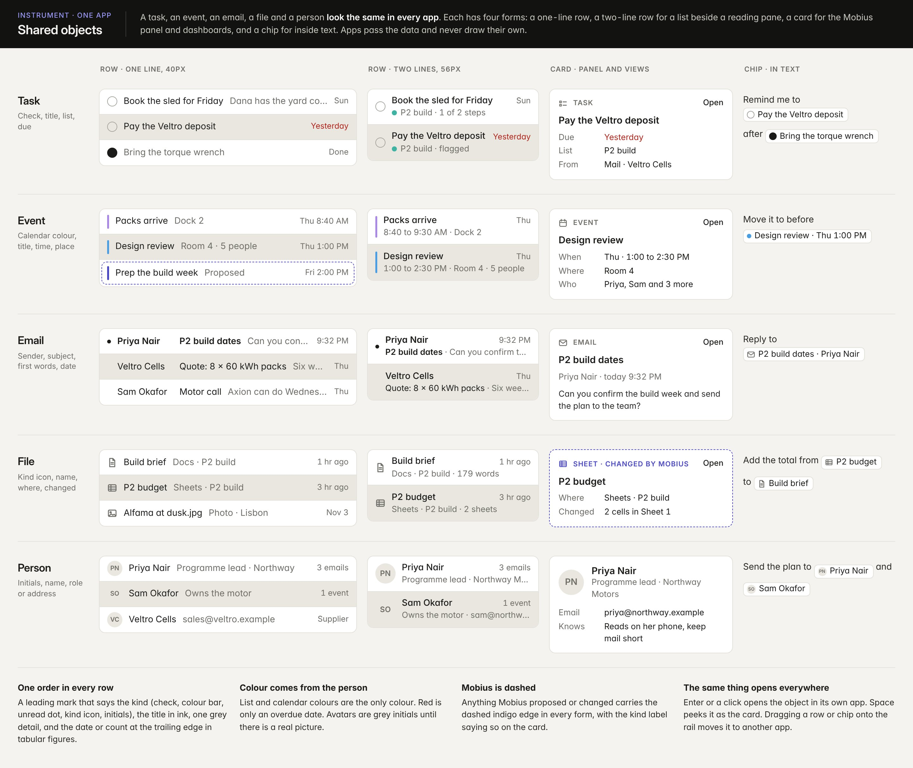

[Dark version](img/mobius-shared-objects-dark.jpg)

## 02. The two-axis pad

*For review*

One point sets two things at once. Both ends of both axes are named in words, a hollow mark shows where Mobius started, and the values read out under the pad. Music uses it first and any Adjust card can.

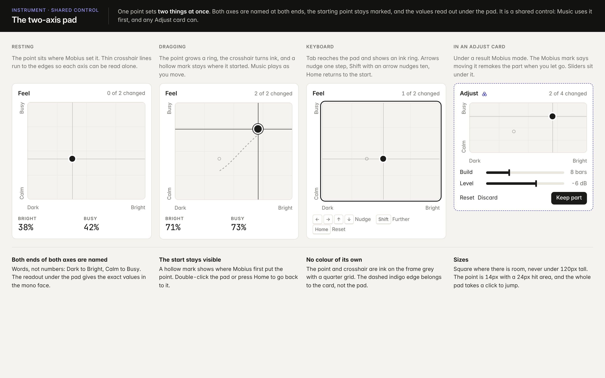

[Dark version](img/mobius-xy-pad-dark.jpg)

## 03. Empty states, one drawing per app

*For review*

Twenty-four drawings in one style: a single grey line, no faces, no fill, no colour. Each sits over one plain line and the New action with its key. Only the apps Mobius runs carry a dashed indigo stroke.

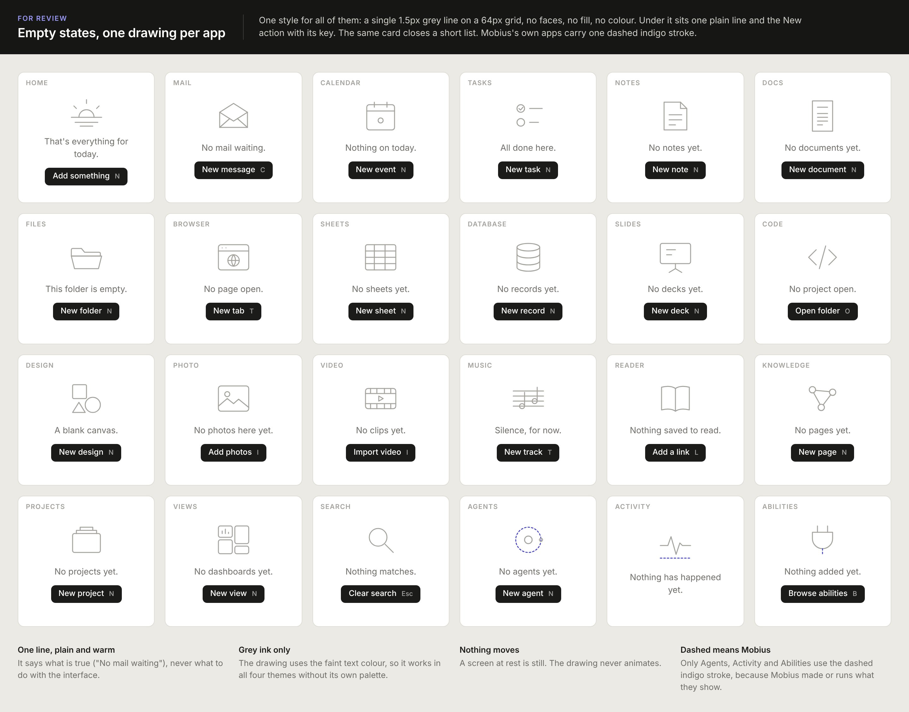

[Dark version](img/mobius-empty-states-dark.jpg)

## 04. After the result: Compare, Check, Repeat

*Proposal*

Three more cards for a finished result. Compare chooses between versions or mixes them, Check lets the app test the result before you keep it, and Repeat turns what you just did into a skill, a button or a schedule.

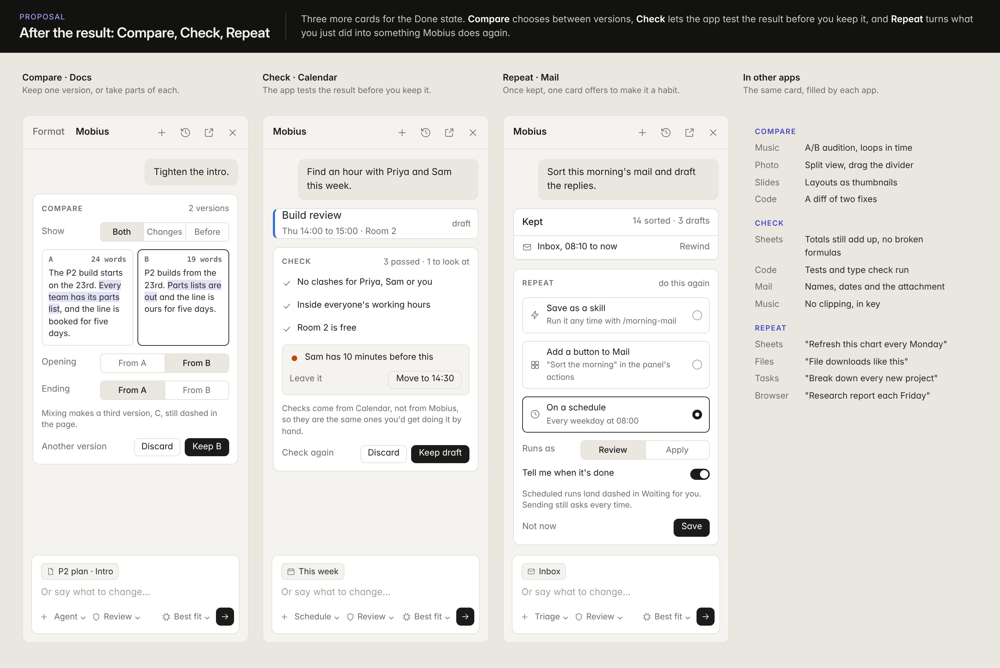

[Dark version](img/mobius-after-result-dark.jpg)

## 05. Around the work: Sources, Preview, Watch

*Proposal*

Sources shows what Mobius read as real objects you can open. Preview shows what a bigger job will touch before it runs. Watch is a standing request that lives in the glance card until it fires.

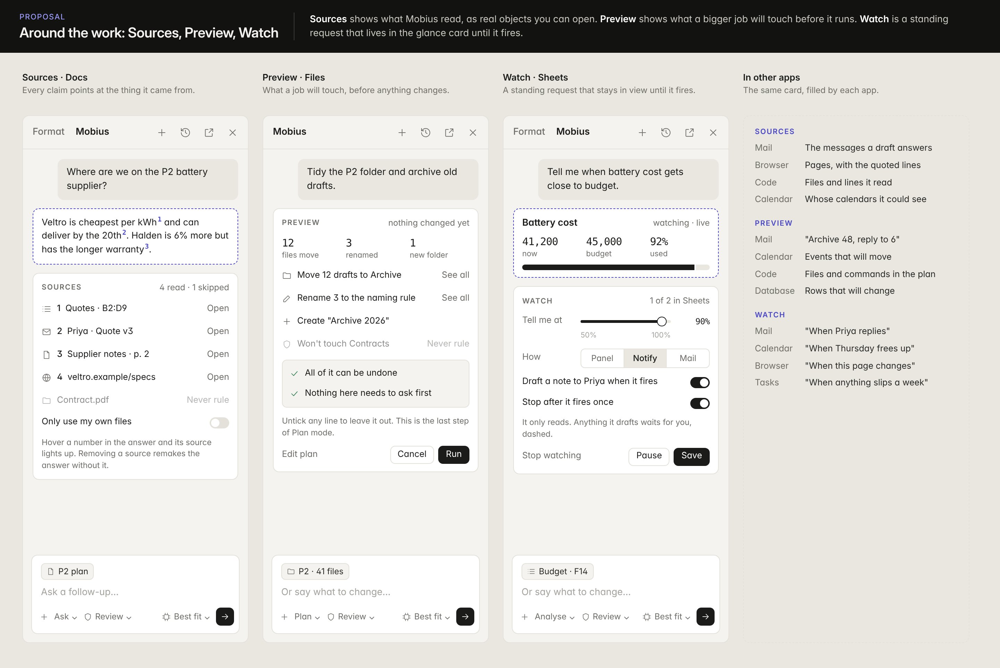

[Dark version](img/mobius-around-work-dark.jpg)

## 06. The Manipulator, play with the result

*Proposal*

A fifth slot. After Mobius makes something, an Adjust card shows the few controls that shaped it: sliders, switches and a pad. Move one and the result changes in place, still dashed, until you keep it.

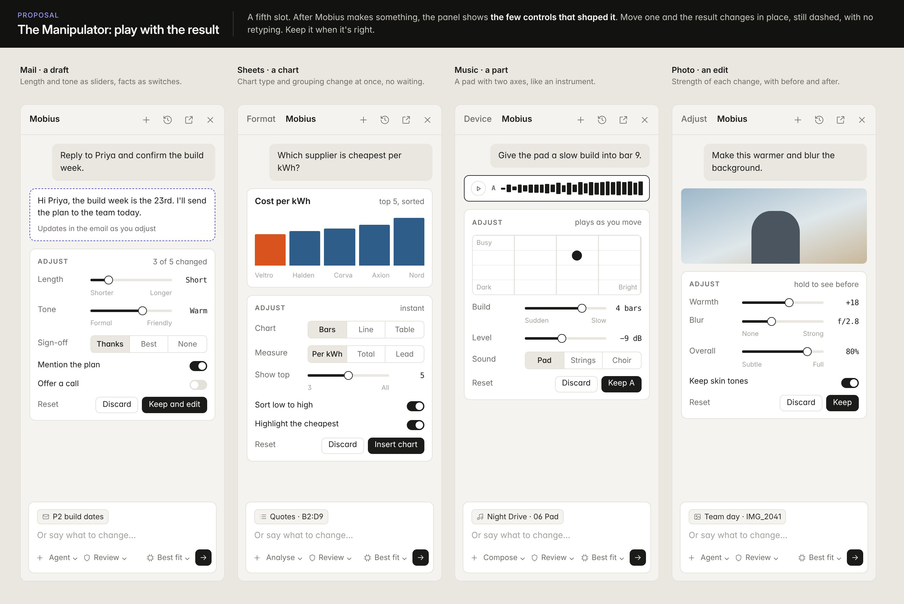

[Dark version](img/mobius-manipulator-dark.jpg)

## 07. The Mobius panel, shaped by the app

*Proposal*

The four states stay the same everywhere. Each app fills four slots: a glance at the top, its own actions, its own way to show a result, and its own pickers for questions. The dashed labels on the image mark which slot is which and are not part of the design.

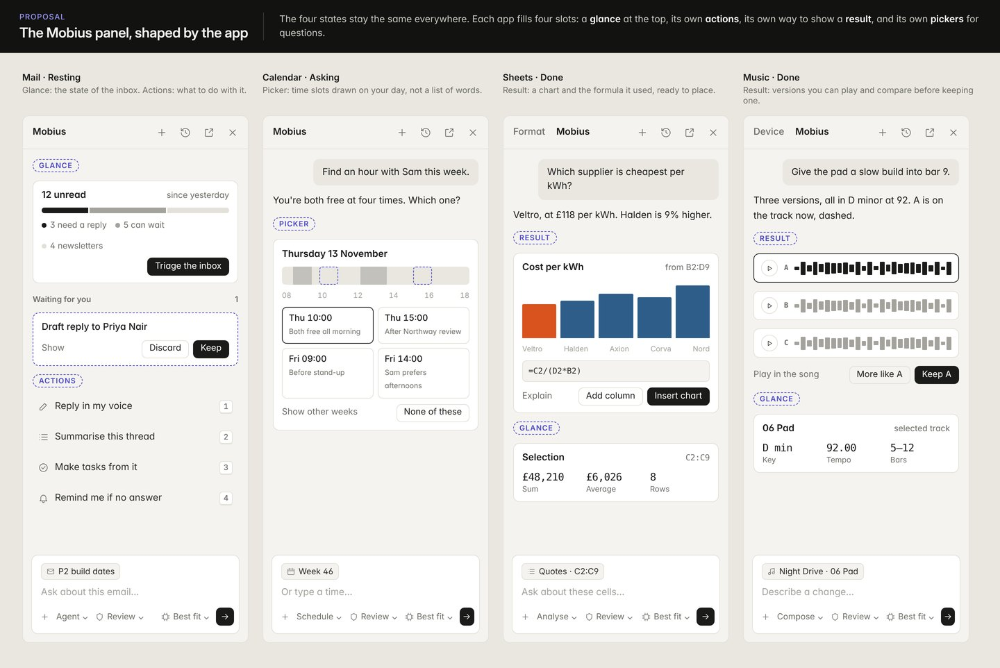

[Dark version](img/mobius-panel-apps-dark.jpg)

## 08. The composer, four controls

*Proposal*

Mode is the kind of help (Agent, Ask, Plan, plus each app's own). Permission is how much runs without asking. Model is who answers. The plus button holds everything else: context, skills, plugins, apps and permissions.

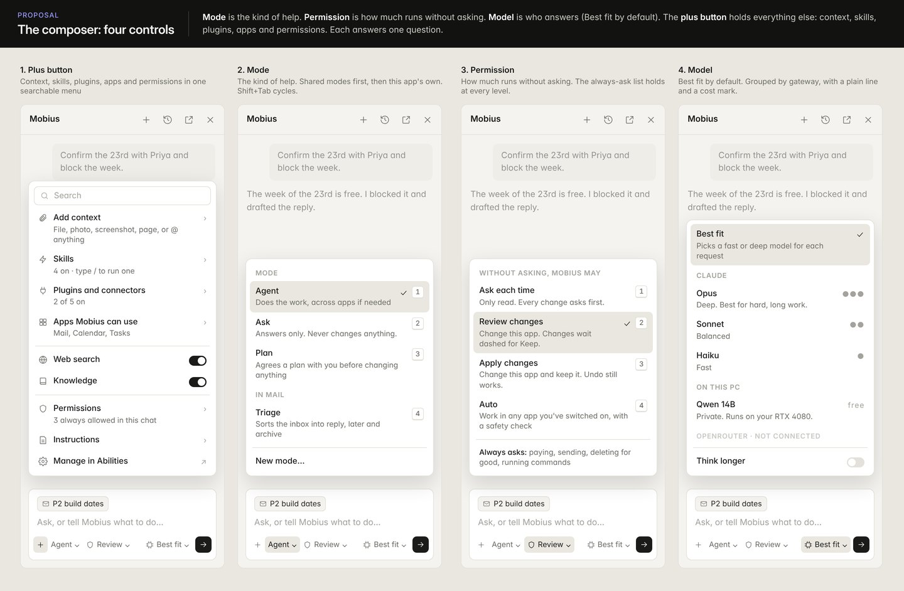

[Dark version](img/mobius-composer-dark.jpg)

## 09. The Mobius panel, four states

*Proposal*

The panel is never empty: it opens on what is waiting for you and what it can do with your selection. Work shows as numbered steps that name each app, results as the real objects with one summary to keep or discard, and questions and approvals as buttons.

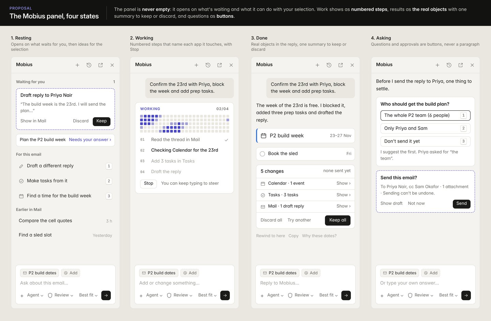

[Dark version](img/mobius-panel-dark.jpg)

## 10. Tasks, denser but finished

*Linear*

14px text on 40px rows, strong ink contrast, one row height everywhere, grouped sections with counts, tabular dates, and a key-hint bar instead of extra buttons. It packs more in than today's Tasks, but never looks empty.

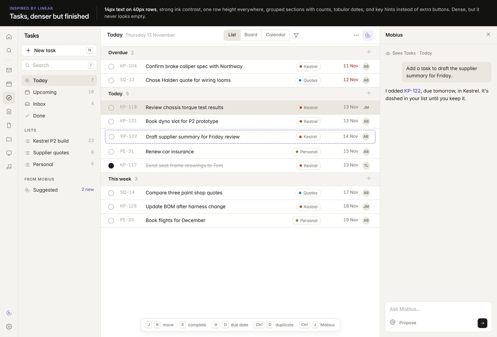

[Dark version](img/linear-dark.jpg)

## 11. Home, comfortable and calm

*Things 3*

A big display heading, 15px body text, 44px rows and a centred reading column, so a short day still looks composed. The end of the list is a designed moment with a small drawing, not leftover grey.

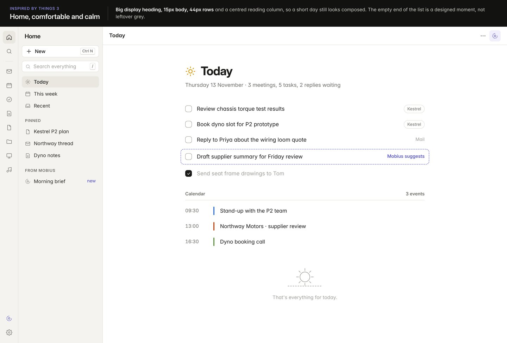

[Dark version](img/things-dark.jpg)

## 12. Music, labelled and alive

*Teenage Engineering*

Every control is labelled in small caps and numbered, numbers are monospace, the grid is strict, and there is one bold content accent. Personality lives in one place: Mobius working shows a dot-matrix pattern with numbered steps and Stop.

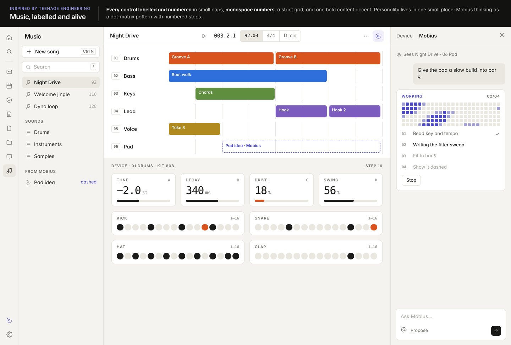

[Dark version](img/te-dark.jpg)

## 13. Calendar, one accent and exact times

*Notion Calendar*

Tabular figures for every time and date so they line up, events as soft tints with one strong edge, an ink badge for today, and the red now line as the only loud colour.

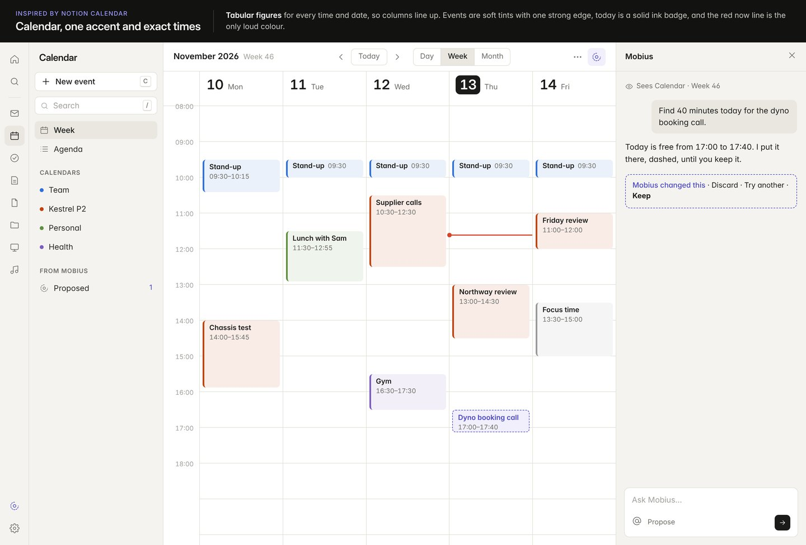

[Dark version](img/cal-dark.jpg)

## 14. Slides, panels that dock and tab

*Zed and Figma UI3*

Format is a tab before Mobius in the right panel, notes live in the bottom area, and one Panels menu shows, hides and moves panels and saves layouts, each with a shortcut. The canvas stays clear.

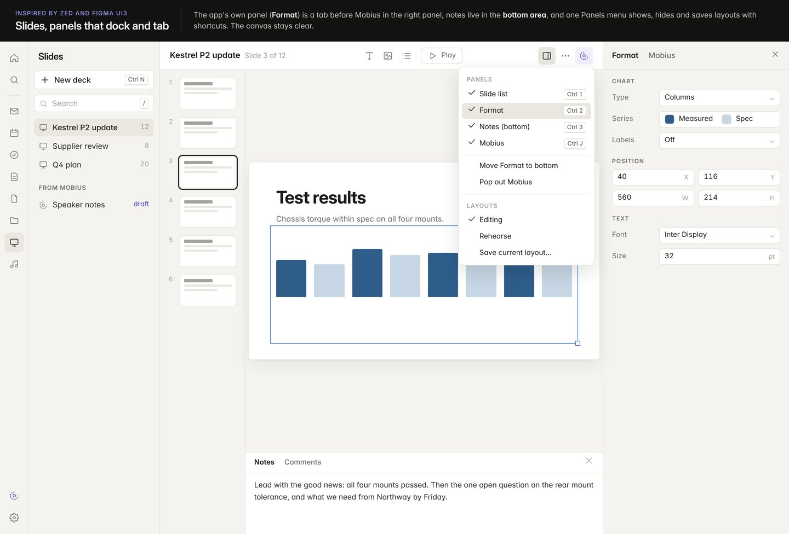

[Dark version](img/panels-dark.jpg)

## 15. One launcher for apps, actions and Mobius

*Raycast and Superhuman*

Type, then act: results in clear sections, each row shows its key, and the footer teaches the next keys. Asking Mobius is just another row, dashed like everything Mobius touches.

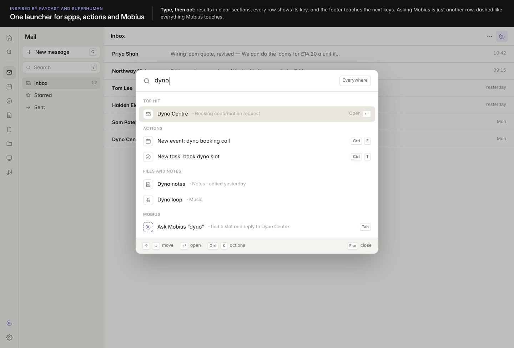

[Dark version](img/launch-dark.jpg)
