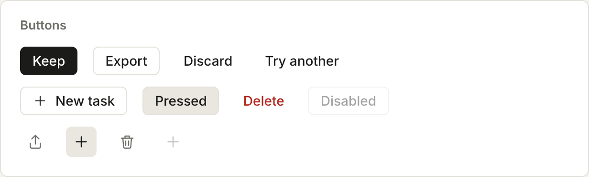
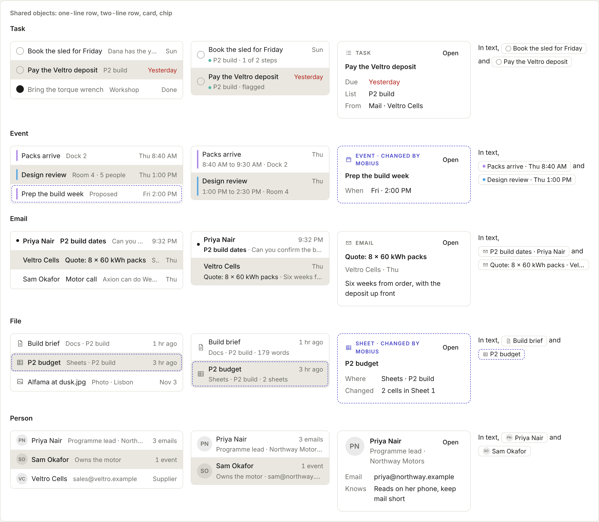
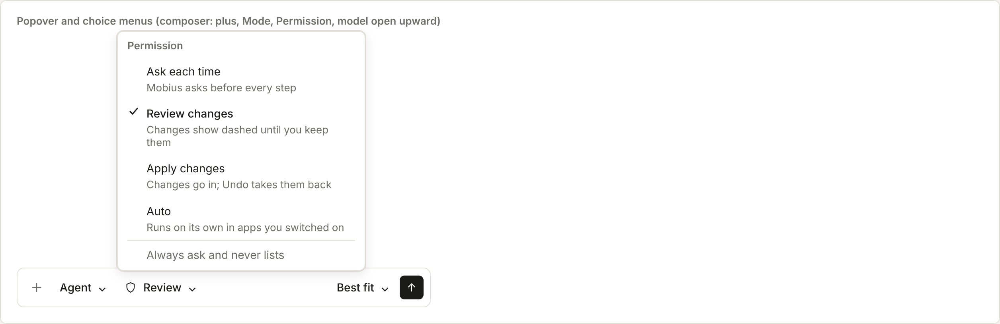
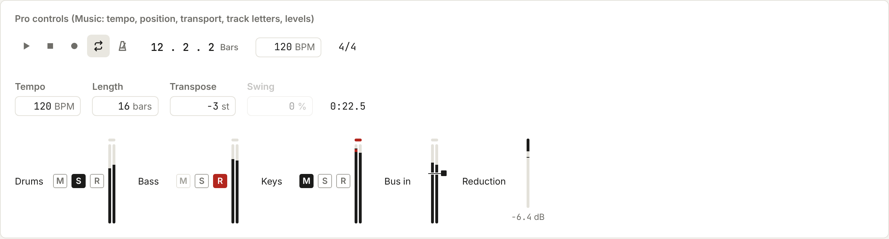
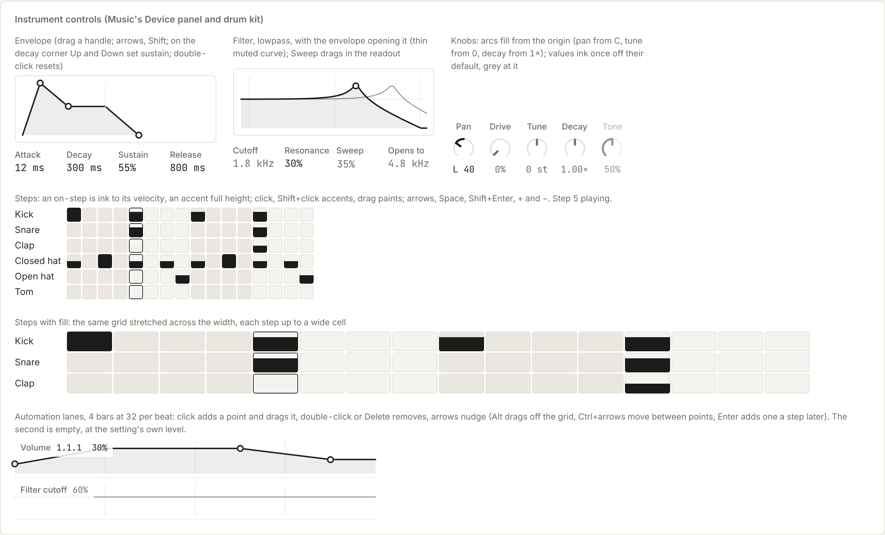
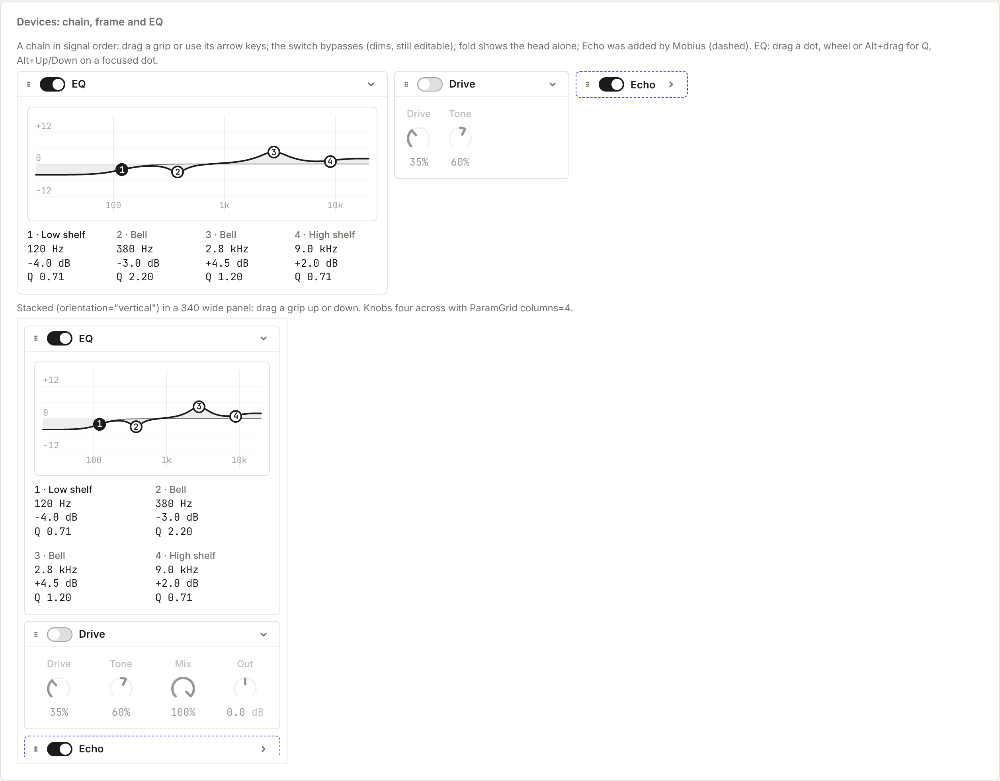
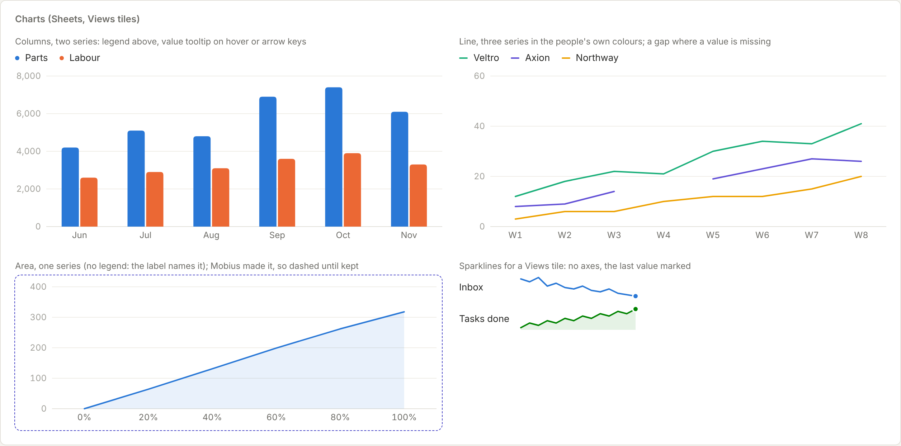

# Shared controls

Every app uses the same menus, and over time the same dialogs, popovers, switches and pickers, from
`apps/desktop/src/ui/`. They behave alike everywhere (keyboard, focus, screen readers, staying inside the window) and
look like one product.

## The stack

| Part | Used for |
| --- | --- |
| React and TypeScript | The interface |
| [Base UI](https://base-ui.com) (`@base-ui/react`) | Behaviour of menus and other controls: focus, keys, typeahead, ARIA, placement. It draws nothing itself |
| Plain CSS with `tokens.css` | The look. `src/ui/ui.css` styles the shared controls by Base UI's data attributes (`[data-highlighted]`, `[data-disabled]`, `[data-open]`) |
| Motion | Movement. Menus grow out of what opened them and go back there when they close (`growFrom` and `morphOut` in `motion.tsx`) |

There is no Tailwind. Colours, sizes, spaces and timings come only from `tokens.css`.

## What is there now

| Control | Import | Use it for |
| --- | --- | --- |
| `Menu` | `import { Menu } from './ui'` | A menu that opens from a button. Pass the button as `trigger` and the rows as `entries` |
| `PointMenu` | `import { PointMenu } from './ui'` | A menu at a point, such as a right-click. It is open while mounted and calls `onClose` when it has gone |
| `ContextMenu` | `import { ContextMenu } from './ContextMenu'` | A row's context menu, with the standard action icons and labels. It is built on `PointMenu` |
| `UndoToast` | `import { UndoToast } from './ui'` | The offer to take back what just happened: one line on what changed, Undo and ×. Bottom-centre of the app's page, opaque, never takes focus (so Ctrl+Z keeps working where the person is). Render it inside the page's positioned box while there is something to undo |
| `ToolbarControls` | `import { ToolbarControls } from './ui'` | Your app's own controls in the toolbar's middle (zone 3), written in your app's file. They show while your app is on screen. Keep to what is used often; the rest goes in your app's menu (⋯) |
| `ToolbarItem` | `import { ToolbarItem } from './ui'` | One of your toolbar controls with a priority for when the toolbar is short of room. Controls that don't fit drop into the one ⋯, first, above your app's commands: lowest priority first (`priority="low"`), the last first; `"keep"` never drops (the `ViewSwitch` is keep). Each direct child of `ToolbarControls` drops as one; a plain button becomes a row that presses it (ticked when pressed, with its `keys`), a view switch becomes ticked choices. Wrap anything else (a field, a group) and give it `menu={[…]}` rows, or it has no row when dropped |
| `ViewSwitch` | `import { ViewSwitch } from './ui'` | Your app's views (Day, Week, Month) as a segmented switch, the current one ink-inverted. Put it inside `ToolbarControls`. One view shows nothing |
| `AppSidebar`, `SidebarSearch`, `SidebarSection`, `SidebarRow` | `import { AppSidebar, … } from './ui'` | Your app's sidebar (zone 2), in the same order in every app: Search, your places in named sections, From Mobius, More. The shell draws the head above it (your app's name, New, Pinned). `AppSidebar` takes your own `className` and `data-*`; `SidebarSection` can be `foldable` (open or shut from its name); `SidebarRow` takes a `sub` line under the name (the row is still named by its label alone, so tests can find it by title) and a `trail` of extra controls after the row button (a hover Pin, an inline Confirm, a "to review" note); the hover and current fill cover the whole row, trail included |
| `PanelLayout` | `import { PanelLayout, type PanelSpec } from './ui'` | Your app's panels (stage 1: show, hide, resize). Wrap your page in it and pass `app` and `panels`: each has an `id`, `name`, `dock` (`'bottom'` under your content, or `'right'` beside it, before Mobius), whether it starts `shown`, optional `keys` (`'mod+shift+o'`), an optional starting `size` for its dock in pixels (until the person resizes it) and `render`. The frame lists them in the toolbar's Panels menu with ticks and keys, Ctrl+J shows and hides the bottom dock, each dock's edge drags to resize (double-click for the default size), and what is shown and each dock's size are kept per app. Every panel gets the same header (its name, then close); put its controls in its body |
| `PanelTab` | `import { PanelTab } from './ui'` | One of your app's panels as a tab in the right panel, before Mobius (Photo's Adjust, Music's Device, Docs' Outline). Render `<PanelTab id="adjust" name="Adjust">…</PanelTab>` anywhere in your app; it shows while your app is on screen and the right panel is open. Your tabs come first, Mobius is always last, and the panel opens again on the tab last used in your app (your first tab until one is chosen). The tab row has the close; put the panel's controls in its body. To bring a tab forward from your own controls (Photo's Adjust, Filters and Crop), call the function from `useShowPanelTab()` with its id (or `'mobius'`); it opens the right panel first when it is shut. When the person asks Mobius something (a start from your sidebar, `onAsk`, the Mobius button), or Mobius is waiting for their answer to a step, the shell brings Mobius in front of your tab for you |
| `useKeyboardClaim` | `import { useKeyboardClaim } from './ui'` | Take the keyboard for your app while `active` is true (Music's piano keys): `useKeyboardClaim(playingKeys)`. While held, the shell's bare-key shortcuts (C for comments, any shortcut bound to a bare key) leave the key to you; Ctrl, Cmd and Alt shortcuts and Escape still work. Don't catch keys in the capture phase to get round the shell |
| `AppMenu` | `import { AppMenu } from './ui'` | Your app's own commands in the one ⋯ at the toolbar's end: `<AppMenu label="Message" entries={[…]} />` (the same `MenuEntry` rows as `Menu`), anywhere in your app. They go at the top of your app's menu there, and the ⋯ opens on it. Never draw a second ⋯ of your own in `ToolbarControls` |
| `KeyCaps` | `import { KeyCaps } from './ui'` | A shortcut drawn as key caps (`<KeyCaps keys="Ctrl+Shift+N" />`), as menus, tooltips and the New button show them. Menus draw their `keys` this way already |
| Tooltips | nothing to import | Every control's `title` shows as the shared ink tooltip. End the title with its shortcut in brackets (`title="Undo (Ctrl+Z)"`) and the shortcut is drawn as key caps after the name. An icon-only button always has a title |
| `KeyHintBar` | `import { KeyHintBar } from './ui'` | The key-hint bar for a list view: `<KeyHintBar id="mail" hints={[{ keys: 'E', label: 'Archive' }]} />` as the last child of the scrolling list. Up to five keys; it hides itself after the keys have been used a dozen times, and never shows when Key hints is off in Settings › Appearance. Mail uses it |
| `AppFrame` | used by `App.tsx` only | The five zones every app sits in. Apps do not render it; they fill its parts with the pieces above |

Each row (`MenuEntry`) has a `label`, a `run`, and optionally an `icon`, `keys` (its shortcut), `danger`, `disabled`
and `separated` (a line before it), `checked` for a row that is on or off (it then shows a tick), and `detail` for a grey
line under the label on what it does ("Echo: Repeats that fade"). Use `Menu` for commands; `ChoiceMenu` is for a setting
that stays chosen. The chosen row runs at once as the menu goes (a copy of it fades out in place), so focus goes where the row sends it and keys typed straight after land there, not in the menu.

## The groups

Each group has its own page, with a picture of every control in its states.

| Group | What is in it | |
| --- | --- | --- |
| [Basic controls](ui/basics.md) | `Button`, `IconButton`, `TextField`, `Select`, `Segmented`, `Switch`, `Checkbox`, `Slider`, `ParamCell`, `Meter`, `Progress`, `Chip`, `Dot`, `Count`, `StatusLetter`, `StatusText`, `Avatar`, `ListRow`, `Swatches` |  |
| [Shared objects](ui/objects.md) | `ObjectRow`, `ObjectCard`, `ObjectChip` |  |
| [Menus, dialogs and dates](ui/menus-and-dialogs.md) | `Popover`, `ChoiceMenu`, `Dialog`, `Confirm`, `ContentTabs`, `DateField`, `TimeField`, `TimeRange`, `MonthPicker` |  |
| [Pro controls](ui/pro-controls.md) | `NumberField`, `Readout`, `LetterToggle`, `Transport`, `LevelMeter`, `GainReductionMeter` |  |
| [Instrument controls](ui/instruments.md) | `Knob`, `EnvelopeGraph`, `FilterGraph`, `StepGrid`, `AutomationLane`, `XYPad`, `WaveformView`, `PadGrid` |  |
| [Devices](ui/devices.md) | `DeviceChain`, `DeviceFrame`, `EqGraph` |  |
| [Charts](ui/charts.md) | `Chart` (columns, lines, areas), `Sparkline` |  |

**The reference sheet.** Every control, in its states, is on one dev-only page: run `npm run dev -w @mobius/desktop`
and open `http://127.0.0.1:5180/ui-sheet.html` (add `?density=compact` or `?theme=mid`; dark follows the system). It is
not part of the built app.

**Adding a control.** Put it on the sheet (`src/ui-sheet/Sheet.tsx`) inside a `<Card shot="…">`, then run
`npm run ui-shots -w @mobius/desktop` (or `npm run ui-shots -w @mobius/desktop -- devices` for one group). Each card
becomes `docs/developers/ui/img/<shot>.png`. Show the picture on its group's page and describe the control there. A test
fails when a card has no picture or its picture is on no page. Retake the pictures when a control's look changes.

More controls are added one at a time.

## Adopting the frame

The frame is the five zones in [Panel layouts](../design/panel-layouts.md): the rail, your app's sidebar, one toolbar
row, your content, and Mobius in the right dock. The shell draws the rail, the sidebar's head and the toolbar's two
ends; your app fills the rest from its own files:

1. **Sidebar.** Build it from `AppSidebar` with `aria-label="<App> sidebar"`, then `SidebarSearch`, your places in
   `SidebarSection`s of `SidebarRow`s, then From Mobius. No New button of your own unless your list starts with one
   (then add your app to `createInList` in `App.tsx`, a marked one-line edit).
2. **Toolbar.** Move your controls out of any action row inside your content into `ToolbarControls`. Views go in a
   `ViewSwitch` there. No second action row inside content.
3. **Content.** Nothing above your content but the toolbar. Mobius's proposals show in your content first (dashed), with
   the explanation in the Mobius panel.

```tsx
<AppSidebar label="Tasks sidebar">
  <SidebarSearch label="Search tasks" value={query} onChange={setQuery} />
  <SidebarSection title="Lists" action={<button type="button" aria-label="New list" onClick={newList}>+</button>}>
    {lists.map((l) => <SidebarRow key={l.name} label={l.name} count={l.open} current={l.name === open} onSelect={() => show(l.name)} />)}
  </SidebarSection>
</AppSidebar>

<ToolbarControls label="Calendar">
  <ViewSwitch label="View" views={[{ id: 'day', name: 'Day' }, { id: 'week', name: 'Week' }]} value={view} onChange={setView} />
</ToolbarControls>
```

```tsx
{deleted && <UndoToast text={`Deleted “${deleted.title}”`} onUndo={restore} onDismiss={() => setDeleted(null)} />}
```

## Guards

`src/ui/guards.test.ts` runs with the unit tests:

- **No new hand-drawn menus.** A file outside `src/ui` with `role="menu"` fails the test, unless it is on the list of
  files that still have their own menu. That list only shrinks. When you move a file to `ui/Menu`, take it off the list.
  Each kind of control joins this guard once `src/ui` offers it.
- **Only tokens in `src/ui`.** The style sheets in `src/ui` may not name a colour (`#hex`, `rgb()`, `hsl()`) or a pixel
  size of their own. Add a token to `tokens.css` instead.
