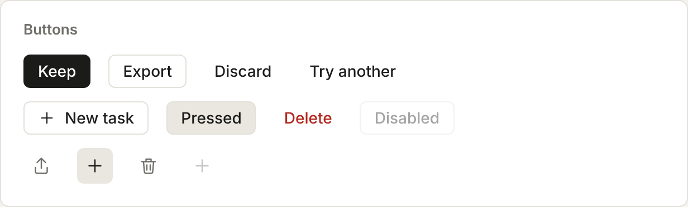
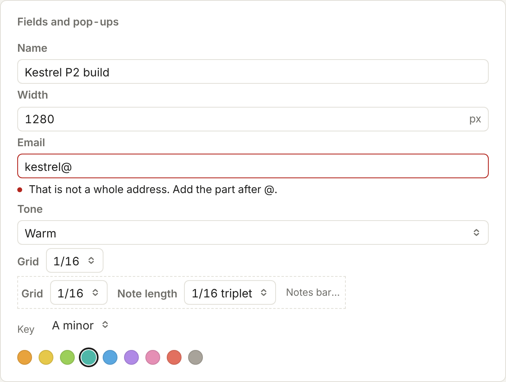
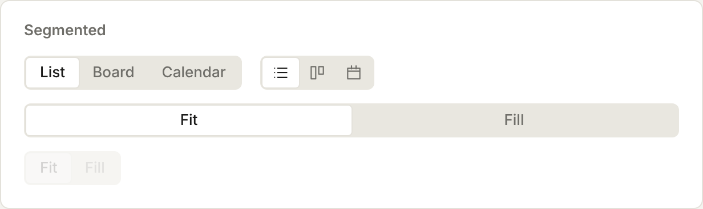
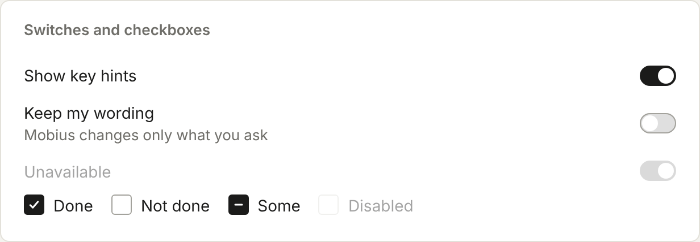
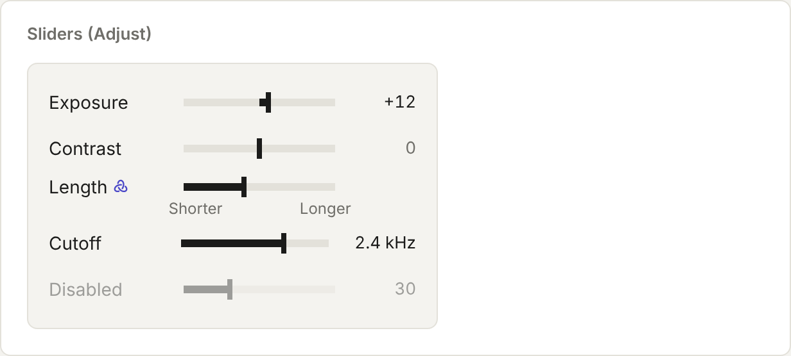
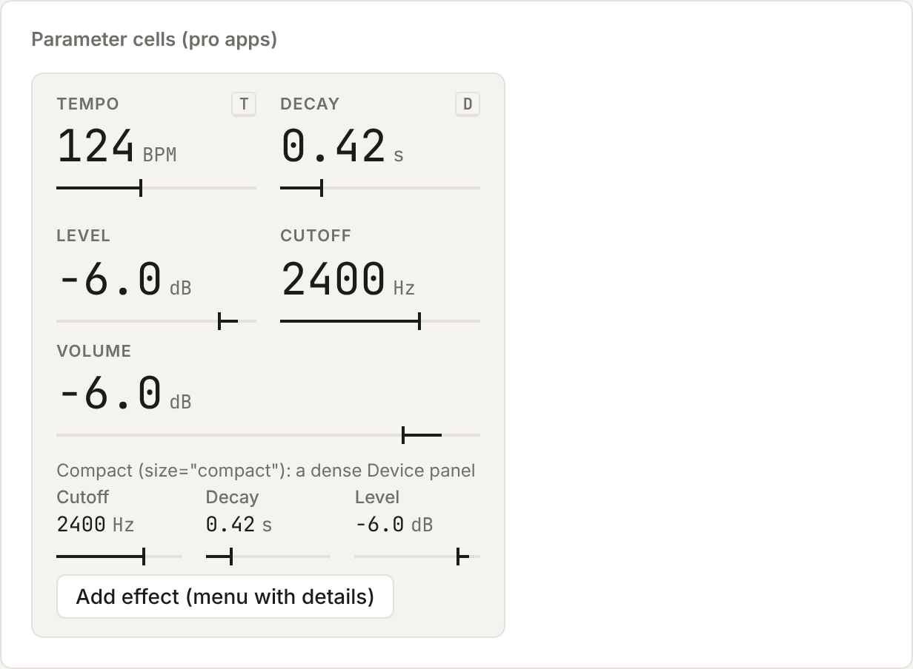
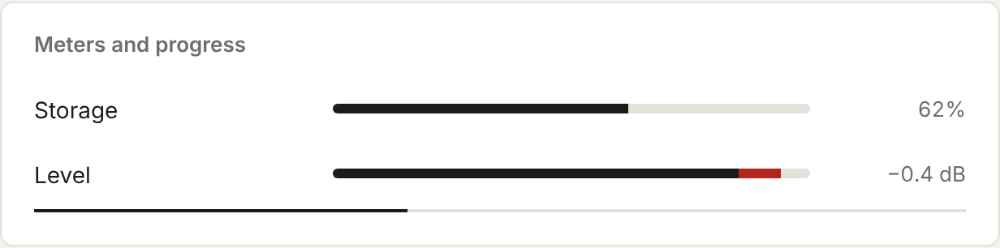
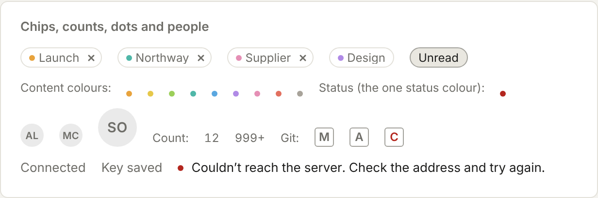
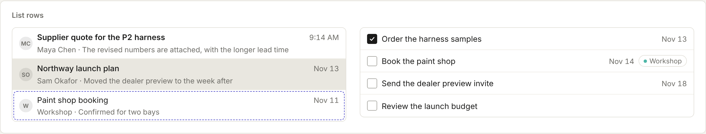

# Basic controls

Buttons, fields, switches, sliders, readouts, meters, chips and rows: the controls every app uses.

Back to [Shared controls](../shared-controls.md). Pictures: light theme, comfortable density, taken from the reference sheet by `npm run ui-shots`.



















Instrument's "Controls" and "Pro app readouts" ([Instrument](../../design/instrument.md)), all from `./ui`. Sizes follow the
density: the window's, or compact for pro apps (the frame sets it). Values use tabular figures; readouts use the mono face.

| Control | Use it for |
| --- | --- |
| `Button` | `kind="primary"` (solid ink, one per view at most), `"secondary"` (the default: paper with a hairline) or `"quiet"` (text only: toolbars, rows, and Discard and Try another beside one primary Keep). Optional `icon`, `keys` (added to the tooltip), `pressed` for a toggle, `danger` for red text |
| `IconButton` | A line icon with no border. `label` is required: it is the accessible name and the tooltip, with `keys` after it. `primary` makes the one ink icon button of an area (the composer's Send) |
| `TextField` | A field with its `label` above (or `hideLabel`), a grey `unit` or key hint at the trailing end, and `error`: one plain sentence under it with a red dot. `onChange` gets the text |
| `Select` | A pop-up: a field with up and down chevrons that opens the shared menu, the chosen row ticked. Pass `choices` (`{ value, label }`) |
| `Segmented` | A small set of choices all worth seeing: a grey track, the chosen one on paper. `iconOnly` for icons (the label becomes the tooltip), `wide` to fill a panel's width. Arrow keys move it. The toolbar's views keep using `ViewSwitch` |
| `Switch` | On and off at the trailing end of its row, the label leading, an optional grey `detail` line. Use it in settings lists and Adjust cards |
| `Checkbox` | A rounded square, ink when checked; `indeterminate` for "some of them". Tasks keeps its round circles |
| `Slider` | Photo's slider: a grey track filled in ink from the `origin` (zero, or `min`) to the value, a slim tick, the value grey until it moves. `format` for units, `scale="log"` for Hz and times, `ends={['Shorter', 'Longer']}` to name the ends, `remake` for an Adjust control that makes the result again when let go (it shows the Mobius mark). `onChange` runs as it moves, `onCommit` once when let go. Shift+arrows nudge further; double-click goes back to `reset`. `proposed` marks a value Mobius set and nobody has kept (indigo value, dashed indigo edge); a value changed from outside glides to place over 300 ms |
| `ParamCell`, `ParamGrid` | Pro app readouts: a small all-caps label, the value large in mono with its `unit`, a thin slider under it, and an optional `keyHint` letter in the corner. Same props as `Slider`. `ParamGrid` puts them two to a row. `size="compact"` is for a dense pro panel (Music's Device): the name in sentence case, small and grey, and the value at body size |
| `Meter`, `Progress` | A level set elsewhere (storage, a track's level), `threshold` makes only the part past it red (clipping, nearly full); and known progress as a thin ink line. No spinners in content |
| `Chip` | A label or tag: outlined pill, a content-colour dot, grey text. `onRemove` adds ×, `onClick` makes it a filter (`pressed` when on) |
| `Dot`, `CONTENT_COLORS` | A content colour as a small dot (the one palette of eight plus stone), or `red` for overdue or failed |
| `Count` | A plain grey tabular number at a row's end. Nothing for zero; never a badge |
| `StatusLetter` | A grey mono letter with its meaning as the tooltip (Code's M, A, D); `tone="red"` for a conflict |
| `StatusText` | "Connected", "Key saved": grey, no dot. `problem` shows a red dot and one plain sentence. Never a green dot |
| `Avatar` | A grey circle with initials (from a name or an address), or `src` for a photo. `size="large"` for a person's card |
| `ListRow` | A row in a content list, inside `<ul role="list" className="ui-list">`: `lead` (a Checkbox, Avatar or icon), `title`, `meta` (date or size, trailing, tabular), and `detail` for the two-line row beside a reading pane (Mail, Notes). `unread` is a semibold title, `current` the grey fill, `proposed` the dashed Mobius edge, `trail` controls inside the row's fill |

```tsx
<Slider label="Length" value={length} onChange={setLength} onCommit={remakeDraft} ends={['Shorter', 'Longer']} remake hideValue />
<ParamGrid label="Device">
  <ParamCell label="Cutoff" unit="Hz" min={20} max={20000} scale="log" value={cutoff} onChange={setCutoff} keyHint="C" />
</ParamGrid>
<ul role="list" className="ui-list">
  <ListRow lead={<Avatar name={m.from} />} title={m.subject} meta={time(m.at)} detail={m.preview} unread={!m.read} current={m.id === open} onSelect={() => show(m.id)} />
</ul>
```

Music asked for these, and they work everywhere:

- `Select inline` puts the name beside the box, for toolbars and bars.
- `Select quiet` is text with chevrons, with a grey fill on hover and while open, for a toolbar's sub line.
- `ParamGrid columns={1}` takes a lone cell such as Volume. `columns={3}` also works, `columns={4}` sets knobs four across (a 340-wide side panel), and a `wide` ParamCell spans its row.
- On a log scale (Cutoff, Attack, Release), the arrows move a twelfth of an octave and Shift+arrows half an octave, always at least one `step`.
- `Swatches` picks a content colour: round swatches in a radio group, a ring on the chosen one, names as tooltips, and arrows to move. Use it for track, list and calendar colours.
