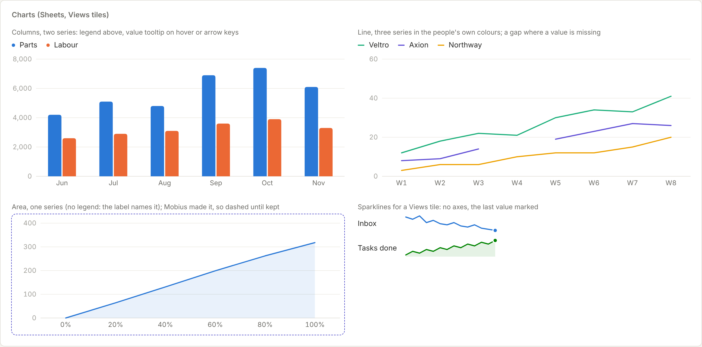

# Charts

Columns, lines and areas for Sheets and any app that shows numbers, and sparklines for Views tiles.

Back to [Shared controls](../shared-controls.md). Pictures: light theme, comfortable density, taken from the reference sheet by `npm run ui-shots`.



The data is the only loud thing. One y axis from zero, a hairline grid one step off the paper, faint tabular axis figures, columns at most 24 wide with a rounded top and a square base, 2-wide lines, a 10% wash under an area. Text is always ink, body, muted or faint; only the marks carry colour.

| Control | Use it for |
| --- | --- |
| `Chart` | `kind` is `'column'` (the default), `'line'` or `'area'`. Pass `categories` (the x axis) and `series` (`{ name, values, color? }`, a value of `null` leaves a gap). Two or more series get a legend above. Hovering, or the arrow keys once the chart has focus, shows every series' value for that category in a raised tooltip, with `format` writing the values (the axis keeps short figures: 8,000, 12K, 4.2M). A screen reader gets the numbers as a table captioned with `label`. `height` sets the plot's height; the width follows the container. `proposed` gives the dashed indigo edge of a chart Mobius made that waits for Keep |
| `Sparkline` | A trend beside a number on a tile or a row: no axes, the last value marked with a dot. `label` names it for screen readers; `area` adds the wash |

**Colour.** A series takes the person's content colour (`color: 'teal'`), drawn at its chart step (`--chart-teal` in `tokens.css`, deeper than the swatch so it holds its own on paper). Series without one take the next in `CHART_ORDER`: blue, coral, teal, amber, pink, green, violet, yellow, an order checked for colour-blind separation in light and dark. Colour follows the series, never its place, so filtering one out does not repaint the rest. Never use two y axes: put two measures of different size in two charts. Past eight series, fold the rest into "Other".

```tsx
<Chart label="P2 build spend by month" categories={months} format={money}
  series={[{ name: 'Parts', values: parts }, { name: 'Labour', values: labour }]} />
<Chart label="Cells tested per week" kind="line" categories={weeks}
  series={suppliers.map((s) => ({ name: s.name, color: s.color, values: s.tested }))} />
<Sparkline label="Unread mail, last 14 days" values={unread} />
```
