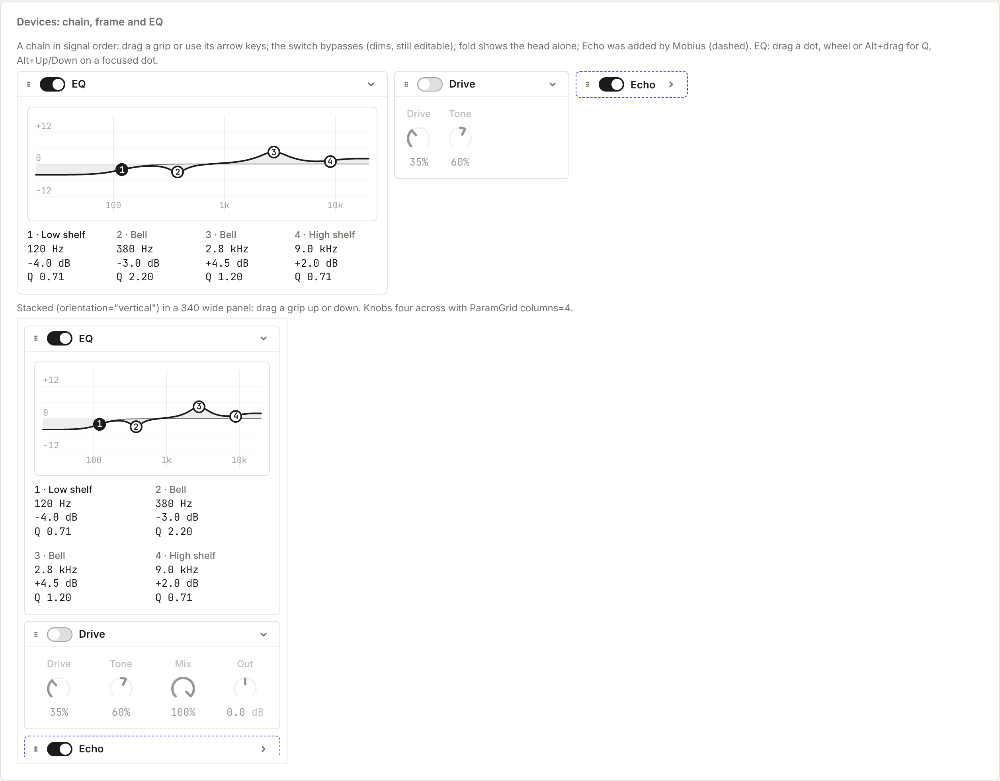

# Devices

Devices in a chain, each in a frame, and the EQ.

Back to [Shared controls](../shared-controls.md). Pictures: light theme, comfortable density, taken from the reference sheet by `npm run ui-shots`.



Instruments and effects sit in devices, and devices sit in a chain in signal order.

| Control | Use it for |
| --- | --- |
| `DeviceChain` | The row of devices: `label`, `count` and `onMove(from, to)`. It scrolls sideways when the devices don't fit. `orientation="vertical"` stacks them top to bottom for a narrow side panel: it fills the panel's width, grips drag up and down, and scrolls down when they don't fit. In a narrow panel the EQ's values go two to a row |
| `DeviceFrame` | One device. The head has a grip, an on/off `Switch`, the title, optional `actions` and a fold. To move a device, drag its grip along the chain, or focus the grip and use the arrow keys (Home and End go to the ends). Off dims the controls but keeps them editable, as a bypass does. `collapsed` shows the head alone. `proposed` gives the dashed indigo edge for a device Mobius added that waits for Keep |
| `EqGraph` | Three or four bands (`{ type: 'lowshelf' \| 'peak' \| 'highshelf', freq, gain, q, on? }`) over 20 Hz to 20 kHz and ±18 dB. Each band has a numbered dot: across is frequency and up is gain (a shelf's dot sits halfway up its step). The wheel or Alt+drag sets Q, and on a focused dot Alt+Up and Alt+Down do. The chosen band's own shape shows faintly under the whole curve, and every band's values read in a column underneath. `bandLevel` and `eqLevel` give the curve in dB, the same way Web Audio's BiquadFilter computes it |

```tsx
<DeviceChain label="Bass effects" count={devices.length} onMove={moveDevice}>
  {devices.map((d, i) => (
    <DeviceFrame key={d.id} title={d.name} index={i} on={d.on} onToggle={(on) => setOn(d.id, on)} collapsed={d.folded} onCollapse={(f) => fold(d.id, f)}>
      {d.kind === 'eq' && <EqGraph bands={d.bands} onChange={(i, band) => setBand(d.id, i, band)} />}
    </DeviceFrame>
  ))}
</DeviceChain>
```

