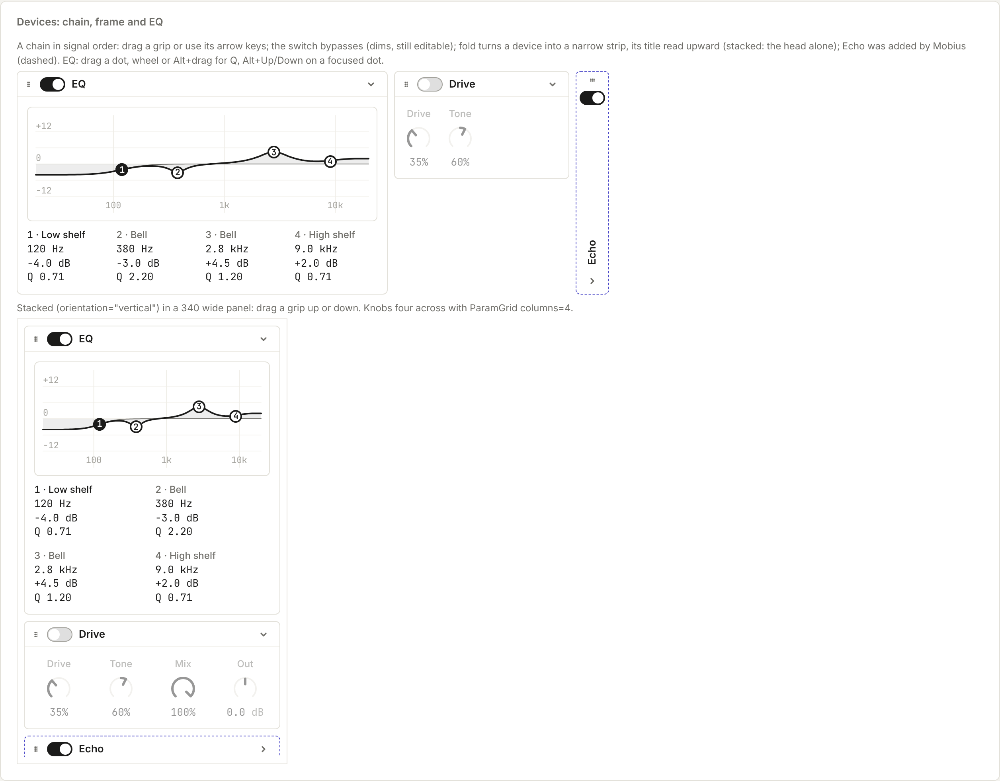
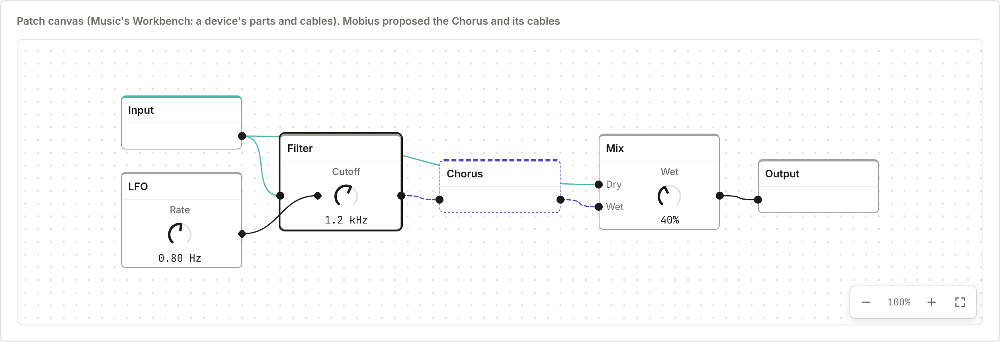

# Devices

Devices in a chain, each in a frame, the EQ, and the patch canvas that joins a device's parts.

Back to [Shared controls](../shared-controls.md). Pictures: light theme, comfortable density, taken from the reference sheet by `npm run ui-shots`.



Instruments and effects sit in devices, and devices sit in a chain in signal order.

| Control | Use it for |
| --- | --- |
| `DeviceChain` | The row of devices: `label`, `count` and `onMove(from, to)`. It scrolls sideways when the devices don't fit. `orientation="vertical"` stacks them top to bottom for a narrow side panel: it fills the panel's width, grips drag up and down, and scrolls down when they don't fit. In a narrow panel the EQ's values go two to a row |
| `DeviceFrame` | One device. The head has a grip, an on/off `Switch`, the title, an optional `lead` right after it (such as the quiet `Select` that changes an instrument, so it stays in view on a wide device), optional `actions` and a fold. To move a device, drag its grip along the chain, or focus the grip and use the arrow keys (Home and End go to the ends). Off dims the controls but keeps them editable, as a bypass does. `collapsed` folds it: in a sideways chain it becomes a narrow strip the chain's height (grip, switch, the title read upward, and the fold button to open it), as in a DAW; in a stacked chain it shows the head alone. Its `lead` and `actions` wait until it opens. `proposed` gives the dashed indigo edge for a device Mobius added that waits for Keep |
| `EqGraph` | Three or four bands (`{ type: 'lowshelf' \| 'peak' \| 'highshelf', freq, gain, q, on? }`) over 20 Hz to 20 kHz and ±18 dB. Each band has a numbered dot: across is frequency and up is gain (a shelf's dot sits halfway up its step). The wheel or Alt+drag sets Q, and on a focused dot Alt+Up and Alt+Down do. The chosen band's own shape shows faintly under the whole curve, and every band's values read in a column underneath. `bandLevel` and `eqLevel` give the curve in dB, the same way Web Audio's BiquadFilter computes it |

```tsx
<DeviceChain label="Bass effects" count={devices.length} onMove={moveDevice}>
  {devices.map((d, i) => (
    <DeviceFrame key={d.id} title={d.name} index={i} on={d.on} onToggle={(on) => setOn(d.id, on)} collapsed={d.folded} onCollapse={(f) => fold(d.id, f)}>
      {d.kind === 'eq' && <EqGraph bands={d.bands} onChange={(i, band) => setBand(d.id, i, band)} />}
    </DeviceFrame>
  ))}
</DeviceChain>
```


## Patch canvas

A device's parts joined by cables, for Music's Workbench. The app keeps the data (where each box sits, which cables run where) and the canvas draws it and reports what people do.



| Part | Use it for |
| --- | --- |
| `PatchCanvas` | `label`, `boxes` and `cables`. A box is `{ id, x, y, title, color?, inputs?, outputs?, proposed?, children? }`, with `x` and `y` in canvas units (one to a pixel at 100%). Inputs sit on the left edge and outputs on the right, named beside the dot when a side has more than one (Dry and Wet). `children` is the box's body. Events: `onSelect` (a box or a cable, or `null` on empty canvas), `onMove` while a box is dragged or nudged and `onMoveCommit` once it is done (for undo), `onConnect(from, to)`, `onDisconnect(cableId)` and `onRemove(boxId)`. `readOnly` shows the patch: choosing and Tab still work, nothing moves or connects. `grid` (8 by default) is the snap step. It fits everything in view when it first has boxes |
| `Port` | A setting a cable can reach. Put it in a box's body beside the control it drives, `<Port id="cutoff" label="Cutoff" kind="control" />`, and a cable `to: { box, param: 'cutoff' }` ends on it. Cables to a setting are drawn over the boxes so they reach the port |
| Port kinds | `audio` (round), `note` (square) and `control` (a diamond). A port is hollow until a cable joins it. By default a cable joins an output to an input of the same kind on another box, once; pass `canConnect(from, to)` to decide otherwise. While a cable is being made, the ports it can end on stand out and the rest fade |
| Cables | Ink, or the source box's `color`, so a device can mix the track colour with ink. `levels` feeds each cable its level through a ref (`levels.current.set(cableId, db)`, about 30 a second) without a re-render, and a louder cable is drawn thicker. `proposed` boxes and cables are dashed indigo until kept |
| `layoutFlow(boxes, cables)` | First placement for a device with no positions yet: boxes go left to right in signal order, in columns on the grid, stacked and centred. Pass `height` to estimate a box's height when it has a body. Keep `x` and `y` in the device file afterwards. A feedback loop doesn't break it |

Mouse: drag a box by its head; drag from one port to another, or click one and then the other, to make a cable; click a cable to choose it. The wheel scrolls, Ctrl+wheel zooms where the pointer is, and Space+drag, a middle drag or a drag on empty canvas pans. The corner holds zoom out, the zoom (a click goes back to 100%), zoom in and Fit.

Keys: Tab goes from box to box, and the arrows go from port to port inside a box. Enter on a port starts a cable, and Enter on a port of another box ends it; Escape cancels. Delete removes the focused box, the chosen cable, or a focused port's cables. Alt+arrows nudge a box one grid step, Shift+Alt four. Every port is named for a screen reader ("Filter Cutoff setting"), and each step is announced.

```tsx
const at = layoutFlow(parts, cables); // once, then keep x and y
<PatchCanvas
  label="Wobble bass device"
  boxes={parts.map((p) => ({ ...p, ...at[p.id]! }))}
  cables={cables}
  levels={levels}
  selected={selected} onSelect={setSelected}
  onMove={moveBox} onMoveCommit={commitMove}
  onConnect={(from, to) => addCable(from, to)} onDisconnect={removeCable}
/>
```
