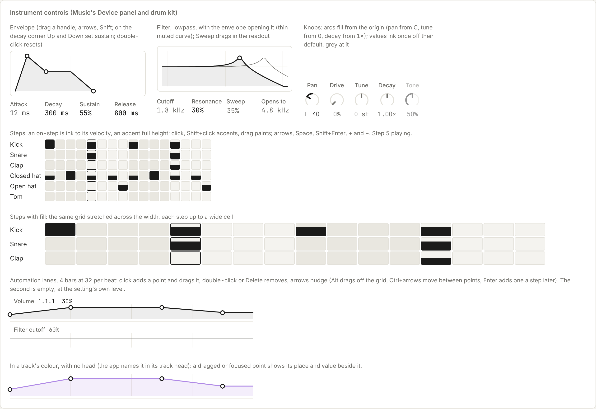
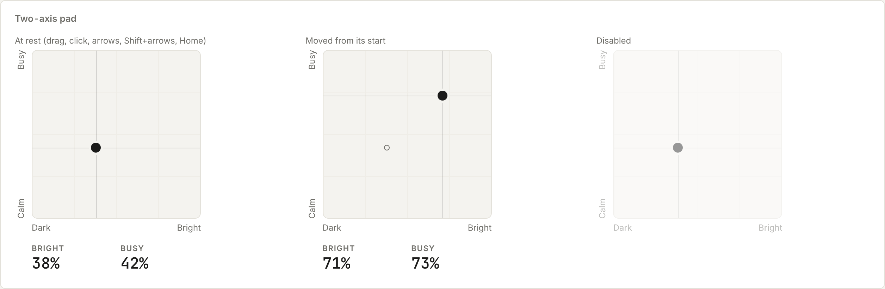
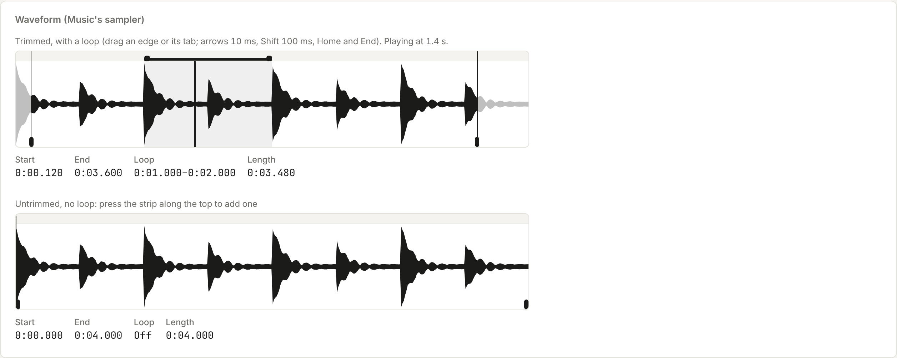
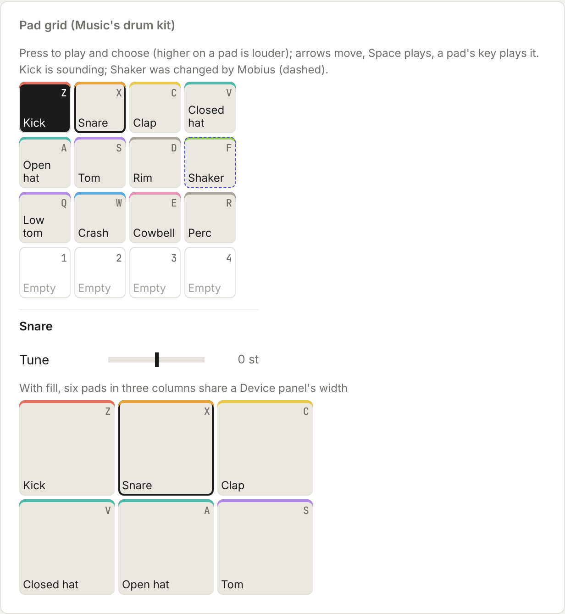

# Instrument controls

What a synth or drum kit draws: knobs, envelope, filter, steps, automation, the two-axis pad, the waveform and pads.

Back to [Shared controls](../shared-controls.md). Pictures: light theme, comfortable density, taken from the reference sheet by `npm run ui-shots`.



What a synth's or drum kit's Device panel draws. Music uses them first; Video's audio and any sound preview can use them later. They follow the same keys as the sliders. Arrows nudge, moving a twelfth of an octave on a log scale, and Shift nudges more. Double-click or Home puts a value back to `reset`. `onCommit` runs once when a drag or a key is let go.

| Control | Use it for |
| --- | --- |
| `Knob` | A `ParamCell` drawn as a dial, with the same props (`label`, `value`, `min`, `max`, `step`, `scale`, `origin`, `reset`, `format`, `unit`), so swapping between them is one line. Use it for a dense row, such as pan or sends, where a slider is too wide. Drag up or down to turn it, with Shift for fine control. The arc fills from the origin. `panLabel` formats pan as "L 40", "C" and "R 40" |
| `EnvelopeGraph` | Attack, decay, sustain and release drawn as one shape. It has three handles: the peak sets attack, the decay corner sets decay across and sustain up (Up and Down on the keyboard), and the end sets release. The four values read underneath, grey until they move from `reset`. `ranges` defaults to Music's: attack 1 ms to 2 s, decay 10 ms to 4 s and release 20 ms to 4 s, all log |
| `FilterGraph` | A two-pole filter's curve across `min` to `max` Hz (log), with one point: across is cutoff, up is resonance, and the point sits on the curve's peak. `type` is `'lowpass'` (default), `'highpass'` or `'bandpass'`. `q` maps resonance (0 to 1) to Q, using Music's `musicQ` unless given. `envAmount` and `envOctaves` add a thin muted curve (solid: dashes mean Mobius made something) where a note's envelope opens it to. Pass `onEnvAmount` (and optionally `onEnvAmountCommit` and `envAmountReset`, both 0 to 1) to make the envelope amount editable: the readout then shows Sweep as a drag-number field (0 to 100%) between Resonance and Opens to, so no separate knob is needed |
| `StepGrid` | Drum rows by steps. `cells[row][step]` is 0 for off, otherwise the velocity (0 to 1), drawn as an ink fill to that height, so every hit reads as on and an accent is a full cell. Click switches a step on or off, Shift+click sets an accent, and dragging across paints. With the keyboard, arrows move, Space or Enter switches, Shift+Enter sets an accent, and + and − change velocity. The grid takes one Tab stop. `now` outlines the playing step, and every other beat is shaded. Pass `fill` to stretch the steps across a wide container, up to `--step-max` each |
| `AutomationLane` | One setting's breakpoint line under a track. It is `beats` × `pxPerBeat` wide, so it lines up with the arrangement. `points` are `{ beat, value }` sorted by beat, with values 0 to 1; `format` turns a value into words for the readout, `grid` (in beats) is what adding, dragging and Left/Right snap to, and `empty` is the level an empty lane shows. Click the lane to add a point and keep dragging to place it; drag a point to move it (Alt moves it off the grid); double-click or Delete removes it. The lane takes one Tab stop: Left and Right move the point by a grid step (Shift by a bar), Up and Down change its value (Shift by 10%), Ctrl or Cmd with Left and Right (or Home and End) move to another point, and Enter adds one a grid step later. A point never passes its neighbours. `color` (a content colour) draws the line and its fill in the track's colour, with the points still ink. The name and readout sit in their own band above the plot; pass `head={false}` when the app names the lane in its own track head, and a dragged or focused point then shows its place and value beside it. `laneValueAt(points, beat)` gives the value to play at any beat, and `beatLabel` reads a beat as bar.beat.sixteenth |

```tsx
<EnvelopeGraph value={sound.env} reset={base.env} onChange={(env) => set({ env })} />
<FilterGraph value={{ cutoff, resonance }} min={80} max={12000} envAmount={sound.filterEnv} onEnvAmount={setFilterEnv} envAmountReset={0.35} onChange={setFilter} />
<StepGrid label="Drums" rows={DRUM_ROWS} cells={pattern} now={playingStep} onChange={setStep} />
<AutomationLane label="Volume" points={track.auto.volume} beats={song.beats} pxPerBeat={zoom} grid={0.25} format={dbLabel} onChange={setVolumeAuto} onCommit={saveSong} />
```



## Two-axis pad

`XYPad` sets two values with one point (Music's Dark to Bright and Calm to Busy, any Adjust card). Values run 0 to 1 on
each axis. Name both ends of both axes in words; `start` is where Mobius first put the point, shown as a hollow mark and
where Home and double-click return. `onChange` runs as it moves; `onCommit` runs once on release, for a remake. Arrows
nudge by `step` and Shift+arrows by ten steps. Each axis can `format` its readout.

```tsx
<XYPad label="Feel" x={{ name: 'Bright', ends: ['Dark', 'Bright'] }} y={{ name: 'Busy', ends: ['Calm', 'Busy'] }}
  value={feel} start={mobiusFeel} onChange={setFeel} onCommit={remakePart} />
```



## Waveform view

`WaveformView` draws an audio file for trimming and looping (Music's sampler, which plays the person's own files). Pass `peaks` from `peaksOf(channelData, slices)`, the `duration` in seconds, and a `value` of `{ start, end, loop: { start, end } | null }`.
- The file's shape is in ink. What's trimmed off greys out.
- Start and end are full-height edges with a tab at the foot. The loop sits in a strip along the top, and its two edges drag.
- Pressing the strip when there's no loop adds one, which you can drag to size.
- Each edge only moves as far as its neighbours allow: start ≤ loop start < loop end ≤ end.
- Every edge is a slider: arrows move it 10 ms, Shift 100 ms, and Home and End go as far as it can reach.
- `playhead` draws where it's playing. `onCommit` runs once a drag is let go. `sampleTime` formats times as "0:01.250".

```tsx
<WaveformView label="Sample" peaks={peaksOf(buffer.getChannelData(0), 400)} duration={buffer.duration} value={range} onChange={setRange} playhead={position} />
```



## Pad grid

`PadGrid` is a drum kit's pads, four to a row (`columns` changes that). Pass `fill` and the columns share the container's width equally, each pad square and up to `--pad-max`, as in Music's Device panel. Each `Pad` is `{ id, name, color?, key?, empty?, proposed? }`.
- Pressing a pad calls `onChoose(i)` and `onPlay(i, velocity)`. Higher on the pad plays louder, as on a hardware pad. `onRelease` runs when the press ends.
- `lit` pads flash in ink as they sound, so a playing pattern shows on the pads.
- The chosen pad has an ink ring, and its settings (`children`) show under the grid with its name.
- Keys: arrows move between pads, Space or Enter plays, and a pad's own `key`, shown in its corner, plays it from anywhere in the grid.
- An empty pad has a plain edge and says Empty. A pad Mobius changed has the dashed indigo edge.

```tsx
<PadGrid label="Drum kit" pads={pads} chosen={chosen} lit={sounding} onChoose={setChosen} onPlay={(i, v) => kit.play(i, v)}>
  <ParamGrid>…the chosen drum's Tune, Decay, Tone…</ParamGrid>
</PadGrid>
```
