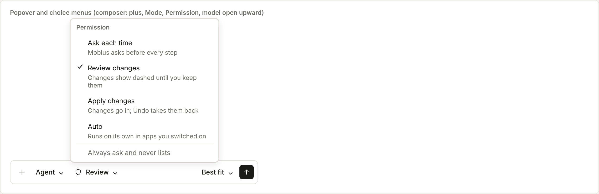
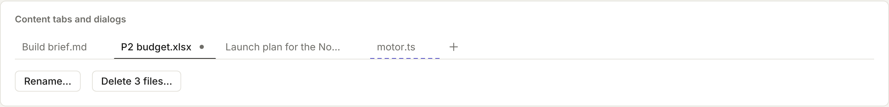
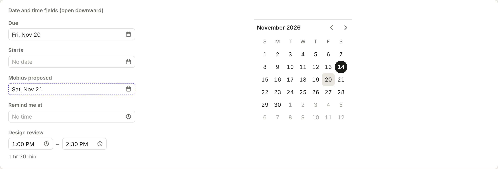

# Menus, dialogs and dates

Popovers, choice menus, dialogs, content tabs and the date and time fields.

Back to [Shared controls](../shared-controls.md). Pictures: light theme, comfortable density, taken from the reference sheet by `npm run ui-shots`.



## Popover and choice menus

| Control | Use it for |
| --- | --- |
| `Popover` | A small floating panel of controls opened from a button: the composer's plus menu (switches, a row or two, a link onward). Pass `trigger`, `label` and the content; `side="top"` opens it upward. `PopoverTitle` is its sentence-case heading; `PopoverLink` is the way out at the bottom ("Manage in Abilities": a row with a hairline above and an arrow) |
| `ChoiceMenu` | Pick one of a few choices from a button (Mode, Permission, model). `choices` are `{ value, label, meaning?, keys? }`: the current one has a check, keys show as caps, and a `meaning` makes a two-line row (name, then a grey line on what it means). `side` is `'top'` by default, for the composer. `footer` adds plain rows after a line ("Manage in Abilities") |

```tsx
<ChoiceMenu label="Permission" value={permission} onChange={setPermission} trigger={<Button kind="quiet">{name}</Button>}
  choices={[{ value: 'review', label: 'Review changes', meaning: 'Changes show dashed until you keep them' }, …]} />
```



## Dialogs and content tabs

| Control | Use it for |
| --- | --- |
| `Dialog` | A small form or choice over a dimmed window (rename, export, a few settings): `open`, `onOpenChange`, `title`, one short `description`, the fields as children, and `actions` (buttons, primary last). Focus stays inside; Escape or a click outside closes it |
| `Confirm` | Only for paying, sending, deleting for good and running commands. `action` names the button ("Delete 3 files"), `permanent` adds "This can’t be undone.", `onConfirm` and `onCancel`. A click outside does not close it; Cancel and Escape do |
| `ContentTabs` | Apps that open several things at once (Browser, Code, Files): plain text tabs, the open one ink with an ink underline, a close on hover. `unsaved` shows a dot in place of the close, `byMobius` a dashed underline. Arrows move, Delete or Ctrl+W closes, middle-click closes. Give the content `role="tabpanel"` and `aria-labelledby={tabId(id)}` |



## Date and time fields

| Control | Use it for |
| --- | --- |
| `DateField` | Any day to pick (due dates, event days, snooze). Shows the day in words ("Thu 20 Nov") and opens a 280px popover downward: a line to type into ("tomorrow", "fri 3pm", "20 nov"), the quick picks Today (T), Tomorrow (M), Next week (W) and No date (Backspace) with the day each means in grey, then the month. Arrows move by day, Page Up and Down by month, Home and End to the week's ends, T to today, Enter picks. `onChange(day, time)` gets the time too when one was typed. `proposed` gives the dashed edge; `quick` swaps the quick picks |
| `TimeField` | A time of day, as minutes since midnight. Takes typing ("9:30", "3pm", "noon") and lists quarter hours scrolled to the time, or to now. With `from` (an end time) the list starts after the start and shows each time's length in grey |
| `TimeRange` | A start and an end side by side, with the length in grey after them (it drops under the times in a narrow panel). Moving the start moves the end with it, keeping the length |
| `MonthPicker` | The month on its own, for a sidebar or a panel |

Read typed text with `parseDate(text, now)` and `parseTime(text)` from the same module, so apps and the agent read
dates the same way. Week start, day and month order, and the 12 or 24 hour clock come from `dates.ts` (`weekStart`,
`dayMonthOrder`, `uses12Hour`); never set them per app.
