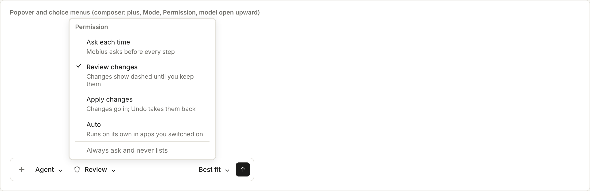
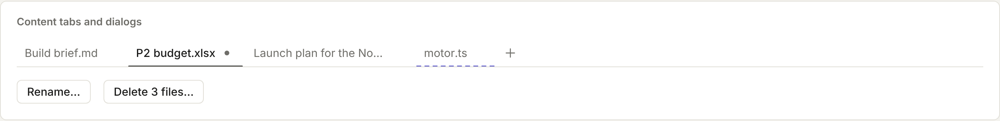
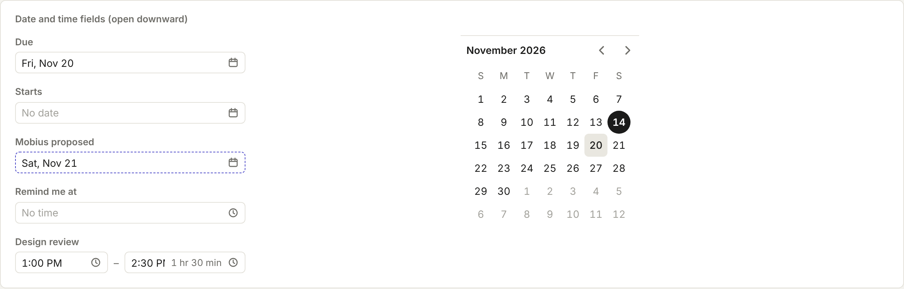
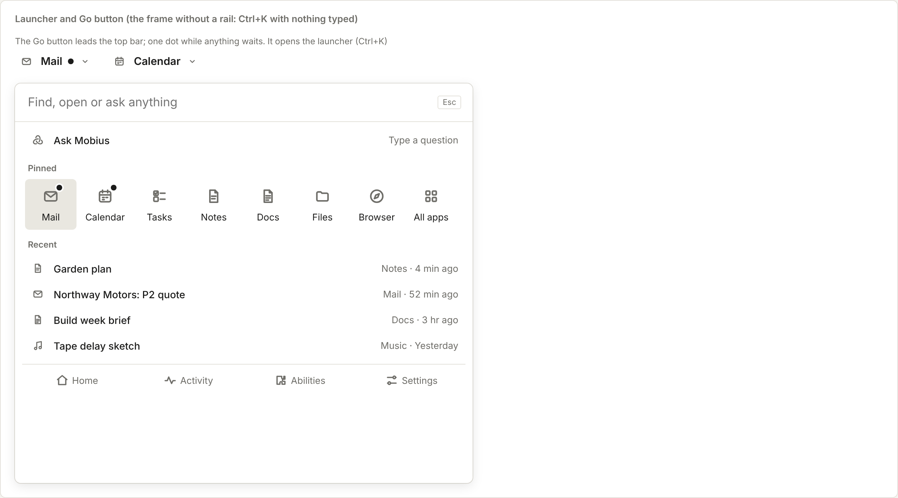

# Menus, dialogs and dates

Popovers, choice menus, dialogs, content tabs and the date and time fields.

Back to [Shared controls](../shared-controls.md). Pictures: light theme, comfortable density, taken from the reference sheet by `npm run ui-shots`.



## Popover and choice menus

| Control | Use it for |
| --- | --- |
| `Popover` | A small floating panel of controls opened from a button: the composer's plus menu (switches, a row or two, a link onward). Pass `trigger`, `label` and the content; `side="top"` opens it upward. `PopoverTitle` is its sentence-case heading; `PopoverLink` is the way out at the bottom ("Manage in Abilities": a row with a hairline above and an arrow) |
| `ChoiceMenu` | Pick one of a few choices from a button (Mode, Permission, model). `choices` are `{ value, label, meaning?, keys? }`: the current one has a check, keys show as caps, and a `meaning` makes a two-line row (name, then a grey line on what it means). `side` is `'top'` by default, for the composer. `footer` adds plain rows after a line ("Manage in Abilities") |

```tsx
<ChoiceMenu label="Permission" value={permission} onChange={setPermission} trigger={<Button kind="quiet">{name}</Button>}
  choices={[{ value: 'review', label: 'Review changes', meaning: 'Changes show dashed until you keep them' }, …]} />
```



## Dialogs and content tabs

| Control | Use it for |
| --- | --- |
| `Dialog` | A small form or choice over a dimmed window (rename, export, a few settings): `open`, `onOpenChange`, `title`, one short `description`, the fields as children, and `actions` (buttons, primary last). Focus stays inside; Escape or a click outside closes it |
| `Confirm` | Only for paying, sending, deleting for good and running commands. `action` names the button ("Delete 3 files"), `permanent` adds "This can’t be undone.", `onConfirm` and `onCancel`. A click outside does not close it; Cancel and Escape do |
| `ContentTabs` | Apps that open several things at once (Browser, Code, Files): plain text tabs, the open one ink with an ink underline, a close on hover. `unsaved` shows a dot in place of the close, `byMobius` a dashed underline. Arrows move, Delete or Ctrl+W closes, middle-click closes. Give the content `role="tabpanel"` and `aria-labelledby={tabId(id)}` |



## Date and time fields

| Control | Use it for |
| --- | --- |
| `DateField` | Any day to pick (due dates, event days, snooze). Shows the day in words ("Thu 20 Nov") and opens a 280px popover downward: a line to type into ("tomorrow", "fri 3pm", "20 nov"), the quick picks Today (T), Tomorrow (M), Next week (W) and No date (Backspace) with the day each means in grey, then the month. Arrows move by day, Page Up and Down by month, Home and End to the week's ends, T to today, Enter picks. `onChange(day, time)` gets the time too when one was typed. `proposed` gives the dashed edge; `quick` swaps the quick picks |
| `TimeField` | A time of day, as minutes since midnight. Takes typing ("9:30", "3pm", "noon") and lists quarter hours scrolled to the time, or to now. With `from` (an end time) the list starts after the start and shows each time's length in grey |
| `TimeRange` | A start and an end side by side, with the length in grey after them (it drops under the times in a narrow panel). Moving the start moves the end with it, keeping the length |
| `MonthPicker` | The month on its own, for a sidebar or a panel |

Read typed text with `parseDate(text, now)` and `parseTime(text)` from the same module, so apps and the agent read
dates the same way. Week start, day and month order, and the 12 or 24 hour clock come from `dates.ts` (`weekStart`,
`dayMonthOrder`, `uses12Hour`); never set them per app.

## Launcher and Go button

The frame has no app rail (see [Panel layouts](../../design/panel-layouts.md)). The **Go button** leads the top bar and opens the launcher. Ctrl+K opens it from anywhere. Both live in `src/Launcher.tsx`.



| Part | What it does |
| --- | --- |
| `GoButton` | Shows the open app's icon and name, then a chevron. It carries one ink dot while anything waits in any app, and the launcher shows which app. Props: `app` (or a place such as `settings`), `waiting`, `keys` for the tooltip, and `onOpen`. |
| `Launcher`, nothing typed | Ask Mobius comes first (`onOpenMobius`). The pinned apps follow in one row (`pinned`, `onPinned`), each with a dot from `waiting`. The first nine show Ctrl+1 to Ctrl+9. Then comes **Recent**: the things last open in any app, newest first, with the app and how long ago. The places sit at the foot: Home, Activity, Abilities and Settings (`places`). |
| `Launcher`, typing | One search over apps, the items `find(query)` returns from every app, open pages and commands. Ask Mobius stays the first row, so a search that finds nothing becomes a question. Enter opens the first thing found. |
| All apps | The pinned row ends with an **All apps** tile. It, or the launcher's key pressed again (`again`, a number the frame bumps when Ctrl+K fires while the launcher is open), switches to every app as a grid seven across, A to Z, with **Add apps** (Abilities) last. Typing filters it, and Backspace on an empty field, Escape or **Back** returns. The launcher reopens in the view it was left in. `startIn="apps"` starts there, for the reference sheet. |
| Look | One height while open, so the field never moves. Section labels are in sentence case. Typed letters are drawn in ink, the rest of the name grey. Rows follow the density (`--row-h`). An app's detail is its key. One footer: the places with nothing typed, else one hint for the chosen row (Open, Ask or Run). With no match, one line says Enter asks Mobius. The chosen row is held by its id, so results that arrive later never move it. |
| Narrow, commands, actions | **Tab** on an app, or on anything in one, narrows the launcher to that app: a chip ("Mail ›") before the words, its items under "In Mail", then the commands that live there; Backspace on an empty field or Escape takes the chip away. Starting with **>** lists commands only (`commandsOnly`). **Shift+Enter** (or Right at the end of the words) shows the chosen row's actions: Open or Run, Ask Mobius about this, Pin or Unpin, Search in the app, Copy name; Escape goes back. **Alt+Enter** asks Mobius about the row straight away. Pass `onAskAbout({ app, label, detail })` to offer asking. |
| Choice memory | What you pick for some words rises to the top of its kind the next time you type the same first three letters (`noteChoice`, `rankByChoice`). Ask stays first. It is kept on this device only (`mobius.launcher.choices`), with up to 20 picks per prefix. |
| Quick answers | Sums (`2+3*4`, `50%*80`), a percent of a number (`12% of 340`), units (`5 km in miles`, `70 f to c`, `2 gb in mb`) and times elsewhere (`3pm PT in London`, `time in Tokyo`) are answered in an **Answer** row under Ask, chosen by default; Enter copies the bare result. Worked out on this computer (`quick-answers.ts`), nothing is sent. |
| Pinning | Drag a pinned app along the row, or press Alt+Left or Alt+Right on it. Right-click (or press Shift+F10) on a pinned app to unpin it, or on an app in the results to pin it. Each change is announced. |
| Keys | Up and Down go row to row, and Left and Right move along the pinned row, the places and the All apps grid. Enter opens and Escape closes. |
| Recent | Call `noteRecentItem({ app, ref, label })` (from `apps.ts`) when a note, thread, file or song opens, and pass `onOpenRecent(item)` to open one again. `recentItems()` reads them back, newest first, kept per device. |
