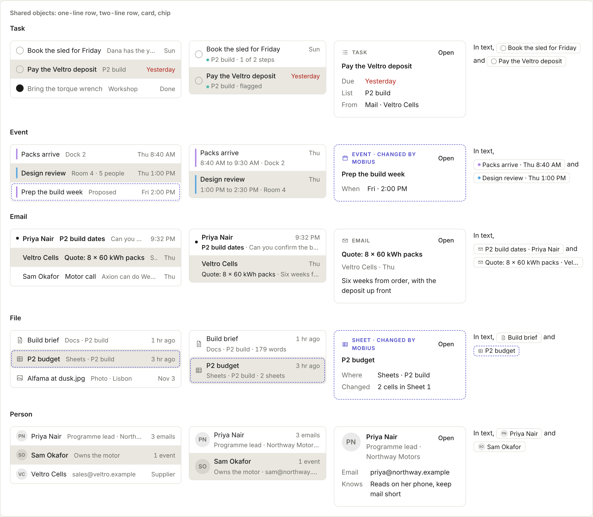

# Shared objects

A task, an event, an email, a file and a person, drawn the same way in every app.

Back to [Shared controls](../shared-controls.md). Pictures: light theme, comfortable density, taken from the reference sheet by `npm run ui-shots`.

A task, an event, an email, a file and a person look the same in every app (Instrument, "One app, not twenty"). Pass
the data as a `Thing` (`{ kind: 'task', title, due, … }`) and pick the form. Never draw your own row or card for these.
Dates and times come in already formatted from `dates.ts`, so they follow the person's clock setting. `byMobius` gives
the dashed indigo edge in every form.

| Form | Import | Use it for |
| --- | --- | --- |
| One-line row | `<ObjectRow thing={t} onOpen={…} />` | Full-width lists and results: the kind's mark (a round check, a calendar-colour bar, an unread dot, a kind icon, initials), the title, one grey detail, the date or count at the end |
| Two-line row | `<ObjectRow thing={t} lines={2} onOpen={…} />` | A list beside a reading pane (Mail, Notes). The detail goes to the second line |
| Card | `<ObjectCard thing={t} onOpen={…} />` | Mobius panel results and Sources, Views, a peek on Space. A kind line with Open, the title, then label and value lines |
| Chip | `<ObjectChip thing={t} onOpen={…} />` | Inside text: the composer, answers, notes. No selected look |

A task's check ticks it from any row when you pass `onToggle`. Rows go in `<ul role="list" className="ui-list">`.
`ListRow` underneath also takes `lines={1}` (the detail sits grey after the title), `metaTone="red"` (overdue only) and
`done` (a grey title).
