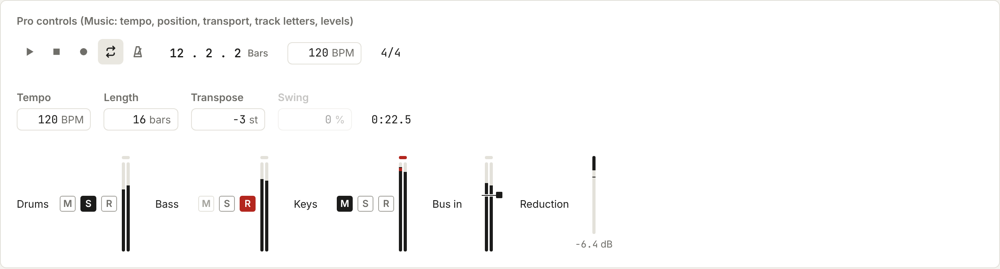

# Pro controls

Number fields, readouts, track letters, transport and level meters for the pro apps.

Back to [Shared controls](../shared-controls.md). Pictures: light theme, comfortable density, taken from the reference sheet by `npm run ui-shots`.

Music uses these first, and then Video, Photo, Design and Code. Live values use the mono face with tabular figures, so they never jitter.

| Control | Use it for |
| --- | --- |
| `NumberField` | A number you can type, nudge or scrub: tempo, bars, transpose, frame, size. Arrows nudge it, Shift+arrows by ten, Page Up and Down by ten, Home and End to the ends. Drag up or down to scrub, with Shift for fine control. Enter or a typed figure opens it for typing and Escape cancels. Double-click goes back to `reset`. Out-of-range values are clamped, and the tooltip says so. Props: `min`, `max`, `step`, `unit` (grey), `signed` and `decimals`. `onCommit` fires once per drag, key or typed value, for undo |
| `Readout` | A read-only live value at a fixed width ("12 . 3 . 2"). With more than one entry in `formats`, a click switches between them (Bars and Time). With `copy`, a click copies it. `size="lg"` for the transport position. Use `barsLabel(beats)` and `clockLabel(seconds)` to write the text |
| `LetterToggle` | M (mute), S (solo) and R (record) on a track, and lock and hide on a layer. `label` is its full name ("Mute Drums"). `armed` turns an R red while it is on. `dimmed` greys the letter of a track that another track's solo silences |
| `Transport` | Play/Pause, Stop, then the latching Record, Loop and Metronome. The app binds the keys itself, so pass `keys` to make the tooltips match (Space, Enter, R, L and K by default) |
| `LevelMeter` | A vertical level meter per track and on the master, stereo by default, from -60 to +6 dB. Feed it through a ref, with `ref.current.set(leftDb, rightDb)` about 30 times a second. It writes straight to the bars, so nothing re-renders. The peak holds for 1.5 seconds and then falls. Only the part over 0 dB is red, and the clip light stays lit until it is clicked (or `reset()` is called) |
| `LevelMeter` threshold | Give a compressor's or gate's input meter `threshold` (dB) with `onThreshold` and `onThresholdCommit`. It draws an ink line across the bars, edged in paper so it shows over a full bar, and a tab at the right to drag. Up and Down move it 1 dB, and Shift moves it 6. Home, or two quick presses, puts it back to `thresholdReset`. It is a vertical slider for screen readers ("−18 dB"). `decibelLabel` writes the figure with a true minus |
| `GainReductionMeter` | How much a compressor, limiter or gate is turning the sound down: one bar from 0 dB at the top down to `range` (24 dB by default), fed through a ref with `ref.current.set(dbTakenOff)`. A line holds the most it took off for 1.5 seconds, and underneath, the most so far reads in mono ("−6.4"). A click on that figure clears it (`readout={false}` hides it). Set it beside the input meter that shows the threshold |

A step grid and the timeline pieces (ruler, playhead, clip, lane) come next, shaped by what Music needs.

Popovers that stay in place and toasts other than the undo pill are not shared yet; ask the library thread before
building one in an app.
