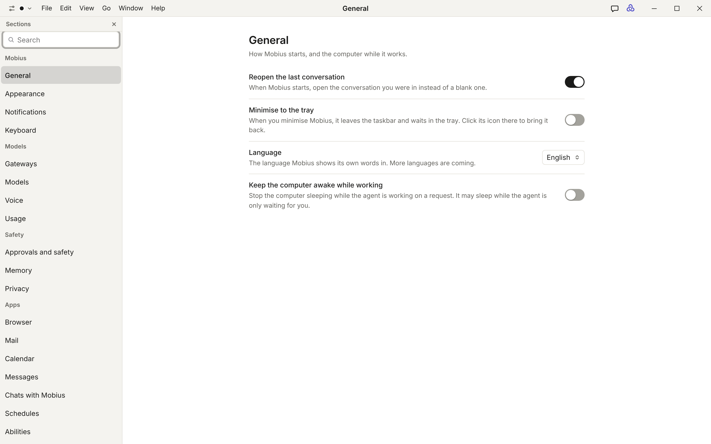

# Settings

Ctrl+, opens Settings. Its sections are grouped in the Sections panel on the left the way System Settings groups them.
That panel is always there, so every section stays one click away. The search box at the top finds any setting by what
it does ("dark", "fallback", "dictation"). This page says what each section holds and where it is explained.

Each section opens with where it is, its name and one grey line on what it is for. Then each of its pages is a small
grey heading over a card of rows: the name and a line of help on the left, the control on the right. Settings take
effect as soon as you change them; there is no Save button.

**Back** and **Forward** in the toolbar (or Alt+Left and Alt+Right, Command-[ and Command-] on a Mac, or the mouse's back and forward buttons) step through the sections you've visited, as in
System Settings. Esc closes Settings, except while you're typing in a field: then the first Esc only leaves the field,
so a half-filled form isn't lost, and the next Esc closes Settings.

## Connections

| Section | What it holds | Explained in |
| --- | --- | --- |
| **Accounts** | Every account, one row each: Google and Microsoft accounts, mail, contacts, drives and chat, with Model Plans and Connectors in their own cards below. Which apps each is on for, which need you to sign in again, and Remove Account | [Accounts](#accounts) |
| **Gateways** | Plans you sign in to, API keys, local and custom servers, instructions | [Models and gateways](models-and-gateways.md#gateways) |

### Accounts

Accounts works like Internet Accounts on a Mac: one row per account, whatever apps use it. The grey line under each
says which apps it's on for, or **Sign in again** with a red dot when it needs you. Choose a row to open the account's
own page.

- **Use this account for** has a switch for each app the account can serve. Turning one off removes only that app's
  part (its mail, events and files stay with the provider). Turning the last one off keeps the account listed.
- **Add Account…** lists the providers: Google, Microsoft, iCloud, Fastmail, Slack and Dropbox, then **Other
  Account…** for a mail account, a CalDAV calendar, a calendar subscription, CardDAV contacts, a WebDAV or S3 drive,
  Matrix or Telegram. Google and Microsoft sign in once, in your browser, for Calendar and Files together, and the
  account's page then turns each on or off. The others open the app that adds them. Mail still takes an app password,
  added in **Mail**; Teams keeps its own sign-in in **Messages**.
- **Remove Account…** asks once more, then removes every app's part of the account.

Below the accounts, **Model Plans** lists the plans you're signed in to and the services you keep a key for; a row
opens **Gateways** at that service. **Connectors** lists the connectors Mobius runs; a row opens **Store**. Only
**Sign in again** gets a red dot.

While Mobius is in Google's testing, a Google sign-in lasts 7 days; the account then shows **Sign in again**.

## Mobius

| Section | What it holds | Explained in |
| --- | --- | --- |
| **General** | Reopen the last conversation at start; keep the computer awake while Mobius works | [Privacy, safety and profiles](privacy-and-profiles.md#notifications) |
| **Appearance** | Theme, typography, layout, how conversations are shown | This page |
| **Notifications** | When Mobius may tell you something while you're in another window, and sounds | [Privacy, safety and profiles](privacy-and-profiles.md#notifications) |
| **Keyboard** | Shortcuts, and quick entry from anywhere | [Keyboard shortcuts](keyboard-shortcuts.md) |
| **Conversations** | Saved conversations, and where they are kept | [Agent](../apps/assistant.md#agent) |
| **Schedules** | Requests to Mobius at a time of day | [Working with Mobius](working-with-mobius.md#schedules) |

## Models

| Section | What it holds | Explained in |
| --- | --- | --- |
| **Models** | Which model does each job; models on this computer | [Models and gateways](models-and-gateways.md#a-model-for-each-job) |
| **Voice** | Who listens when you dictate, and who reads replies aloud | [Voice](voice.md) |
| **Usage** | Tokens used and estimated cost by day, by model, service or app; CSV export | [Usage](#usage) below |

## Safety

| Section | What it holds | Explained in |
| --- | --- | --- |
| **Approvals and safety** | The permission, what Mobius may do in each app, always-allowed actions, the activity log | [Working with Mobius](working-with-mobius.md#permission) |
| **Memory** | What Mobius remembers, with Forget | [Memory and Knowledge](memory-and-knowledge.md) |
| **Privacy** | The privacy report, key storage, how web content is treated, Remove my data | [Privacy, safety and profiles](privacy-and-profiles.md) |

## Apps

| Section | What it holds | Explained in |
| --- | --- | --- |
| **Browser** | Allowed sites, local addresses, bookmarks, history | [Browser](../apps/browse-and-find.md#browser) |
| **Mail** | Mail accounts: add one with an app password, or remove one | [Mail](../apps/browse-and-find.md#mail) |
| **Calendar** | Calendar accounts: subscribe to a link, connect iCloud, Fastmail or Nextcloud, or sign in to Google or Outlook | [Calendar](../apps/write-and-plan.md#calendar) |
| **Contacts** | Contacts accounts: connect iCloud, Fastmail or Nextcloud address books with an app password, or remove one | This page |
| **Messages** | Chat accounts: sign in to Slack, or remove a workspace | [Messages](../apps/browse-and-find.md#messages) |
| **Store** | Opens the Store | [Store](abilities.md) |

## System

| Section | What it holds | Explained in |
| --- | --- | --- |
| **Advanced** | Steps per request, letting other apps use Mobius over MCP, profiles | [Abilities](abilities.md#mobius-for-other-apps), [Privacy, safety and profiles](privacy-and-profiles.md#profiles) |
| **About** | Software Update, versions (including whether the core is running), the data folder | [Install Mobius](../getting-started/install.md#updates) |

## Appearance

- **Theme:** follow the system (light by day, dark by night), or always use Light, Mid grey, Dark or Cool dark. Every theme keeps the frame neutral so your own colours stand out.
- **Typography:** interface zoom, and the conversation's text size and font (system, serif or mono).
- **Layout:** the apps pinned at the top of Go (Ctrl+1 to Ctrl+9 open the first nine), whether the Mobius panel is
  attached or floats over the page and its size, list density, **Panels on the frame**, and key hints under lists.
- **Conversation:** text direction, and whether finished tool steps are shown or hidden.

## Usage

**Settings › Usage** shows what your model calls used, counted on this computer:

- **Period:** the last 7, 30 or 90 days, or this month.
- **Totals:** tokens (in and out), estimated cost, and requests, with how many tokens came from the server's cache.
- **Tokens by day:** one bar per day. Point at a bar, or move to it with Tab, for that day's tokens, requests and cost.
- **Breakdown:** the period by **Model**, **Service** (the gateway) or **App** (where you were when you asked).
- **Export:** **Copy as CSV**, or **Export CSV…** for a file with one line per day, service, model, app and kind, for
  a spreadsheet.
- **Clear Usage…** forgets every count so far (it asks first).

Costs are **estimates** from OpenRouter's public price list, refreshed at most once a day. Models on this computer cost
nothing and show **Free**. Calls through a plan you signed in to (Claude, ChatGPT, Copilot) count against that plan, so
they show **Plan** rather than a price; a model with no known price shows **—**. Your gateway's own bill is the final
word. Nothing on this page leaves your computer.
