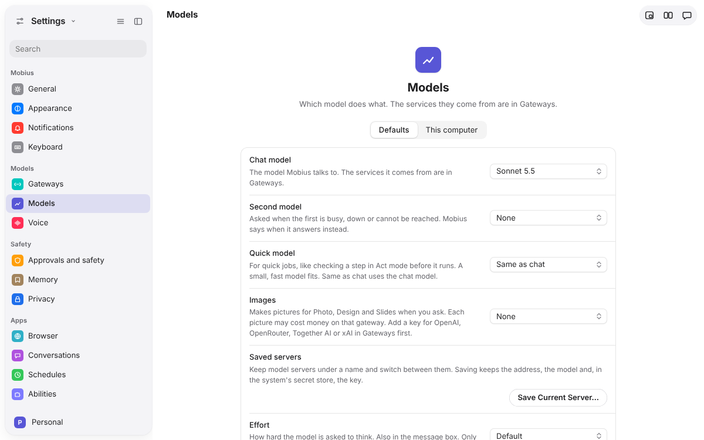

# Settings

Ctrl+, opens Settings. Its sections are grouped in the sidebar the way System Settings groups them, and the search box
at the top finds any setting by what it does ("dark", "fallback", "dictation"). This page says what each section holds
and where it is explained.

Each section opens with its icon, name and one line on what it is for, then its settings in grouped cards: the name
and a line of help on the left, the control on the right. Settings take effect as soon as you change them; there is no
Save button.

## Mobius

| Section | What it holds | Explained in |
| --- | --- | --- |
| **General** | Reopen the last conversation at start; keep the computer awake while Mobius works | [Privacy, safety and profiles](privacy-and-profiles.md#notifications) |
| **Appearance** | Theme, typography, layout, how conversations are shown | This page |
| **Notifications** | When Mobius may tell you something while you're in another window, and sounds | [Privacy, safety and profiles](privacy-and-profiles.md#notifications) |
| **Keyboard** | Shortcuts, and quick entry from anywhere | [Keyboard shortcuts](keyboard-shortcuts.md) |

## Models

| Section | What it holds | Explained in |
| --- | --- | --- |
| **Gateways** | Plans you sign in to, API keys, local and custom servers, instructions | [Models and gateways](models-and-gateways.md#gateways) |
| **Models** | Which model does each job; models on this computer | [Models and gateways](models-and-gateways.md#a-model-for-each-job) |
| **Voice** | Who listens when you dictate, and who reads replies aloud | [Voice](voice.md) |

## Safety

| Section | What it holds | Explained in |
| --- | --- | --- |
| **Approvals and safety** | The mode, what Mobius may do in each app, always-allowed actions, the activity log | [Working with Mobius](working-with-mobius.md#the-three-modes) |
| **Memory** | What Mobius remembers, with Forget | [Memory and Knowledge](memory-and-knowledge.md) |
| **Privacy** | The privacy report, key storage, how web content is treated, Remove my data | [Privacy, safety and profiles](privacy-and-profiles.md) |

## Apps

| Section | What it holds | Explained in |
| --- | --- | --- |
| **Browser** | Allowed sites, local addresses, bookmarks, history | [Browser](../apps/browse-and-find.md#browser) |
| **Conversations** | Saved conversations, and where they are kept | [Agent](../apps/assistant.md#agent) |
| **Schedules** | Requests to Mobius at a time of day | [Working with Mobius](working-with-mobius.md#schedules) |
| **Abilities** | Opens the Abilities app | [Abilities](abilities.md) |

## System

| Section | What it holds | Explained in |
| --- | --- | --- |
| **Advanced** | Steps per request, letting other apps use Mobius over MCP, profiles | [Abilities](abilities.md#mobius-for-other-apps), [Privacy, safety and profiles](privacy-and-profiles.md#profiles) |
| **About** | Software Update, versions (including whether the core is running), the data folder | [Install Mobius](../getting-started/install.md#updates) |

## Appearance

- **Theme:** follow the system, or always light or dark.
- **Typography:** interface zoom, conversation text size and font (system, serif or mono), text direction.
- **Layout and Conversation:** list density, and whether finished tool steps are shown or hidden.
